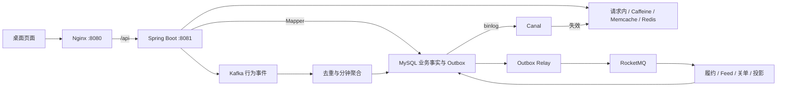

# 黑马点评 — Java 本地生活与高并发业务项目

[](https://github.com/lijx-dev/Learning-Enhancement-and-Refactoring-of-Dark-Horse-Review/actions/workflows/ci.yml)

基于 Spring Boot 的本地生活平台，包含店铺搜索、探店笔记、点赞关注、签到、普通领券、异步秒杀和个人订单。在课程业务基础上，增加多层缓存、Canal 数据变更同步、RocketMQ 可靠业务消息、Kafka 行为分析、订单超时关闭及网页体验验证。

项目面向 Java 后端学习与面试实践：既能从页面完成业务操作，也能沿 Controller → Service → Mapper 阅读实现，结合隔离测试理解并发、幂等、事务和故障恢复。

**详细教程：[项目 Wiki](wiki/README.md)**。包含 13 章和接口附录，按业务问题、方案推导、源码讲解、操作验证与常见问题展开。

导航：[快速启动](#快速启动) · [代码目录](#项目结构与开发规范) · [开发约定](CONTRIBUTING.md) · [验证记录](docs/README.md) · [数据开发方向评估](docs/数据开发方向评估与路线.md)


截图来自已有验证记录，仅作界面预览，不代表当前有可访问的公网演示。

## 业务功能

| 模块 | 当前功能 |
| --- | --- |
| 用户与登录 | 手机验证码登录、令牌刷新、注销、本人资料、登录限流 |
| 店铺与搜索 | 分类、商圈、关键词、价格、评分、优惠券筛选、附近商家与分页排序 |
| 探店社区 | 发布笔记、图片上传、点赞状态、关注关系、共同关注与关注动态 |
| 签到 | 按月 Bitmap 签到、当前月截至今天的连续签到天数 |
| 优惠券与订单 | 普通领券、一人一单、订单快照、本人订单、未付款普通订单取消 |
| 秒杀 | 活动发布、Lua 预占、异步履约、请求状态、指定补偿与库存对账 |
| 行为分析 | 浏览、订单及模拟付款事件，5/60 分钟商家热榜 |
| 体验与运维 | 缓存路径、Kafka 持久回执、本人订单任务进度、管理员复核与监控 |

配套桌面页面位于 [frontend](frontend)，调用本项目 Java 接口。克隆本仓库即可取得配套源码，不依赖仓库外的原课程 Nginx 目录。

## 核心技术亮点

| 亮点 | 解决的问题 | 当前实现 | 详细讲解 |
| --- | --- | --- | --- |
| 五层查询链路 | 热点重复查询与集中回源 | 请求内缓存 → Caffeine → Memcache → Redis → MySQL；空值缓存、同键加载合并、互斥重建 | [缓存](wiki/05-五层缓存与一致性.md) |
| 缓存一致性 | 更新后旧加载重新回填 | 版本与锁 owner 校验、源到期时间、事务 Outbox 失效、Canal 补充直接数据库变更 | [缓存](wiki/05-五层缓存与一致性.md)、[CDC](wiki/06-Canal与数据库变更同步.md) |
| 普通券幂等 | 双击重复建单与历史价格变化 | 用户锁、稳定数据库槽位、事务、订单金额与规则快照 | [订单](wiki/07-优惠券与订单生命周期.md) |
| 异步秒杀 | 超卖、重复资格与服务中断 | Lua 入口预占、Stream pending 接管、持久预约、Outbox 交接、条件扣库存 | [秒杀](wiki/08-秒杀Lua与RedisStream.md) |
| 精确补偿与复核 | 旧失败释放新订单资格 | 核对 userId/voucherId/orderId、幂等补偿、REVIEW、死信与只读对账 | [秒杀恢复](wiki/08-秒杀Lua与RedisStream.md) |
| RocketMQ 可靠消息 | 提交后任务丢失、重复投递与工作者竞争 | 业务与 Outbox 同事务、租约认领、owner 条件写回、退避重投、Inbox 消费去重 | [可靠消息](wiki/09-RocketMQ可靠消息.md) |
| 延迟关单 | 未付款订单长期占用业务状态 | 到期时间、定时消息、条件状态迁移、数据库定期扫描兜底 | [订单](wiki/07-优惠券与订单生命周期.md)、[消息](wiki/09-RocketMQ可靠消息.md) |
| Kafka 分析 | 统计阻塞请求、重放重复累计 | 有界浏览采集、订单分析 Outbox、eventId 去重、事务聚合、提交数据库后确认 offset | [行为分析](wiki/10-Kafka行为分析与热榜.md) |
| 社区可靠性 | 重试切换点赞、Feed 分页遗漏、图片删除竞争 | 明确点赞状态、持久关系、分批 Feed 续传、时间游标与 offset、图片归属和引用锁 | [社区](wiki/11-社区搜索与页面验证.md) |

MySQL 保存大部分持久业务事实，缓存保存查询副本，Outbox 保存可恢复任务。Redis 还承担登录、验证码、签到和秒杀入口预占，这些内容并非全部能从 MySQL 重建。

## 技术栈与架构

| 分类 | 组件 |
| --- | --- |
| Java 后端 | Java 8、Spring Boot 2.3.12、MyBatis-Plus 3.4.3 |
| 数据与迁移 | MySQL 8、Flyway |
| 缓存与协调 | Redis 7、Redisson 3.13.6、Caffeine 2.9.3、Memcached 1.6 |
| 数据变更同步 | Canal 1.1.8 |
| 消息与分析 | RocketMQ 5.3.2、Kafka 3.9.1 |
| 监控与部署 | Actuator、Micrometer、Prometheus、Alertmanager、Docker Compose、Nginx |
| 配套页面 | Vue 2、Element UI 图标与本地静态资源；桌面浏览器布局 |



秒杀入口在 Redis 内预占并写入 Stream，随后交接数据库预约与可靠任务。浏览采集允许有界丢弃，订单分析通过持久任务继续投递；不同数据使用不同可靠性策略，具体边界见对应 Wiki 章节。

## 快速启动

准备已启动的 Docker 与 Compose v2，并能下载项目镜像和 Maven 依赖。以下命令均在**克隆后的项目根目录**执行。

```bash
git clone https://github.com/lijx-dev/Learning-Enhancement-and-Refactoring-of-Dark-Horse-Review.git
cd Learning-Enhancement-and-Refactoring-of-Dark-Horse-Review
```

可选：复制根目录 `.env.example` 为 `.env` 后修改本地配置。Compose 将新上传图片保存在命名卷 `uploads`；缺失的课程本地图片显示占位图，SQL 内第三方图片仍依赖外站。需要原始演示图片时见 [素材说明](dev/images/README.md)。

```bash
docker compose -p hm-dianping -f dev/docker-compose.yml up -d
docker compose -p hm-dianping -f dev/docker-compose.yml ps -a
docker compose -p hm-dianping -f dev/docker-compose.yml logs -f java
```

完整环境启动 MySQL、Redis、Memcache、Canal、RocketMQ、Kafka、Java 和 Nginx；首次初始化导入演示数据、创建消息 Topic，并由 Java 执行 Flyway 增量迁移。首次启动需要等待镜像、依赖下载与 Java 初始化；`mq-init`、`kafka-init` 等任务正常完成后退出是预期行为。

| 入口 | 默认地址 |
| --- | --- |
| 桌面首页 | [http://127.0.0.1:8080/](http://127.0.0.1:8080/) |
| 体验验证页 | [http://127.0.0.1:8080/experience.html](http://127.0.0.1:8080/experience.html) |
| Java API | `http://127.0.0.1:8081` |
| 基础健康检查 | [http://127.0.0.1:8081/actuator/health](http://127.0.0.1:8081/actuator/health) |

确认直接 Java 和网页代理都能查询：

```bash
curl -i 'http://127.0.0.1:8081/shop-type/list'
curl -i 'http://127.0.0.1:8080/api/shop-type/list'
```

浏览器经 Nginx 请求时加 `/api`，直接请求 Java 时不加。数据卷保留数据库和消息数据，日常停止使用：

```bash
docker compose -p hm-dianping -f dev/docker-compose.yml down
```

业务环境不使用 `down -v` 清理。已有数据库升级、独立 IDE 启动、上传路径和依赖地址配置见 [环境搭建](wiki/02-环境搭建与启动.md)。只执行 `mvn spring-boot:run` 不会自动启动网页或消息服务。

## 登录、配置与页面体验

### 登录和常用配置

网页登录使用演示手机号获取验证码；当前验证码从 Java 调试日志查看，输入后完成正常登录。业务请求使用原始 token 作为 `authorization` 请求头，浏览器保存于 `sessionStorage.token`。

| Compose 变量 | 默认值 | 用途 |
| --- | --- | --- |
| `HMDP_WEB_PORT` | 8080 | 网页宿主机端口 |
| `HMDP_API_PORT` | 8081 | Java 宿主机端口 |
| `HMDP_EXPERIENCE_ENABLED` | true | 体验观察接口 |
| `HMDP_ADMIN_IDS` | 空 | 管理员用户 ID 白名单，多个 ID 用逗号分隔 |
| `HMDP_PAYMENT_MOCK_ENABLED` | false | 本地模拟付款 |
| `HMDP_MONITOR_TOKEN` | 开发演示值 | 专用指标抓取凭证 |

管理员 ID 从正常登录后的 `GET /user/me` 获取。配置可以保存在项目根目录自己的 `.env` 中；修改环境后用 `up -d` 重新创建相应服务，`restart` 不刷新环境变量。

单独启动 Java 时，体验、Canal、Memcache、RocketMQ 和分析功能默认关闭；完整 Compose 会启用这些扩展。变量映射与独立运行配置以 [配置附录](wiki/附录-接口配置与数据字典.md) 为准，不能假设宿主机所有环境变量都会自动传入容器。

### 三步体验核心亮点

在 [体验验证页](http://127.0.0.1:8080/experience.html) 按 01 → 02 → 03 操作：

1. **缓存**：匿名选店铺并连续读取 3 次，查看 3 个 HTTP 请求、6 次实际读取及各次命中路径。已有热缓存时不一定出现 MySQL 回源；采样只展示实际经过的层。
2. **Kafka**：产生 3 次真实浏览，查询本次返回的三个 eventId，等待持久回执。再刷新 5 分钟热榜；匹配回执证明本次事件落库，热榜总数还可能受到其他访客影响。
3. **订单**：正常登录后选择真实券提交，重复领取仍有效的普通券并比较订单号，查看本人订单的 Outbox 与 Inbox 进度。付费普通券创建待付款单；免费券可直接领取；秒杀需有效活动，返回订单号后继续查询请求状态。

网页用于验证当前请求的真实结果。CDC 断线恢复、旧值回填竞争、补偿与重复消费等需要受控时序的场景，通过隔离测试验证，详见 [页面验收](wiki/11-社区搜索与页面验证.md) 与 [测试排障](wiki/13-测试监控与故障排查.md)。

## 主要接口

接口使用 `success`、`data`、`errorMsg` 与可选 `total`，空字段可能省略。客户端同时判断 HTTP 状态和业务 success。

| 分类 | 代表接口 | 说明 |
| --- | --- | --- |
| 登录与身份 | `POST /user/code`、`POST /user/login`、`GET /user/me` | 验证码、令牌与当前用户 |
| 签到 | `POST /user/sign`、`GET /user/sign/count` | 本人当日签到与连续天数 |
| 店铺 | `GET /shop/{id}`、`GET /shop/search` | 详情、组合筛选和分页 |
| 优惠券 | `GET /voucher/list/{shopId}` | 当前店铺券目录及活动信息 |
| 普通领券 | `POST /voucher-order/ordinary/{id}` | id 是券 ID，返回本人订单号 |
| 秒杀 | `POST /voucher-order/seckill/{id}`、`GET /voucher-order/requests/{id}` | 提交用券 ID，状态查询用订单 ID |
| 本人订单 | `GET /voucher-order/mine`、`GET /voucher-order/{id}` | 登录与归属检查 |
| 社区 | `POST /blog`、`PUT /blog/like/{id}/state`、`PUT /follow/{id}/{isFollow}` | 发布、明确点赞状态与关注 |
| 热榜 | `GET /shop/hot-ranking` | windowMinutes 只支持 5/60 |
| 体验 | `GET /experience/cache`、`POST /experience/visits`、`GET /experience/visits` | 缓存采样、浏览提交与匹配回执 |
| 运维 | `GET /ops/outbox`、`GET /ops/seckill/tasks` | 管理员查看任务与复核记录 |

完整 67 个业务路由与 2 个 Actuator 入口、参数、权限、curl 示例、Redis Key 和数据库字典见 [接口附录](wiki/附录-接口配置与数据字典.md)。金额区分元和分；Java Long 订单号在浏览器保留字符串，避免数值精度损失。

## 项目结构与开发规范

```text
hm-dianping/
├── src/main/java/com/hmdp/
│   ├── controller/       HTTP 接口
│   ├── service/          业务接口与实现
│   ├── mapper/           数据访问接口
│   ├── entity/、dto/     实体与传输对象
│   ├── cache/            缓存层与 CDC
│   ├── messaging/        RocketMQ 与可靠消费
│   ├── analytics/        Kafka 行为生产与消费
│   └── reliability/      秒杀恢复、访问保护与运维
├── src/main/resources/
│   ├── mapper/           Mapper XML
│   ├── db/hmdp.sql       原始表与演示数据
│   ├── db/migration/     Flyway 增量迁移
│   └── *.lua             缓存、验证码、限流与秒杀脚本
├── src/test/             分层、单元与集成测试
├── frontend/             配套桌面页面
├── dev/                  Compose、消息与监控配置
├── deploy/               云端轻量部署与发布包脚本
├── scripts/              仓库文件、链接与凭证特征检查
├── config/               Java 格式检查配置
├── docs/                 已有测试与性能记录
└── wiki/                 完整项目教程
```

新增功能先明确 Mapper/DAO 与数据约束，再实现 Service 事务和业务规则，最后由 Controller 接收参数并调用 Service。生产数据库访问使用 Mapper，不另建 JDBC 查询路径。Java 先写明确 import，遵循项目 Google Java Style 检查规则；`@Resource` 独立一行，字段声明写在下一行。

## 构建、测试与监控

### 构建和风格检查

Java 本地检查需要 JDK 8 与 Maven，前端检查需要 Node.js 18+：

```bash
python scripts/check-repository.py
sh dev/java-style.sh check
mvn -DskipTests package
npm --prefix frontend run check
npm --prefix frontend test
```

打包命令跳过测试，但仍执行 Maven Checkstyle。前端运行使用已提供的本地资源，不要求先安装 npm 依赖。

### 隔离回归

[测试 Compose](dev/docker-compose.test.yml) 使用独立项目与数据库 `hmdp_optimization_test`。先创建 Maven 缓存卷，再运行：

```bash
docker volume create hm-dianping_maven-cache
docker compose -p hmdp-optimization-test -f dev/docker-compose.test.yml run --rm test
# 仅清理这套明确命名的隔离测试环境
docker compose -p hmdp-optimization-test -f dev/docker-compose.test.yml down -v
```

测试覆盖缓存并发与版本、真实 CDC、消息租约与去重、Kafka 聚合、秒杀身份与补偿、订单归属和页面观察接口。部分用例会清理隔离测试数据，不将测试连接指向业务数据库，也不直接以未知配置运行全部课程演示测试。

已有 [验证报告](docs/experience-verification.json) 生成于 **2026-10-10 北京时间 23:13:58**：90 项 Java 测试、24 个套件，失败/错误/跳过均为 0；12 项前端测试、Google Java 格式和 Checkstyle 检查通过。这是历史结果；本次整理的实际检查范围见 [仓库整理记录](docs/仓库整理记录.md)。GitHub Actions 自动执行仓库检查、前端检查、Java Checkstyle、选定的无中间件测试与打包，不等同于完整集成回归。

[缓存性能记录](docs/cache-benchmark.json) 在单实例、固定热点、并发 8、每阶段 10000 请求、预热 200 的条件下，记录约 1655 → 2295 QPS，测量阶段详情回源 10000 → 0。该记录用于说明特定查询场景的优化，不能推导全站或秒杀容量。

### 可选监控

```bash
docker compose -p hm-dianping -f dev/docker-compose.yml --profile monitoring up -d
```

默认 [Prometheus :9091](http://127.0.0.1:9091/) 与 [Alertmanager :9094](http://127.0.0.1:9094/)，关注缓存回源、CDC 延迟、Stream pending、Outbox 积压、消费失败和 Kafka lag。基础健康 UP 不等于所有后台任务都已完成，具体事件仍以业务回执判断。指标凭证只用于监控读取，不授予管理员业务权限。

## 当前实现范围

- 验证码使用本地日志演示，尚未接入真实短信；付款仅有默认关闭的本地模拟能力，真实支付、核销与退款尚未形成完整业务闭环。
- 秒杀返回订单号表示受理，预约 SUCCESS 表示正式订单落库；两者均不能直接作为真实收款证据，当前没有普通用户取消秒杀订单的入口。
- Kafka UV 只去重登录用户，匿名浏览计入 PV；普通订单创建已有生命周期分析事件，秒杀履约尚未统一接入同一创建事件路径。
- 评论 Controller 尚无完整接口；Feed 历史重建、多机高可用和灾备演练仍是后续方向。消息与数据库靠重试、幂等和条件状态保证指定效果，未实现所有组件共享原子事务。
- 默认端口绑定本机 `127.0.0.1`。交付给他人独立运行时提供源码、Wiki 和启动命令；共享部署的网络入口与登录方式见 [部署教程](wiki/02-环境搭建与启动.md)。

学习顺序建议：先按 [运行教程](wiki/02-环境搭建与启动.md) 跑通业务，再读 [架构与数据库](wiki/03-架构代码与数据库.md)，随后学习缓存、秒杀和消息链路；准备面试时结合 [学习路线与面试表达](wiki/12-学习路线与面试表达.md) 与真实验证记录组织自己的讲解。

## 来源与后续方向

本项目基于黑马点评课程及已有学习代码继续改造，保留原有 Git 历史。来源与第三方许可边界见 [开发约定](CONTRIBUTING.md#来源与许可边界)。

如果目标是数据开发，建议把本项目保留为业务数据源，优先补齐数据契约、数仓分层、指标口径、补数对账，再选择实时流处理。具体代码依据、技术取舍和阶段验收见 [数据开发方向评估与路线](docs/数据开发方向评估与路线.md)。路线中的新组件属于规划，尚未实现。
