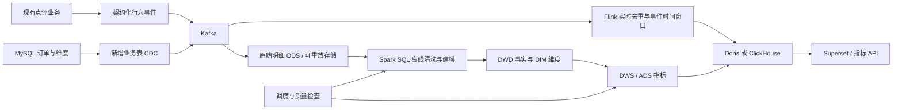

# 数据开发方向评估与路线

评估日期：2026-10-30。依据是当前源码、数据库迁移、部署配置和已有验证报告；没有对照具体公司的招聘 JD，也没有重新进行容量压测。以下区分已经实现的事实和建议建设的能力，所有新组件都是规划。

## 1. 当前定位与判断

**当前项目主要证明 Java 后端、缓存与消息可靠性能力，可以作为数据开发项目的业务数据源；还不能仅凭引入 Kafka 和 Canal 就定位成实时数仓。**

已有扩展明显超过原版课程 CRUD：事务 Outbox/Inbox、消费去重、失败隔离、分钟聚合、持久回执和集成测试，都是可继续利用的工程基础。但向数据开发转型的主要短板，是缺少明确的业务指标、数仓模型、可重放数据、调度补数与数据质量闭环。继续增加缓存层数或消息组件，不能直接补齐这些能力。

岗位方向也影响选择：离线数仓岗位更关注 SQL、Spark、建模和调度；实时岗位更关注 Kafka、Flink、事件时间和一致性；数据平台岗位还会关注元数据、权限、可观测性和平台工程。没有具体 JD 时，建议先完成共同基础，再选择其中一条深入。

## 2. 已有能力：代码依据与边界

| 观察到的能力 | 原始代码依据 | 能证明什么、尚不能证明什么 |
| --- | --- | --- |
| 行为采集与 Kafka 投递 | [KafkaBehaviorTransport](../src/main/java/com/hmdp/analytics/KafkaBehaviorTransport.java) | 有幂等生产、按店铺分区、手动提交 offset；浏览经过有界内存队列，进程崩溃或拥塞可丢弃，不是完整审计日志 |
| 订单事件持久投递 | [BehaviorJournalServiceImpl](../src/main/java/com/hmdp/service/impl/BehaviorJournalServiceImpl.java) | 有分析 Outbox、租约、重投与稳定 eventId；发送确认不等于所有下游均已处理 |
| 数据库去重与聚合 | [BehaviorAggregationServiceImpl](../src/main/java/com/hmdp/service/impl/BehaviorAggregationServiceImpl.java)、[BehaviorMapper.xml](../src/main/resources/mapper/BehaviorMapper.xml) | 明细插入、分钟计数和登录用户去重同事务提交；这是 MySQL 聚合，不是 Flink 状态计算 |
| 分析表与演进 | [V8](../src/main/resources/db/migration/V8__shop_behavior_analytics.sql)、[V9](../src/main/resources/db/migration/V9__analytics_delivery_checkpoint.sql) | 有明细、分钟桶、登录 UV、失败隔离与 Outbox 表；尚无 ODS/DWD/DWS/ADS 分层和历史维度模型 |
| CDC 与恢复意识 | [CanalCacheConsumer](../src/main/java/com/hmdp/cache/CanalCacheConsumer.java)、[CacheChangeProjector](../src/main/java/com/hmdp/cache/CacheChangeProjector.java) | 当前订阅用于店铺/券的缓存投影与失效；不能直接当作全量订单入仓链路 |
| 订单事实与历史快照 | [VoucherOrder](../src/main/java/com/hmdp/entity/VoucherOrder.java)、[OrderLifecycleServiceImpl](../src/main/java/com/hmdp/service/impl/OrderLifecycleServiceImpl.java) | 已有金额、店铺、券类型等快照；真实支付、核销与退款闭环并未完整实现，不能宣称真实 GMV |
| 故障与测试意识 | [测试目录](../src/test/java/com/hmdp)、[验证索引](README.md) | 有重放、故障、缓存并发和消息恢复测试；历史测试、固定热点压测不代表大规模生产验证 |

主观评价：作为学习型 Java 后端项目，工程深度和文档是优势；作为数据开发求职作品，目前数据消费仍偏单一，缺少可展示的模型、SQL 作业、补数和对账结果。没有足够依据给出“生产级”“高吞吐数仓”或精确能力分数。

## 3. 首先优化已有数据链路

### P0：定义数据契约与指标口径

[BehaviorEvent](../src/main/java/com/hmdp/analytics/BehaviorEvent.java) 当前包含 `schemaVersion/eventId/shopId/userId/action/occurredAt`，适合现有热榜，但不足以独立支持交易漏斗与金额分析。

建议为新版本事件明确增加：`orderId`、`voucherId`、`eventType`、`eventTime`、`ingestTime`、`source`、`traceId`；交易事件增加金额分、币种、状态及 `isMock`。匿名访问如需 UV，应另设计匿名设备/会话标识，说明其与“独立自然人”的区别；不要直接使用手机号作为分析标识。采集层保存 Kafka topic/partition/offset；CDC 明细另保存源表、主键、操作类型与位点，源位点不是业务 eventId。

新增字段需要兼容旧事件，已有消费者不应因升级而误隔离全部旧消息。金额必须来自订单历史快照，不能用当前券价格回填历史交易；旧快照缺失时应明确标记未知。

建议先冻结以下口径：

| 指标 | 建议口径 | 必须说明的限制 |
| --- | --- | --- |
| PV | 有效 `VISIT` 事件按 eventId 去重后的次数 | 当前采集允许丢失；是观察到的访问量 |
| 登录 UV | 窗口内有效访问的 distinct userId | 不包含匿名访客；跨分钟 UV 不能相加 |
| 创建订单数 | 按 orderId 去重的创建事实，区分普通券/秒杀券 | 需统一秒杀履约的创建事件覆盖，不能按投递次数计数 |
| 模拟支付金额 | `isMock=true` 的付款事实金额，单位分 | 必须独立展示，不称真实收入；免费领券与付款事件也应区分 |
| 下单转化 | 固定人群、归因与时间范围内，访问者中创建订单的人数比例 | 单纯“订单数 ÷ PV”应另命名，不能混用用户转化率 |
| 热度 | 当前 `PV + 2×登录UV + 5×订单 + 10×模拟付款` | 是人为权重，没有经过业务效果验证 |

现有窗口按 `occurredAt` 划分钟桶，查询包含当前分钟和前 N−1 个分钟桶，是“分钟桶滚动范围”，不是精确到毫秒的最近 N 分钟。迟到事件会写入旧桶，历史统计可能变化；目前没有显式 Watermark、允许迟到时间或结果最终封账规则。

### P0：补齐可重放、对账与数据保留策略

开发 Kafka 当前配置保留约 72 小时。超过保留期不能假设仅重置 offset 就能补回数据；去重表、分钟桶、UV 表也需要容量与生命周期规划。若删除去重记录后又重放旧数据，计数可能重复增加。

建议保留独立的原始数据副本，首次全量快照与 CDC 位点建立一致衔接，再支持按业务日期回放。补数先写独立结果表或分区，验证后原子替换/幂等合并，避免向已有累计桶再次盲加。记录批次 ID、代码版本、源范围、输入/拒绝/输出行数与执行时间。

至少完成四类校验：源业务订单与明细订单对账；订单与付款/关闭状态的时序校验；明细与聚合计数/金额对账；维度关联成功率和缺失值检查。浏览数据允许丢失，应从采集接受量、丢弃量、Kafka 持久量分别观察，不能要求它与用户真实浏览次数绝对相等。

### P1：解耦分析作业与业务服务

目前 Kafka 消费者与 Web 服务同进程，主要靠单消费者逐条事务写入 MySQL。后续将采集、计算和查询服务拆出明确边界，让分析重启、扩缩容和回放不干扰下单接口。优先拆独立模块或进程，不必马上上微服务注册中心。

现有去重与事务能够支持指定数据库效果的幂等，但不能概括成全链路 Exactly Once。Flink Checkpoint 也不能自动让任意外部 Sink 获得同样语义，需要结合源恢复、事务/幂等写入和故障测试验证。

### P1：建立安全和资源基线

Java 8、Spring Boot 2.3.12、旧 MySQL 驱动及 Vue 2 是维护负担。建议单独开升级分支评估 Java 17/21 和兼容的 Spring Boot 主版本，核对 `javax`/`jakarta`、MyBatis、Redis、监控及测试迁移；这是一项工程成本，不应与数仓建设混在一次大改中。

五层缓存、两套 MQ 和多个 JVM 带来资源、配置和排障成本。缓存的必要性应靠命中率、延迟与一致性成本证明；数据分析新链路优先复用 Kafka，RocketMQ 继续承担已有业务任务即可。轻量 2GB 部署关闭多种中间件，不适合同时演示 Flink、Spark 和 OLAP。

## 4. 推荐的目标架构

先建设一条完整小链路，再扩展规模。图中除已有业务、Kafka 和现有缓存 CDC 外，其余入仓和计算节点均为后续方案。

数仓起步模型应以业务粒度为先：`dwd_shop_visit_event` 一行一个有效访问事件，`dwd_order_created` 一行一个创建订单事实，`dwd_order_status_change` 一行一次状态变化；如需要订单当前状态，另建按 orderId 更新的快照表。不要将同一订单不同 CDC 更新都当成新订单。

维度先做店铺、券和日期；店铺商圈/分类有历史归属要求时再做 SCD2，按事件时间关联有效期，保证同一维度版本有效期不重叠。用户维度只保留分析必需的脱敏字段。DWS 建店铺日汇总和 5 分钟窗口指标，ADS 提供热榜、店铺漏斗和订单状态分析。分区采用明确的业务日期与时区约定；毫秒时间戳统一存 UTC，业务日可显式按 Asia/Shanghai 计算。

## 5. 应引入哪些技术

| 优先级 | 技术或能力 | 引入目的 | 取舍 |
| --- | --- | --- | --- |
| 最高 | SQL、维度建模、指标字典、可重复样例数据 | 先证明建模、去重、Join、窗口、分区和对账能力 | 这些比继续罗列组件重要 |
| 高 | Spark SQL / PySpark | 离线清洗、批处理、历史回算 | 面向离线岗位优先；小数据先 local 模式，说明单机限制 |
| 高 | Flink SQL | 事件时间、Watermark、迟到、状态、Checkpoint 与恢复 | 面向实时岗位优先；与离线路线分阶段实施 |
| 高 | Apache Doris **或** ClickHouse | 聚合查询与看板服务，隔离业务 MySQL 负载 | 只选一个；比较主键更新、乱序、去重和历史修正需求后决定 |
| 高 | Airflow **或** DolphinScheduler | 依赖调度、参数化日期、失败重试和补数 | 只选一个；调度重试仍要求任务本身幂等 |
| 中 | 独立业务 CDC：Debezium **或** Flink CDC | 订单/维度全量与增量衔接、状态变更采集 | 依据团队栈二选一；保留现有 Canal 缓存职责，避免多路重复采集同一事实 |
| 中 | Parquet 与对象存储/文件落地 | 保存原始和清洗数据，支持超出 Kafka 保留期的回放 | 先本地目录，需 S3 兼容性时再引入 MinIO 等实现 |
| 中 | Superset | 展示指标与口径，让招聘方可操作验证 | 不必为看板重新开发一整套前端 |
| 后续 | Iceberg、Catalog、血缘/质量平台 | 表格式演进、历史版本、元数据治理 | 在确有更新、回溯、治理需求后引入；不要一次堆齐 |

不建议第一阶段同时增加 Hadoop/Hive 全家桶、Spark、Flink、两套 OLAP、Kubernetes 和完整治理平台。它们需要额外机器、版本管理、数据规模和运维时间；项目容易变成“环境都启动了，但没有可验证结果”。若目标 JD 强调 Hive/HDFS，可在离线路线补 Hive 分区、元数据和存储实践，不必为了本地小样本搭大集群。

## 6. 分阶段交付与验收

以下是按每周约 10～15 小时投入的建议节奏，约 6～8 周起步，实际取决于 SQL/Linux 基础和可用资源，不是完成承诺。

| 阶段 | 交付物 | 可核验的完成标准 |
| --- | --- | --- |
| 第 1～2 周：数据基础 | 事件 v2 契约、指标字典、可复现数据生成器、样本预期结果 | 包含重复、乱序、跨日、匿名、免费券、模拟支付与取消样本；明确订单事件覆盖；SQL 输出可与手算一致 |
| 第 3～4 周：先选一条主线 | 离线：Spark SQL 分层与日期补数；或实时：Flink SQL 去重、窗口与 OLAP | 离线同日期重跑不重计；实时重复投递不增量、迟到按约定修正，故障恢复后最终结果与离线基准一致 |
| 第 5～6 周：闭环 | 调度、原始数据留存、质量校验、对账与看板 | 指定日期可补数；脏数据可定位；看板可回溯至明细；模拟支付单独标识；演练源端中断与下游不可用 |
| 第 7～8 周：深化与展示 | 补另一条计算路线或针对目标 JD 深化；容量与成本报告 | 给定相同源范围和截止时间，实时/离线核心指标可对账；保存差异原因、资源消耗和复现命令 |

建议第一版验收集有 100～1000 条可手算的固定数据，再用参数化生成器扩大到合适规模。只有实际执行后才能在简历写“处理了多少条”；“可生成百万条”不是“已验证百万条”。性能测试应同时记录数据分布、并行度、机器规格、输入速率、P95 延迟、积压、失败恢复时间和最终对账结果。

推荐独立建立 `data-platform/` 目录，包含 `contracts/`、`sample-data/`、`sql/`、`jobs/`、`quality/`、`orchestration/` 和自己的 Compose；不要将数仓作业塞入业务 Controller。这个目录是建议结构，本次尚未创建这些实现。

## 7. 面试与简历表达

现在可以基于实际代码说明：“在点评业务中实现 Kafka 行为采集、基于 eventId 的幂等消费与 MySQL 分钟聚合；交易分析采用 Outbox 重试，数据库提交后确认 offset，并对坏消息进行持久隔离。”同时说明浏览允许丢失、UV 仅覆盖登录用户以及当前单机验证范围。

完成上述交付后，再把项目表述扩展为：“围绕店铺访问与订单生命周期构建批流数据链路，设计事实/维度与统一指标口径，支持重复/迟到处理、日期补数和源到指标对账。”只有真正完成的部分才写入简历；吞吐、延迟和准确率必须来自自己的可复现实验。

如果目标明确是数据开发，优先把项目打磨成“点评业务数据源 + 一条可补数、可对账的数据链路”。继续做缓存花样的求职收益，通常低于把 SQL、建模和数据质量做扎实；这是针对当前代码重心的判断，不是对所有后端岗位的通用结论。

## 8. 进一步学习的原始资料

下列为官方概念与实现资料，用于后续设计核对；本文没有把某个特定版本的完整组合当成已验证兼容方案。实施前应固定连接器、Flink/Spark、JDK 和目标存储版本。

- [Kafka：投递语义](https://kafka.apache.org/documentation/#semantics)
- [Flink：事件时间与 Watermark](https://nightlies.apache.org/flink/flink-docs-stable/docs/concepts/time/)
- [Flink：Checkpoint](https://nightlies.apache.org/flink/flink-docs-stable/docs/dev/datastream/fault-tolerance/checkpointing/)
- [Spark SQL 官方指南](https://spark.apache.org/docs/latest/sql-programming-guide.html)
- [Airflow：日期范围回填](https://airflow.apache.org/docs/apache-airflow/stable/core-concepts/backfill.html)
- [Debezium MySQL Connector](https://debezium.io/documentation/reference/stable/connectors/mysql.html)
- [Apache Doris 官方文档](https://doris.apache.org/docs/)
- [Apache Iceberg 官方文档](https://iceberg.apache.org/docs/latest/)
