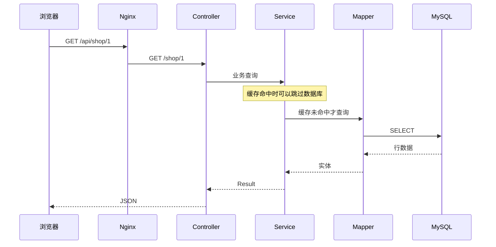
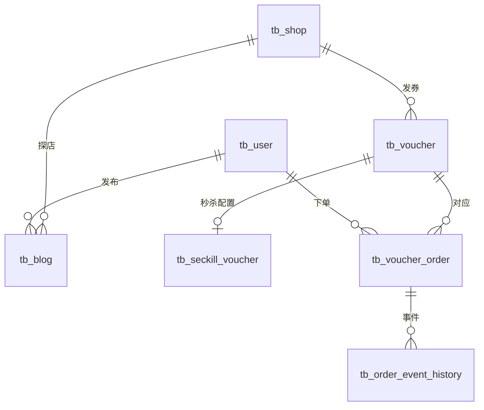

# 03 架构、代码与数据库

[返回目录](README.md) · [上一章](02-环境搭建与启动.md) · [下一章：登录与权限](04-登录权限与签到.md)

**本章学习目标**：本章教你沿一次请求读懂代码，并把实体、参数、Mapper SQL 和事务对应起来。读完应能找到一个页面动作的三层实现，也能解释为什么需要唯一约束与受影响行数。

**本章导航**

- [1. 从一次请求看分层](#section-01)
- [2. 目录导航](#section-02)
- [3. 从一个字段追踪到数据库](#section-03)
  - [请求参数不是凭空进入 Java 的](#section-03-01)
  - [如何在 IDE 里跟一条链路](#section-03-02)
  - [DAO 的参数绑定怎么工作](#section-03-03)
  - [事务提交与返回失败有何关系](#section-03-04)
  - [数据库事务的边界图](#section-03-05)
  - [学会读一次更新的返回值](#section-03-06)
- [4. 实体、DTO 与快照有什么区别](#section-04)
- [5. 数据库的核心关系](#section-05)
- [6. 唯一约束如何帮助并发正确性](#section-06)
- [7. 迁移文件的阅读顺序](#section-07)
- [8. 响应、金额与时间约定](#section-08)
  - [用一个真实 Mapper 方法读懂 XML](#section-08-01)
- [9. 新增功能的规范示例](#section-09)
- [10. 手把手读懂分层、事务与数据库返回值](#section-10)
  - [先学会在三个位置读同一个名字](#section-10-01)
  - [更新了 0 行，不是只有“SQL 报错”一种解释](#section-10-02)
  - [事务像一次提交，不像所有组件共同签字](#section-10-03)
  - [Entity、DTO 和快照为什么不能随意互换](#section-10-04)
  - [用一个真实功能完成源码阅读作业](#section-10-05)

<a id="section-01"></a>

## 1. 从一次请求看分层

浏览器访问 `/api/shop/1`，Nginx 去掉 `/api`，转发给 Java 的 `/shop/1`。`ShopController` 接收路径参数 1，调用 `IShopService` 的实现；服务决定走缓存还是 Mapper，最终将数据包装成 `Result` 返回 JSON。



**Controller** 管输入和输出，不直接拼数据库查询来完成复杂业务。**Service** 管业务规则、事务、权限归属、状态迁移和协调。**Mapper/DAO** 管 SQL 和持久化操作。本项目使用 MyBatis-Plus，Mapper 通常继承 `BaseMapper`；复杂 SQL 通过 Mapper 方法声明。

学习顺序可以是 Controller → Service → Mapper，开发新功能时则先明确表与 Mapper，再实现 Service，最后提供 Controller。生产查询沿用 Mapper，不另外引入 JdbcTemplate 绕过现有访问层。

<a id="section-02"></a>

## 2. 目录导航

| 路径 | 内容 | 建议先读 |
| --- | --- | --- |
| [controller](../src/main/java/com/hmdp/controller) | 店铺、用户、笔记、券、订单、体验等接口 | `ShopController`、`VoucherOrderController` |
| [service](../src/main/java/com/hmdp/service) | 业务接口 | `IShopService`、`IExperienceService` |
| [service/impl](../src/main/java/com/hmdp/service/impl) | 业务实现与事务 | `ShopServiceImpl`、`VoucherOrderServiceImpl` |
| [mapper](../src/main/java/com/hmdp/mapper) | 数据访问 | `VoucherOrderMapper`、`BusinessOutboxMapper` |
| [entity](../src/main/java/com/hmdp/entity) | 持久化实体 | `Shop`、`Voucher`、`VoucherOrder` |
| [dto](../src/main/java/com/hmdp/dto) | 请求和返回模型 | `Result`、`UserDTO`、`ShopSearchDTO` |
| [cache](../src/main/java/com/hmdp/cache) | 请求缓存、Memcache、CDC、读取采样 | `CacheChangeProjector`、`CanalCacheConsumer` |
| [messaging](../src/main/java/com/hmdp/messaging) | RocketMQ 事件与传输 | `BusinessEvent`、`RocketMqTransport` |
| [analytics](../src/main/java/com/hmdp/analytics) | Kafka 传输与热榜入口 | `KafkaBehaviorTransport` |
| [reliability](../src/main/java/com/hmdp/reliability) | 权限、限流、运维、维护任务 | `AccessGuard`、`OperationsController` |
| [utils](../src/main/java/com/hmdp/utils) | 缓存客户端、ID、令牌拦截器等 | `CacheClient`、`RedisIdWorker` |
| [resources](../src/main/resources) | YAML、Lua、基础 SQL 和增量迁移 | `application.yaml`、`seckill.lua` |
| [frontend](../frontend) | 桌面静态页面、脚本、样式、证据 | `index.html`、`scripts/experience.js` |
| [dev](../dev) | Compose、Nginx、监控、格式检查 | `docker-compose.yml` |
| [src/test/java](../src/test/java) | 回归与教学测试 | 按业务选择对应测试类 |

本项目的方法命名尽量写明“动作 + 业务对象”。`queryInventoryReconciliationReport` 表示生成库存对账报告，`markReservationFailedAndCompensateRedis` 表示保存预约失败状态后补偿 Redis，`syncReservationStateAndAcknowledgeMessage` 表示同步展示并确认消息。后一个动作不等于订单成功，状态仍可能是 FAILED 或 REVIEW。

批处理入口 `relayOutboxBatch` 和 `relayAnalyticsOutboxBatch` 明确一次只处理一批；访问采集 `submitShopVisitEvent` 返回事件号，用于后续追踪，不保证已落库。首次发布与人工恢复分别调用 `publishActivity(voucherId)`、`recoverActivity(voucherId)`，共享内部准备流程，避免在调用处猜测布尔参数的含义。

变量名称写明身份和单位，例如 `orderId`、`voucherId`、`eventId`、`ttlMillis`、`occurredAtMillis`。方法注释重点解释事务要求、重复执行、故障窗口与返回含义，避免把代码中的每条赋值再描述一遍。Java 方法名的调整不改变已有 HTTP 路径或 JSON 字段，例如 `/ops/seckill/{id}/reconcile` 仍调用同一个对账报告功能。

构造器注入可以清楚表示一个对象必须依赖哪些服务，已有代码也使用 `@Resource` 字段注入。不要因为某个类使用了构造器，就误以为它不符合风格；需要检查的是缩进、换行、导入、命名和职责，而不是统一禁止构造器。

<a id="section-03"></a>

## 3. 从一个字段追踪到数据库

<a id="section-03-01"></a>

### 请求参数不是凭空进入 Java 的

以 `/shop/1` 为例，`@GetMapping("/{id}")` 表示路径中有一个变量，`@PathVariable("id")` 把这个变量绑定到 Java 的 Long id。数字 1 是店铺 ID，不是店铺名称或分类 ID。

以 `/shop/search?typeId=1&minScore=45` 为例，参数进入 `ShopSearchDTO`，Service 校验范围后再构造 Mapper 查询。Controller 不需要自己查询数据库才能知道参数合法；Service 更适合保存业务约束，便于其他调用入口复用。

<a id="section-03-02"></a>

### 如何在 IDE 里跟一条链路

1. 打开浏览器开发者工具的 Network，点击店铺，记录请求路径和响应。
2. 在 `ShopController.queryShopById` 放断点，确认传入 ID。
3. 进入 `ShopServiceImpl.queryShopDetail` 与 `queryById`，区分正常详情与纯缓存读。
4. 继续进入 CacheClient；已有缓存时可能看不到 SQL，这是正常的。
5. 在隔离环境的冷数据路径继续跟到 Mapper，再查看数据库记录。
6. 返回时看 Result 与 JSON，判断实体中的哪些字段实际给了浏览器。

断点会暂停处理线程，可能让锁过期、消息重试或超时。所以用于理解代码的暂停不能当作正常延迟测量；也不要在共享秒杀任务上随意暂停很长时间。

<a id="section-03-03"></a>

### DAO 的参数绑定怎么工作

`#{orderId}` 由 MyBatis 绑定为 SQL 参数，通常不能用作任意表名或排序表达式。`${...}` 是文本替换，错误使用会让不可信输入进入 SQL 结构。当前业务沿用 Mapper，复杂 SQL 集中在对应 XML 文件。

动态条件应先做白名单和类型检查。例如 search 的 sort 只允许指定值，经纬度必须是有限且在范围内的数，不能让浏览器自由决定一段 SQL。

<a id="section-03-04"></a>

### 事务提交与返回失败有何关系

抛出符合回滚规则的异常通常触发 Spring 事务回滚；但 `return Result.fail(...)` 只是返回一个对象，并不天然通知数据库回滚。若一个方法已经写了一半数据再返回 fail，需要确认该路径是否显式回滚，或设计为校验全部通过后才开始写。

这也是阅读 Service 时不能只关注结尾 `Result.ok()` 的原因：先标出第一条写语句，再逐条看后续失败分支如何处理。当前核心履约在条件扣库存后出现错误会抛异常，让库存与订单写入一同回滚。

`TransactionTemplate.execute` 明确划出事务块；`@Transactional` 通常通过 Spring 代理生效。方法在同对象内直接调用另一个带注解方法，不应默认得到新的事务边界。具体行为要看代理调用、传播方式和当前是否已在事务中。

<a id="section-03-05"></a>

### 数据库事务的边界图

```text
同一事务可以覆盖：订单 INSERT + 库存 UPDATE + 预约更新 + Outbox INSERT
不自动覆盖：Redis DECR + 文件删除 + Broker 网络发送
```

后一组要依靠幂等、补偿、提交后动作和持久任务协调，不能只给外层加一个注解就声称所有组件共同回滚。

<a id="section-03-06"></a>

### 学会读一次更新的返回值

SQL 执行没抛异常，与“改到了目标行”不同。条件不满足时影响 0 行，数据库可以正常返回；Service 必须解释是重复、状态已变、对象不存在还是未到期限。

同样，`INSERT IGNORE` 返回 0 不是自动成功，可能需要读现有记录核对业务身份。当前行为聚合会核对重复 eventId 的原有内容，秒杀会核对订单 ID 对应的用户与券。

<a id="section-04"></a>

## 4. 实体、DTO 与快照有什么区别

实体对应数据库中的行，例如 `VoucherOrder`。DTO 是接口边界传递的数据，例如 `LoginFormDTO` 表示手机号和验证码，`UserDTO` 只暴露登录需要的基本资料。它们不一定与数据库列一一对应。

快照表示“发生某个动作时的数据副本”。订单保存券标题、规则、实付金额、类型和店铺 ID 的快照，避免管理员修改券后，历史订单金额或归属跟着变化。缓存快照则是另一种用途：把对象序列化保存，读取时重新解码，避免一个请求修改共享实体污染其他请求。

内部消息任务使用 `BusinessOutboxTask`，秒杀预约使用 `SeckillReservation`，活动发布数据使用 `SeckillPublication`。Mapper XML 的 `resultMap` 把 `order_id` 等数据库列明确映射为 `orderId` 等 Java 属性，Service 可以直接调用 getter，减少字段名拼错和强制类型转换。接口已有的 JSON 字段保持原约定，内部模型不等于对外响应格式。

`OrderStatus` 和 `VoucherType` 给数据库数字提供业务名称。例如 `OrderStatus.UNPAID.getCode()` 仍写入数字 1，但读代码时可以立即知道含义。`OutboxState`、`ReservationState` 给字符串状态提供统一名称。枚举不会自动代替 SQL 的状态条件或行锁；并发保护仍由 Mapper 与事务共同完成。

`Result<T>` 的 `T` 表示 data 的 Java 类型，例如 `Result<SeckillReservation>`。这样内部调用拿到预约时无需从 Object 强制转换。它的 JSON 外层依然是 success、errorMsg、data 和 total，现有页面可以按原字段读取。

Java 的 `final Map` 只是不允许把变量重新指向另一张 Map，并不意味着 Map 内容不可修改。因此缓存安全不能只靠 `final` 关键字判断。

<a id="section-05"></a>

## 5. 数据库的核心关系



这是业务关系示意图，不表示每个关系都声明了数据库外键。项目通过业务校验、索引、事务与唯一约束维护相关规则。

理解数据库时，把表分为四组：

1. **业务表**：用户、店铺、笔记、券、订单。
2. **关系与资源表**：关注边、点赞、图片归属、笔记图片引用。
3. **可靠性表**：秒杀预约、死信、Outbox、Inbox、操作审计、CDC 检查点。
4. **分析表**：行为事件、分钟热度桶、登录访问用户、分析 Outbox 与失败记录。

数据库并不是“只为了订单”。它还保存消息进度和可恢复的关系事实，使服务退出之后不会只剩内存中的未完成任务。

<a id="section-06"></a>

## 6. 唯一约束如何帮助并发正确性

- 用户手机号唯一：同时首次登录的请求不能注册两个相同手机号账号。
- `tb_ordinary_order_slot(user_id,voucher_id)` 主键：为普通券同一用户提供稳定可加行锁的槽位，避免查询“还没有订单”时并发穿透。
- 秒杀预约唯一键使用 `voucher_id,active_user`。FAILED 预约的生成列为 NULL，使明确失败后可以释放资格；PROCESSING、SUCCESS、REVIEW 仍占资格。
- `tb_message_inbox(consumer_group,event_id)` 主键：同一逻辑组不能重复完成同一数据库处理步骤。
- `tb_behavior_event(event_id)` 主键：同一行为事件只统计一次。
- 关注边、点赞、笔记图片引用也有各自唯一约束。

分布式锁帮助减小竞争范围，但锁的租约可能到期、连接可能断开；最终数据库约束仍要兜底。出现唯一键冲突时，需要区分“重复同一业务”与“相同 ID 对应不同业务身份”，后者不能直接当成功。

<a id="section-07"></a>

## 7. 迁移文件的阅读顺序

| 版本 | 主要变化 |
| --- | --- |
| V1 | 订单快照、秒杀预约与活动、死信、业务 Outbox、持久关注/点赞、图片归属、审计和索引、普通券槽位 |
| V2 | 笔记正文扩为 TEXT |
| V3 | 秒杀活动增加已发布标记，防止用过的活动被随意重置 |
| V4 | 图片生命周期与笔记图片引用、删除事件资源路径 |
| V5 | CDC 检查点记录 |
| V6 | Outbox 租约/发送/消费时间、Inbox、消息失败、订单事件历史、订单到期时间 |
| V7 | 秒杀持久交接幂等键 |
| V8 | 行为 Outbox、事件事实、分钟桶、登录用户去重、消费失败及订单店铺快照 |
| V9 | 分析事件发送检查点 |

详见 [迁移目录](../src/main/resources/db/migration)。不要只读原始 `hmdp.sql` 就认为已经掌握当前数据库；扩展设计主要在这些迁移中。

<a id="section-08"></a>

## 8. 响应、金额与时间约定

统一业务响应见 [Result](../src/main/java/com/hmdp/dto/Result.java)：`success`、`errorMsg`、`data`、`total`。`total` 并非所有分页接口都会填充，课程型列表可能只返回当前页数组；按接口实际返回解析。

订单与券的 `payValue`、`actualValue`、`payValueSnapshot` 用**分**；店铺平均价格筛选 `maxPrice` 用**元**；评分 `minScore=45` 表示 4.5 分。不要把金额字段混用。

订单 ID 是 Java Long，可能超过 JavaScript 安全整数范围。浏览器应保留为字符串，不能先 `Number(id)` 再转字符串；精度已经丢失就无法恢复。

业务时间涉及 Java `LocalDateTime`、MySQL 时间、Redis TIME 与消息时间戳。容器时区和宿主机时区可能不同；演示活动时按服务实际解释的时间设置。日志当前只显示分秒毫秒，不是完整日期时间，排查时还要结合 Docker 日志时间和事件表。

<a id="section-08-01"></a>

### 用一个真实 Mapper 方法读懂 XML

[VoucherOrderMapper](../src/main/java/com/hmdp/mapper/VoucherOrderMapper.java) 声明：

```java
int closeExpiredOrder(@Param("orderId") Long orderId);
```

[对应 XML](../src/main/resources/mapper/VoucherOrderMapper.xml) 使用同名 `id="closeExpiredOrder"`。`@Param` 的名字对应 XML 中 `#{orderId}`，MyBatis 进行参数绑定；`int` 返回更新行数。Mapper 的 namespace 必须对应接口完整类名，否则会出现找不到绑定语句的问题。

MyBatis-Plus 的 `getById`、`save`、`updateById` 等基础操作也通过 Mapper 访问数据库，只是无需为每条简单 SQL 手写 XML。不要把“不见 XML”误认为“没有 DAO 层”。

<a id="section-09"></a>

## 9. 新增功能的规范示例

以“查询本人订单事件”为例：先在 Mapper 写按用户和订单归属查询的方法；Service 从 `UserHolder` 获取当前用户并校验归属；Controller 接收路径参数并调用 Service。前端不传一个 `userId` 就决定自己能看谁的订单。

Java 使用明确 import，避免 `org.xxx.SomeType` 在字段或参数里长串堆叠；遵循 Google Java Style 的缩进与换行，不使用通配符 import。项目提供 [检查脚本](../dev/java-style.sh)：

项目额外要求 `@Resource` 独立成行，字段声明写在下一行。格式化脚本会保留这一约定，Checkstyle 会阻止重新写回同一行：

```java
@Resource
private IBlogService blogService;
```

```bash
sh dev/java-style.sh check
# 主动整理代码时使用 format；会改动 Java 源文件
sh dev/java-style.sh format
```

格式检查帮助统一外观，业务分层和命名仍要靠设计与审查。不要把 Checkstyle 通过当作业务正确性证明。

<a id="section-10"></a>

## 10. 手把手读懂分层、事务与数据库返回值

<a id="section-10-01"></a>

### 先学会在三个位置读同一个名字

从 [VoucherOrderMapper](../src/main/java/com/hmdp/mapper/VoucherOrderMapper.java) 的 `closeExpiredOrder` 开始，在接口看输入和返回类型，在 [XML](../src/main/resources/mapper/VoucherOrderMapper.xml) 看更新条件，再到 [OrderLifecycleServiceImpl](../src/main/java/com/hmdp/service/impl/OrderLifecycleServiceImpl.java) 看谁调用、何时调用。

接口告诉你输入是 orderId，返回值是更新行数；XML 告诉你仅更新状态为待支付且已经到期的订单；Service 告诉你调用前还有行锁、券类型和截止时间检查，成功后才登记关闭事件。三者结合才是完整行为。

“DAO 先写、Service 再组合、Controller 最后调用”的目的，是把数据库操作、业务判断和 HTTP 参数拆开。Controller 不应该为了展示进度临时执行 SQL，Service 也不需要直接操作 JDBC 连接。MyBatis-Plus 基础方法和手写 Mapper XML 都属于项目的数据访问路径。

<a id="section-10-02"></a>

### 更新了 0 行，不是只有“SQL 报错”一种解释

假设订单 9001 原来待支付，两个线程分别执行支付与到期关闭。关闭 SQL 带着 `status=1` 条件。如果支付已经提交，关闭更新 0 行，说明它没有取得这次状态迁移，而不是必须重试直到成功。

同样，`INSERT IGNORE` 返回 0 可能表示唯一键已存在。行为事件消费不能只把这个 0 当成功：还要比较原记录的店铺、用户、动作和时间是否与新事件一致。同 ID 同内容是合法重放，同 ID 不同内容是身份冲突。阅读 SQL 返回值时，始终先列出“0 可能来自哪些情况”。

| 返回值/结果 | 应先考虑的含义 | 上层还要做什么 |
| --- | --- | --- |
| 条件 UPDATE 返回 1 | 当前记录满足条件并完成迁移 | 登记与这次迁移一致的事件 |
| 条件 UPDATE 返回 0 | 不存在，或当前状态/时间已不符合 | 结合前置查询和业务契约决定是否返回原结果 |
| 去重 INSERT 返回 0 | 主键或唯一约束阻止了新插入 | 必要时比较业务身份，不能吞掉内容冲突 |
| 查询返回空集合 | 当前条件下没有记录 | 区分不存在、尚未落地和无权限的接口表现 |

<a id="section-10-03"></a>

### 事务像一次提交，不像所有组件共同签字

数据库事务会让本连接中的一组写入共同提交或回滚。订单与同库 Outbox 一起写入，可以避免“订单提交了却没有待发送任务”。Redis 失效、MQ 发送和文件删除不因此成为同一个数据库事务。

例如先删除文件再回滚数据库，SQL 回滚不会把文件恢复。项目为此使用资源状态与异步删除任务，使失败后仍有可追踪的处理责任。理解事务时，把每一步标出执行介质，再用框圈出真正同事务的数据库操作。框外步骤都要另找重试、幂等或补偿。

Spring 的声明式事务还经过代理；在同一个对象内部直接调用自己的另一个方法，不能只因被调方法有 `@Transactional` 就假定又建立了所需事务。项目不少可靠性流程直接使用 `TransactionTemplate` 明确包住临界数据库操作。阅读时要跟到实际入口，而不是只搜索注解个数。

另外，返回 `Result.fail` 是普通返回值，本身不会触发事务回滚。若此前已经执行数据库修改，必须检查是否抛异常、标记回滚或在修改前完成校验。不能把“页面显示失败”当成“数据库一定没写”。

<a id="section-10-04"></a>

### Entity、DTO 和快照为什么不能随意互换

Entity 表达数据库记录，DTO 表达接口需要交换的字段，快照保存一个历史时点。以订单为例，当前券可能改价格或迁店，订单金额按领取时保存的快照解释；分析事件使用历史店铺快照。当前本人订单详情中的补充 shopId 仍取当前券的归属，不能把这个字段宣传为已经完全按历史快照展示。

`BusinessOutboxTask` 是 Mapper 读取任务的类型模型。`aggregateId` 指向这条事件关联的业务对象，未必是订单：店铺失效事件可以指店铺，社区事件可以指笔记。字段用了 Long 不表示不同对象的 ID 可以互换；还要结合 kind 判断。显式 `resultMap` 把 `aggregate_id` 映射到 `aggregateId`，有助于避免依赖隐含命名猜测。

内部使用枚举改善语义，并不意味着接口可随意改返回值。订单状态仍要保持已有数字协议，预约和消息任务使用各自状态名称。重构内部名字时，检查序列化、SQL 和 Lua 的外部约定，不能只改 Java 编译能通过的引用。

<a id="section-10-05"></a>

### 用一个真实功能完成源码阅读作业

选择“关闭过期普通订单”，依次完成：

1. 在 Service 找到读取候选订单的入口，解释候选查询为什么不是最终判断。
2. 找到单订单事务，标出 `FOR UPDATE` 的查询和带状态条件的更新。
3. 说明另一个线程先支付后，该关闭流程走哪一个分支。
4. 找到关闭事件写入，判断它与订单更新是否同事务。
5. 到 Outbox Relay 找下一段执行，说明它与上一步为何不是一个事务。

作业完成标准不是记住方法名，而是能在源码中指出“候选过期”和“真正关闭”之间还有重新校验。类似方法名的差异往往对应不同保证，忽略它就容易把扫描任务写成无条件修改状态。
