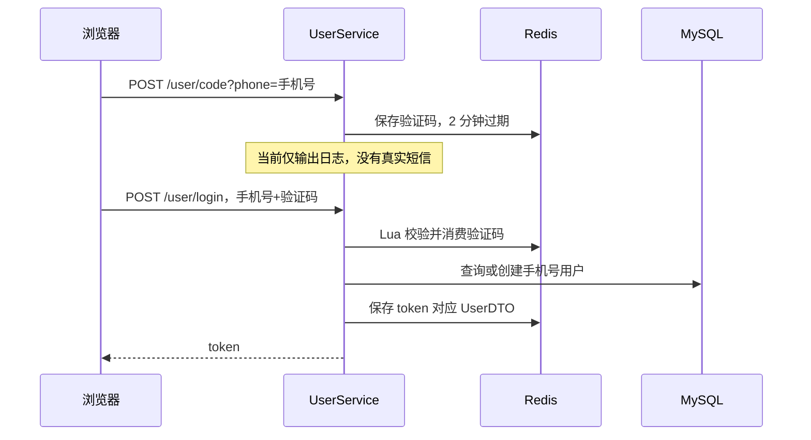

# 04 登录、权限与签到

[返回目录](README.md) · [上一章](03-架构代码与数据库.md) · [下一章：五层缓存](05-五层缓存与一致性.md)

**本章学习目标**：先理解为什么 Session 方案要改成共享登录，再分段读验证码、登录与请求拦截。最后用具体二进制数字解释连续签到。读完应能自己画出认证顺序，并指出身份什么时候被清理。

**本章导航**

- [1. 为什么把 Session 换成 Redis 令牌](#section-01)
- [2. 发送验证码到登录成功](#section-02)
- [3. 当前 TTL 要读代码，不能照搬课程](#section-03)
- [4. 两个实际生效的拦截器](#section-04)
- [5. ThreadLocal 怎么理解](#section-05)
- [6. 从 Session 推导 Redis 登录实现](#section-06)
  - [先实现一台服务器上的最小登录](#section-06-01)
  - [为什么验证码 Key 不能都叫 code](#section-06-02)
  - [第一步：阅读发送验证码](#section-06-03)
  - [第二步：为什么验证码校验与删除不能分两次](#section-06-04)
  - [第三步：阅读登录成功后的保存过程](#section-06-05)
  - [第四步：请求如何恢复用户](#section-06-06)
  - [用两个请求演算 ThreadLocal](#section-06-07)
- [7. 哪些接口可以匿名访问](#section-07)
- [8. 限流怎么保护入口](#section-08)
- [9. Bitmap 签到](#section-09)
- [10. 从日历格子推导连续签到算法](#section-10)
  - [签到次数与连续签到不同](#section-10-01)
  - [写入当前日的代码](#section-10-02)
  - [读取位串并逐位计算](#section-10-03)
  - [独立练习，不改业务签到数据](#section-10-04)
- [11. 亲手验证](#section-11)
- [12. 把登录、鉴权与签到按一次真实请求讲清楚](#section-12)
  - [用户身份经过了哪些位置](#section-12-01)
  - [原始 token 与 Bearer 凭证怎样区分](#section-12-02)
  - [验证码为何要原子消费，而不是先比较再删除](#section-12-03)
  - [TTL 的数字要连同单位一起看](#section-12-04)
  - [ThreadLocal 只能保存当前线程的请求上下文](#section-12-05)
  - [签到练习要算出具体答案](#section-12-06)

<a id="section-01"></a>

## 1. 为什么把 Session 换成 Redis 令牌

传统 Session 常由单台应用服务器保存。登录请求到了 A，下一次业务请求到了 B，B 可能找不到 A 的会话。课程通过共享 Redis 登录状态解决多实例会话共享。

当前方案是：登录生成随机 token；Redis 用 token 对应一份用户简要信息；浏览器每次请求携带 token；Java 拦截器读取用户信息后放入当前请求线程可访问的位置。它不是 JWT，不依赖解码 token 获取用户身份。

<a id="section-02"></a>

## 2. 发送验证码到登录成功



代码入口：[UserController](../src/main/java/com/hmdp/controller/UserController.java)、[UserServiceImpl](../src/main/java/com/hmdp/service/impl/UserServiceImpl.java)、[验证码 Lua](../src/main/resources/consume-code.lua)。

验证码消费采用原子校验和删除，防止两个并发请求都用同一验证码登录成功。手机号唯一约束用于兜底并发注册：插入发生重复键冲突时，再查询已创建的用户。不要把手机号、验证码等完整个人信息加入登录 DTO 的缓存展示。

<a id="section-03"></a>

## 3. 当前 TTL 要读代码，不能照搬课程

[RedisConstants](../src/main/java/com/hmdp/utils/RedisConstants.java) 中：验证码有效期是 2 分钟；登录有效期是 **36000 分钟，即 25 天**。这是当前源码的真实设置，不是常见教程中的 30 分钟。

登录 token 对应 Redis Hash，保存 `id`、`nickName`、`icon` 等简要信息。有效 token 访问接口时刷新这个 TTL，形成滑动过期。是否调整到更短时长，是后续产品与安全策略的选择，本文不修改配置。

<a id="section-04"></a>

## 4. 两个实际生效的拦截器

[MvcConfig](../src/main/java/com/hmdp/config/MvcConfig.java) 注册顺序为：

1. `RefreshTokenInterceptor`：尝试恢复 token 用户并刷新 TTL。
2. `AccessGuard`：按照路径、HTTP 方法、身份和限流规则决定是否放行。

源码中还有课程 `LoginInterceptor`，但当前没有作为这条权限链注册。面试解释时要说实际运行的类。

业务请求头写法：

```http
authorization: 登录返回的原始token
```

业务 token 前面不加 `Bearer `。`Authorization: Bearer ...` 只出现在独立监控凭证场景。两者混用会导致“明明有 token 却提示未登录”。

<a id="section-05"></a>

## 5. ThreadLocal 怎么理解

`UserHolder` 使用 ThreadLocal，让一个请求的服务代码可以取得当前用户，不用每层都额外传 userId。它绑定的是当前处理线程，不是为每个用户永久分配一条线程。

Web 服务器会复用线程。如果请求结束不清理，上一个用户的信息可能影响下一个请求。因此 `RefreshTokenInterceptor.afterCompletion` 会移除 ThreadLocal。后台异步任务不能假定还能读到请求线程的用户；应从持久任务中明确携带并校验身份信息。

注销时删除当前 token 对应的 Redis Hash，并清理当前上下文。它不会自动踢掉这个用户所有设备上的其他 token。

<a id="section-06"></a>

## 6. 从 Session 推导 Redis 登录实现

<a id="section-06-01"></a>

### 先实现一台服务器上的最小登录

教学上可以先设想：验证码写在 HttpSession，验证成功后把用户保存在同一 Session，再由 Cookie 带会话 ID。这样单机能工作，但换一台应用实例后，如果会话不共享，用户会突然变成未登录。

当前项目的方法签名仍有 HttpSession 参数，不能据此判断实现还在用 Session。阅读时要跟到实际存储语句：发送验证码使用 `StringRedisTemplate.opsForValue().set`，登录使用 Redis Hash。

<a id="section-06-02"></a>

### 为什么验证码 Key 不能都叫 code

Redis 被所有用户共享。如果每次都 `SET code 验证码`，B 获取验证码会覆盖 A 的验证码。Key 应包含验证码对应的手机号：`login:code:{phone}`。Key 标识一份数据的归属，value 保存验证码，TTL 限定可使用时间。

这不意味着浏览器应该用手机号当登录凭证。手机号可被知道，无法证明持有人身份；完成验证码校验后需要生成不可预测的随机 token。

<a id="section-06-03"></a>

### 第一步：阅读发送验证码

以下为 [UserServiceImpl.java](../src/main/java/com/hmdp/service/impl/UserServiceImpl.java) 的相关源码片段。为便于阅读只展示当前部分，依赖与 import 请查看原文件；无需把片段另建类复制运行。

```java
public Result sendCode(String phone, HttpSession session) {
  // 1.校验手机号
  if (RegexUtils.isPhoneInvalid(phone)) {
    // 2.如果不符合，返回错误信息
    return Result.fail("手机号格式错误！");
  }
  if (!rateLimiter.allow("code-phone:" + phone, 1, 60000)) {
    return Result.fail("请一分钟后再获取验证码");
  }
  // 3.符合，生成验证码
  String code = RandomUtil.randomNumbers(6);

  // 4.保存验证码到 session
  stringRedisTemplate
      .opsForValue()
      .set(LOGIN_CODE_KEY + phone, code, LOGIN_CODE_TTL, TimeUnit.MINUTES);

  // 5.发送验证码
  log.debug("发送短信验证码成功，验证码：{}", code);
  // 返回ok
  return Result.ok();
}
```


| 代码步骤 | 为什么需要 | 缺少时可能怎样 |
| --- | --- | --- |
| 格式校验 | 尽早拒绝无效手机号 | 生成无意义验证码与状态 |
| 每手机号窗口限制 | 防止反复覆盖验证码与滥用 | 一分钟产生大量验证码 |
| 生成六位随机值 | 为本次验证创建输入 | 固定验证码失去验证作用 |
| Redis SET + TTL | 跨实例读取且自动失效 | 永久可用或依赖单机 Session |
| 日志输出 | 本地未接短信时可体验 | 用户不知道演示验证码 |

源码旧注释写“保存到 session”，实际下面调用的是 Redis；读教材或源码时应以执行语句为准。生产接入短信后还需要供应商响应处理、发送费用控制等，这些不属于当前日志演示。

<a id="section-06-04"></a>

### 第二步：为什么验证码校验与删除不能分两次

设想两个登录请求都 GET 到相同验证码，它们各自比较成功，再各自 DEL。两个请求都可能登录成功，同一次验证被消费了两遍。当前使用 Lua 把比较与消费放到一次 Redis 执行中。

以下为 [consume-code.lua](../src/main/resources/consume-code.lua) 的相关源码片段。为便于阅读只展示当前部分，依赖与 import 请查看原文件；无需把片段另建类复制运行。

```lua
if redis.call('GET',KEYS[1])~=ARGV[1] then return 0 end
redis.call('DEL',KEYS[1])
return 1
```


这里 KEYS[1] 是带手机号的验证码 Key，ARGV[1] 是本次输入。只有匹配才删除并返回成功；删除后第二个请求读不到原值。验证码验证成功后数据库操作如果失败，验证码也不会由 MySQL 回滚恢复，这体现了组件事务边界。

<a id="section-06-05"></a>

### 第三步：阅读登录成功后的保存过程

以下为 [UserServiceImpl.java](../src/main/java/com/hmdp/service/impl/UserServiceImpl.java) 的相关源码片段。为便于阅读只展示当前部分，依赖与 import 请查看原文件；无需把片段另建类复制运行。

```java
public Result login(LoginFormDTO loginForm, HttpSession session) {
  // 1.校验手机号
  String phone = loginForm.getPhone();
  if (RegexUtils.isPhoneInvalid(phone)) {
    // 2.如果不符合，返回错误信息
    return Result.fail("手机号格式错误！");
  }
  if (!rateLimiter.allow("login-phone:" + phone, 5, 120000)) {
    return Result.fail("尝试次数过多，请稍后重试");
  }
  String code = loginForm.getCode();
  if (code == null
      || !code.matches("[0-9]{6}")
      || !Long.valueOf(1)
          .equals(
              stringRedisTemplate.execute(
                  CONSUME_CODE, Collections.singletonList(LOGIN_CODE_KEY + phone), code))) {
    return Result.fail("验证码错误或已使用");
  }

  // 4.一致，根据手机号查询用户 select * from tb_user where phone = ?
  User user = query().eq("phone", phone).one();

  // 5.判断用户是否存在
  if (user == null) {
    // 6.不存在，创建新用户并保存
    try {
      user = createUserWithPhone(phone);
    } catch (DuplicateKeyException duplicate) {
      user = query().eq("phone", phone).one();
    }
  }

  // 7.保存用户信息到 redis中
  // 7.1.随机生成token，作为登录令牌
  String token = UUID.randomUUID().toString(true);
  // 7.2.将User对象转为HashMap存储
  UserDTO userDTO = BeanUtil.copyProperties(user, UserDTO.class);
  Map<String, Object> userMap =
      BeanUtil.beanToMap(
          userDTO,
          new HashMap<>(),
          CopyOptions.create()
              .setIgnoreNullValue(true)
              .setFieldValueEditor((fieldName, fieldValue) -> fieldValue.toString()));
  // 7.3.存储
  String tokenKey = LOGIN_USER_KEY + token;
  stringRedisTemplate.opsForHash().putAll(tokenKey, userMap);
  // 7.4.设置token有效期
  stringRedisTemplate.expire(tokenKey, LOGIN_USER_TTL, TimeUnit.MINUTES);

  // 8.返回token
  return Result.ok(token);
}
```


按以下顺序读，不要求第一次就认识全部 Hutool API：

1. 校验手机号与尝试窗口，避免无效输入进入后续查询。
2. 输入必须是六位数字，Lua 返回 1 才通过验证码。
3. 根据手机号查询 MySQL；没有就创建用户。
4. 并发首次注册遇到手机号唯一冲突后再查询，不创建第二个身份。
5. 生成随机 UUID token，复制有限字段到 UserDTO。
6. 将 DTO 转为可写入 Hash 的字段值，忽略空值并把值变成字符串。
7. 写 `login:token:{token}`，设置分钟 TTL，返回 token。

注意 Hash 值从 Redis 读回来是文本，所以还需要映射成 DTO。DTO 不包含全部用户表字段，是明确的传递边界，而不是把完整 User 实体直接发给浏览器。

<a id="section-06-06"></a>

### 第四步：请求如何恢复用户

以下为 [RefreshTokenInterceptor.java](../src/main/java/com/hmdp/utils/RefreshTokenInterceptor.java) 的相关源码片段。为便于阅读只展示当前部分，依赖与 import 请查看原文件；无需把片段另建类复制运行。

```java
public boolean preHandle(HttpServletRequest request, HttpServletResponse response, Object handler)
    throws Exception {
  // 1.获取请求头中的token
  String token = request.getHeader("authorization");
  if (StrUtil.isBlank(token)) {
    return true;
  }
  // 2.基于TOKEN获取redis中的用户
  String key = LOGIN_USER_KEY + token;
  Map<Object, Object> userMap = stringRedisTemplate.opsForHash().entries(key);
  // 3.判断用户是否存在
  if (userMap.isEmpty()) {
    return true;
  }
  // 5.将查询到的hash数据转为UserDTO
  UserDTO userDTO = BeanUtil.fillBeanWithMap(userMap, new UserDTO(), false);
  // 6.存在，保存用户信息到 ThreadLocal
  UserHolder.saveUser(userDTO);
  // 7.刷新token有效期
  stringRedisTemplate.expire(key, LOGIN_USER_TTL, TimeUnit.MINUTES);
  // 8.放行
  return true;
}
```


没有 token 或 Hash 为空时，它返回 true，含义是“身份恢复步骤不阻塞请求”，不是“这个匿名用户有权限”。后面的 AccessGuard 才根据请求判断需不需要登录。

有效 token 恢复为 DTO，放进 UserHolder，再刷新 TTL。这让匿名公开页面也可以在携带 token 时识别用户，并保持活跃会话；如果只在受保护页面才刷新，长期浏览公开内容的用户可能被意外过期。

以下为 [RefreshTokenInterceptor.java](../src/main/java/com/hmdp/utils/RefreshTokenInterceptor.java) 的相关源码片段。为便于阅读只展示当前部分，依赖与 import 请查看原文件；无需把片段另建类复制运行。

```java
public void afterCompletion(
    HttpServletRequest request, HttpServletResponse response, Object handler, Exception ex)
    throws Exception {
  // 移除用户
  UserHolder.removeUser();
}
```


请求处理结束清理 ThreadLocal。它不表示删除 Redis token，只是从被复用的线程上移除用户上下文；Redis 登录寿命由 TTL/注销管理。

<a id="section-06-07"></a>

### 用两个请求演算 ThreadLocal

线程 T 先处理 A 的订单，UserHolder 存 A；请求结束 remove；T 后来处理匿名 B 的公开查询，应该没有用户。若遗漏 remove，B 可能继承 A 的身份。真正的请求隔离需要结束清理，而不是在入口“通常会覆盖”就放心。

后台消费者是另一条线程，不能自动得到 A 的 ThreadLocal。需要用户信息时，从消息关联的持久记录读取并校验，避免线程上下文丢失造成错误归属。

<a id="section-07"></a>

## 7. 哪些接口可以匿名访问

店铺、分类、券的公开读取，以及热门笔记、按店铺笔记、笔记检索和健康检查，可以匿名调用。体验页的能力、缓存观测、浏览提交与回执也有明确的公开白名单。

本人资料、签到、关注、笔记详情、发布、订单操作都需要登录。运维 `/ops/*`、商家写接口和普通登录方式读取 Prometheus 还需要管理员身份。优惠券创建在 Service 中进一步检查商品管理权限。

重要区别：**登录证明你是谁，归属校验证明这条数据是不是你的，管理员配置决定你能否管理系统。** “已经登录”不能替代订单归属校验。非本人查询应失败，不能只在前端隐藏按钮。

HTTP 401 表示缺少有效身份，403 表示权限不足，429 表示触发限流；业务参数错误还可能是 HTTP 200 配合 `success=false`。

<a id="section-08"></a>

## 8. 限流怎么保护入口

[RateLimiter](../src/main/java/com/hmdp/reliability/RateLimiter.java) 使用 Redis Lua 完成窗口内计数。当前主要限制：

| 场景 | 当前限制 |
| --- | --- |
| 登录类请求 | 连接 IP 每分钟 30 次 |
| 获取验证码 | 同一手机号每分钟 1 次 |
| 登录验证 | 同一手机号两分钟内 5 次尝试 |
| 秒杀提交 | 每用户每秒 10 次，整体每秒 1000 次 |
| 订单读取 | 每用户每秒 30 次 |
| 体验接口 | 连接 IP 每分钟 60 次 |

这是固定窗口类限制，不是已经实现的自适应令牌桶或公平排队。Nginx 代理下 `getRemoteAddr()` 可能都是代理 IP，多人会共享 IP 额度；要正确识别原始客户端地址，需要后续明确可信代理和转发头配置。

<a id="section-09"></a>

## 9. Bitmap 签到

把一个月想象成最多 31 格的日历：当天签到就把那格标记为 1。Redis 位图只需要很少空间保存这些标记。

Key 格式是 `sign:{userId}:yyyyMM`，偏移量是 `dayOfMonth - 1`：1 日写第 0 位，2 日写第 1 位。重复签到只是再次把同一位设成 1，不会凭空增加一天。

`POST /user/sign` 记录当天；`GET /user/sign/count` 通过 BITFIELD 取当月至今的位，检查末尾连续的 1。若今天未签到，当前连续天数为 0；此实现统计当前月，月初不会接着上个月统计。

签到使用 Java 服务本地日期。跨时区部署前应明确业务时区，否则用户感知的“今天”与服务器计算可能不同。签到当前没有 MySQL 持久化副本，也没有奖励发放系统。

<a id="section-10"></a>

## 10. 从日历格子推导连续签到算法

<a id="section-10-01"></a>

### 签到次数与连续签到不同

假设本月前 8 天为 `1 1 0 1 0 1 1 1`，今天是第 8 天。总签到次数是 6，但截至今天连续签到是 3。BITCOUNT 得到的是 1 的数量，不能直接作为连续天数。

如果第 8 天没有签到，当前算法从今天向前遇到 0 就停止，连续结果是 0；它不计算“截至昨天曾经保持的连续天数”，也不计算本月最长连续纪录。

<a id="section-10-02"></a>

### 写入当前日的代码

以下为 [UserServiceImpl.java](../src/main/java/com/hmdp/service/impl/UserServiceImpl.java) 的相关源码片段。为便于阅读只展示当前部分，依赖与 import 请查看原文件；无需把片段另建类复制运行。

```java
public Result signInToday() {
  // 1.获取当前登录用户
  Long userId = UserHolder.getUser().getId();
  // 2.获取日期
  LocalDateTime now = LocalDateTime.now();
  // 3.拼接key
  String keySuffix = now.format(DateTimeFormatter.ofPattern(":yyyyMM"));
  String key = USER_SIGN_KEY + userId + keySuffix;
  // 4.获取今天是本月的第几天
  int dayOfMonth = now.getDayOfMonth();
  // 5.写入Redis SETBIT key offset 1
  stringRedisTemplate.opsForValue().setBit(key, dayOfMonth - 1, true);
  return Result.ok();
}
```


dayOfMonth 从 1 开始，位偏移从 0 开始，所以要减 1。2026 年 10 月的某用户会写 `sign:{userId}:202610`。第 1 天是第 0 位，不是第 1 位。

<a id="section-10-03"></a>

### 读取位串并逐位计算

以下为 [UserServiceImpl.java](../src/main/java/com/hmdp/service/impl/UserServiceImpl.java) 的相关源码片段。为便于阅读只展示当前部分，依赖与 import 请查看原文件；无需把片段另建类复制运行。

```java
/**
 * 统计本月截至今天连续签到的天数，不是本月累计签到次数。
 *
 * <p>从今天对应的最低位开始数连续的 1；今天未签到返回 0，统计不会跨越月份。
 */
@Override
public Result queryCurrentMonthConsecutiveSignInDays() {
  // 1.获取当前登录用户
  Long userId = UserHolder.getUser().getId();
  // 2.获取日期
  LocalDateTime now = LocalDateTime.now();
  // 3.拼接key
  String keySuffix = now.format(DateTimeFormatter.ofPattern(":yyyyMM"));
  String key = USER_SIGN_KEY + userId + keySuffix;
  // 4.获取今天是本月的第几天
  int dayOfMonth = now.getDayOfMonth();
  // 5.获取本月截止今天为止的所有的签到记录，返回的是一个十进制的数字 BITFIELD sign:5:202203 GET u14 0
  List<Long> bitmapValues =
      stringRedisTemplate
          .opsForValue()
          .bitField(
              key,
              BitFieldSubCommands.create()
                  .get(BitFieldSubCommands.BitFieldType.unsigned(dayOfMonth))
                  .valueAt(0));
  if (bitmapValues == null || bitmapValues.isEmpty()) {
    // 没有任何签到结果
    return Result.ok(0);
  }
  Long signInBitmap = bitmapValues.get(0);
  if (signInBitmap == null || signInBitmap == 0) {
    return Result.ok(0);
  }
  // 6.循环遍历
  int consecutiveDays = 0;
  while (true) {
    // 6.1.让这个数字与1做与运算，得到数字的最后一个bit位  // 判断这个bit位是否为0
    if ((signInBitmap & 1) == 0) {
      // 如果为0，说明未签到，结束
      break;
    } else {
      // 如果不为0，说明已签到，计数器+1
      consecutiveDays++;
    }
    // 把数字右移一位，抛弃最后一个bit位，继续下一个bit位
    signInBitmap >>>= 1;
  }
  return Result.ok(consecutiveDays);
}
```


BITFIELD 使用 unsigned(dayOfMonth)，取从第 0 位到今天的有效位串。读取结果是十进制 Long，但它的二进制位仍表达这段日历。

`num & 1` 读取最后一位：1 表示今天/当前扫描日已签到，0 表示中断。`num >>>= 1` 是无符号右移，丢掉当前位，让前一天成为最后一位。

| 循环 | 二进制视角（示例） | num & 1 | count |
| --- | --- | --- | --- |
| 开始 | 11010111 | 1 | 1 |
| 右移一次 | 01101011 | 1 | 2 |
| 右移两次 | 00110101 | 1 | 3 |
| 右移三次 | 00011010 | 0 | 停止，结果 3 |

不要把“取到十进制数”与“统计十进制数字位数”混淆；这里处理的是二进制位。

<a id="section-10-04"></a>

### 独立练习，不改业务签到数据

下面只操作 `tutorial:sign`，用于理解命令；请在自己的 Redis 练习环境运行，不套用真实用户 Key：

```text
SETBIT tutorial:sign 0 1
SETBIT tutorial:sign 1 1
SETBIT tutorial:sign 2 0
SETBIT tutorial:sign 3 1
BITCOUNT tutorial:sign
BITFIELD tutorial:sign GET u4 0
DEL tutorial:sign
```

前三个签到加上第 4 位示例，总 1 的数量为 3，前四位是 1101，BITFIELD 返回 13。连续扫描从低位开始，遇到第二个扫描位 0，因此当前连续为 1。这是学习命令的演算，网页实际签到仍由服务器今天的日期决定。

<a id="section-11"></a>

## 11. 亲手验证

打开页面，登录后在个人中心点击签到，再刷新；重复点击不应增加第二天。记录本人 `/user/me` 的 ID，用另一个测试账号尝试查询第一账号订单，应失败。注销后刷新本人页面，应重新要求登录。

接口示例使用自己的 token，不把真实值写到文档里：

```bash
# 交互输入避免把 token 写入命令历史
read -r HMDP_DEMO_TOKEN
curl -H "authorization: $HMDP_DEMO_TOKEN" 'http://127.0.0.1:8081/user/me'
curl -X POST -H "authorization: $HMDP_DEMO_TOKEN" 'http://127.0.0.1:8081/user/sign'
curl -H "authorization: $HMDP_DEMO_TOKEN" 'http://127.0.0.1:8081/user/sign/count'
unset HMDP_DEMO_TOKEN
```

排查顺序：请求头是否传原始 token → Redis 是否有对应 Hash → 用户是否在管理员列表 → 数据是否属于本人 → 是否被限流。不要用修改前端按钮或伪造用户 ID 的方式代替后端权限检查。

<a id="section-12"></a>

## 12. 把登录、鉴权与签到按一次真实请求讲清楚

<a id="section-12-01"></a>

### 用户身份经过了哪些位置

登录成功后，数据库中有用户记录，Redis 中有 token 对应的用户 Hash，浏览器保存 token。这三个对象不是同一个东西：用户记录负责长期账户身份，Redis 令牌负责当前会话，浏览器负责在后续请求里带上凭证。

下一次请求先进入 `RefreshTokenInterceptor`：取 `authorization`，读取 Redis Hash，恢复 `UserDTO`，保存到 `UserHolder`，刷新令牌寿命。随后 `AccessGuard` 根据路径、方法和当前用户判断是否放行。顺序不能倒过来，否则鉴权时还没恢复用户就会误判匿名。

用户 ID 应从恢复的登录上下文取，而不是相信前端传来的 userId。否则攻击者只需改一个参数就能把“本人订单”变成“别人的订单”。Controller 路径上的订单号只是要查询的对象，Service 仍必须比较对象归属。

<a id="section-12-02"></a>

### 原始 token 与 Bearer 凭证怎样区分

当前业务登录读取的是请求头中的原始令牌值；监控抓取专门识别 Bearer 凭证。两种格式不要混用。下面只演示请求结构，变量应来自自己的登录返回值，不把实际凭证写进文档。

```bash
# hmdp_login_token 已在当前终端设置为自己的登录响应值
curl -i 'http://127.0.0.1:8081/user/me' \
  -H "authorization: $hmdp_login_token"
```

只在浏览器地址栏访问本人接口时，地址栏不会替你附加 sessionStorage 中的 token；页面代码发送请求时才会添加。因此“页面个人中心正常，复制接口到地址栏未登录”可以是两个请求头不同，而不是用户资料随机消失。

<a id="section-12-03"></a>

### 验证码为何要原子消费，而不是先比较再删除

设两个登录请求同时使用同一验证码。若 Java 先 GET、比较、再 DEL，两者可能都在 DEL 前读到相同值并通过。把比对与成功删除放到同一 Lua 调用，成功消费只允许一次。

但是原子消费也有取舍：后续数据库操作失败时，已经消费的验证码不会因 SQL 回滚自动回来。正确的处理不是无条件恢复旧码，否则可能重新开放已消费凭证；演示用户重新获取验证码即可。阅读这个流程时要把“验证码消费成功”和“用户注册、令牌保存成功”分开看。

验证码过期、错误、成功消费后的再次提交都不应登录成功。测试时先保留一条正常成功样本，再分别验证错误值和重复值；不要同时改变手机号、验证码和请求格式，否则难以判断是哪一个因素造成失败。

<a id="section-12-04"></a>

### TTL 的数字要连同单位一起看

当前 `LOGIN_USER_TTL=36000` 在刷新处配合 `TimeUnit.MINUTES`，即 25 天；验证码 2 分钟。这个值与常见课程示例不同，不能仅看到常量名就说登录有效期 30 分钟。

每次有效令牌请求都会刷新寿命，因此是滑动过期，而非从首次登录固定倒计时。Redis PTTL 返回毫秒，TTL 返回秒，Java 设置使用分钟：排查“过期时间不对”时，先统一单位，再比较请求前后是否有自动续期。

| 观察 | 更可能说明什么 |
| --- | --- |
| Redis 没有 token Hash，接口匿名 | 令牌过期、退出或传错，继续查登录链路 |
| token Hash 存在，但浏览器未带请求头 | 页面会话或请求封装问题 |
| 本人接口成功，管理接口 403 | 已登录，但未进入管理员白名单 |
| 登录/体验请求返回 429 | 命中入口限流，不等于账号被注销 |

<a id="section-12-05"></a>

### ThreadLocal 只能保存当前线程的请求上下文

服务器会复用工作线程。线程 A 处理用户甲后，如果未清理，再处理用户乙时可能读到残留。`afterCompletion` 中移除用户，是请求结束时归还线程前清理上下文。

异步消费不是原来那个 HTTP 请求线程，不能到 Kafka 或 RocketMQ 消费线程里依靠 `UserHolder` 判断事件属于谁。消息和持久任务必须显式携带或查询用户身份；否则你在请求线程看到的用户不会自动“跟随”后台任务。

<a id="section-12-06"></a>

### 签到练习要算出具体答案

假设本月前五天状态依次是 `1、1、0、1、1`，今天第五天，连续签到是 2，不是累计的 4。明天尚未签到时，按“从今天开始连续”的当前算法可能得到 0，不能把昨天的连续次数直接当今天的结果。

Bitmap 中第一天偏移为 0，第五天偏移为 4。同一天重复 SETBIT 为 1 不会产生第二条签到记录。算法从取出的位串末端检查连续的 1，在第一个 0 停止；本实现只算当月，跨月累计是未来需求，不能在演示时说已经实现。

完成本章后，应能解释三个失败：无 token 为何不能查本人订单；有 token 为何不一定是管理员；昨天签到为何不代表今天连续天数必然大于 0。它们分别来自身份、权限和统计口径。
