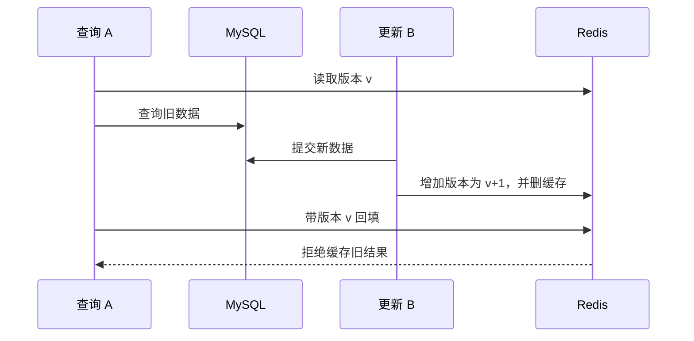

# 05 五层缓存与一致性

[返回目录](README.md) · [上一章](04-登录权限与签到.md) · [下一章：Canal](06-Canal与数据库变更同步.md)

**本章学习目标**：先从无缓存方案推导空值缓存和互斥重建，再逐层阅读当前客户端。重点是命中路径、对象快照、版本和锁 owner 的不同作用。并发时序与练习用于检验理解，不要求直接照抄复杂缓存类。

**本章导航**

- [1. 从“每次都查数据库”开始](#section-01)
- [2. 从课程最简缓存逐步推导当前方案](#section-02)
  - [第 0 版：每次查询 MySQL](#section-02-01)
  - [第 1 版：Cache Aside](#section-02-02)
  - [第 2 版：区分不存在与未缓存](#section-02-03)
  - [第 3 版：热点重建要合并请求](#section-02-04)
  - [第 4 版：同进程与跨进程各自协调](#section-02-05)
  - [第 5 版：再加读副本，必须同时加失效规则](#section-02-06)
  - [三类更新策略不要混在一起](#section-02-07)
- [3. 每层为什么存在](#section-03)
- [4. 一次未命中如何回源](#section-04)
- [5. 按实际代码走一次五层读取](#section-05)
  - [入口 queryWithMutex](#section-05-01)
  - [真正的远程读取与重建 loadLayers](#section-05-02)
  - [把请求内缓存看成一次调用的笔记本](#section-05-03)
- [6. 穿透、击穿、雪崩分别是什么](#section-06)
- [7. 为什么缓存中保存快照](#section-07)
- [8. 两种热点方案的完整比较](#section-08)
  - [互斥重建的时序](#section-08-01)
  - [逻辑过期的时序](#section-08-02)
  - [为什么 TTL 抖动不是击穿的完整解法](#section-08-03)
- [9. 为什么“删除缓存”还不够](#section-09)
  - [读懂实际回填脚本](#section-09-01)
- [10. 上层缓存怎样失效](#section-10)
- [11. 数据更新如何触发失效](#section-11)
- [12. 用三个并发时序理解一致性](#section-12)
  - [先删缓存再写库的旧值窗口](#section-12-01)
  - [先写库再失效的在途回填窗口](#section-12-02)
  - [锁过期也会产生迟到写入](#section-12-03)
  - [Memcache 的旧条目为什么可以不用立即删除](#section-12-04)
- [13. 在页面怎么验证](#section-13)
- [14. 一组能复核的缓存练习](#section-14)
  - [练习一：不用清缓存理解多层命中](#section-14-01)
  - [练习二：理解空结果](#section-14-02)
  - [练习三：数据库更新与展示](#section-14-03)
  - [练习四：并发旧加载](#section-14-04)
- [15. 面试追问与边界](#section-15)
- [16. 缓存完整推演：命中、重建、失效和观察](#section-16)
  - [从一次真实命中解释五层的成本](#section-16-01)
  - [用版本和 owner 两个条件手算一次拒绝回填](#section-16-02)
  - [上层 TTL 为什么不能从“现在”重新算一遍](#section-16-03)
  - [通知能加速失效，却不是持久消息](#section-16-04)
  - [空结果缓存的收益与代价](#section-16-05)
  - [本章实验怎样才算有结论](#section-16-06)

<a id="section-01"></a>

## 1. 从“每次都查数据库”开始

热门店铺会被许多人反复打开。如果每次都执行相同 SELECT，数据库做了大量重复工作。课程先把店铺详情放进 Redis，当前项目进一步把读取链路组织成五层：

```text
请求内缓存 → Java Caffeine → Memcache → Redis 数据缓存 → MySQL
```

最后的 MySQL 是事实来源，前四层都是查询副本。不是每条接口都使用完整五层；店铺详情和券的静态目录/元数据是主要应用场景，组合搜索、交易库存等仍有自己的数据库读取路径。

核心代码：[CacheClient](../src/main/java/com/hmdp/utils/CacheClient.java)、[RequestCacheScope](../src/main/java/com/hmdp/cache/RequestCacheScope.java)、[MemcacheStore](../src/main/java/com/hmdp/cache/MemcacheStore.java)、[ShopServiceImpl](../src/main/java/com/hmdp/service/impl/ShopServiceImpl.java)。

<a id="section-02"></a>

## 2. 从课程最简缓存逐步推导当前方案

<a id="section-02-01"></a>

### 第 0 版：每次查询 MySQL

先假设接口只有 `getById(id)`。功能容易理解，修改数据库后下一次读取就能看到，但热点店铺重复请求都要到数据库。当读远多于写时，这些重复 SELECT 是可优化的工作。

<a id="section-02-02"></a>

### 第 1 版：Cache Aside

下面是教学伪代码，用来理解基础读缓存流程，不是当前项目的完整 CacheClient：

```text
读取 Redis
如果存在可用数据：反序列化并返回
否则查询 MySQL
如果查到：序列化、设置 TTL，再返回
如果查不到：返回不存在
```

为什么叫 Cache Aside？应用自己决定何时读缓存、何时查库、何时删缓存。不是 MySQL 自动维护 Redis，也不是在 Mapper 上加一个注解就解决了一致性。

<a id="section-02-03"></a>

### 第 2 版：区分不存在与未缓存

ID=999999 从未存在。第 1 版每次都去数据库查询，攻击者或错误链接可以持续造成穿透。保存一份短期“不存在”结果后，相同 ID 才能在缓存层止住。

| Redis 读取结果 | 语义 | 后续动作 |
| --- | --- | --- |
| null | 这个 Key 没有缓存条目 | 继续回源 |
| 空字符串 | 已回源确认不存在 | 返回不存在，暂不再查库 |
| 非空 JSON | 保存过对象快照 | 解码并返回 |
| 不可解析或不匹配的内容 | 损坏/旧格式副本 | 失效并重新读取 |

空结果 TTL 要短于常用对象，原因是对象可能稍后被创建。空缓存也不能解决不断换新 ID 的全部穿透问题；参数验证、访问约束和后续 Bloom 方案各有不同职责。

<a id="section-02-04"></a>

### 第 3 版：热点重建要合并请求

热点 Key 失效时，100 个请求看到 null，如果都查库，缓存还没建好数据库已经承担 100 次查询。希望第一个请求建好后，其他请求利用同一结果。

只给“数据库查询”套锁还不够：排队拿到锁的后续请求如果不再读缓存，仍会逐个查数据库。锁内第二次检查的作用就是省掉这些重复回源。

<a id="section-02-05"></a>

### 第 4 版：同进程与跨进程各自协调

Caffeine LoadingCache 的同键加载合并覆盖本 JVM；Redis 锁覆盖不同 JVM。只使用 synchronized 无法协调两台机器；只使用 Redis 锁也会让同一实例的重复调用都产生远程竞争。

当前 LoadRequest 的 equals/hashCode 依据业务 Key 与 generation，不依据本次创建的 Supplier 对象。否则每个调用构造一个新 Supplier，可能被认为不同加载请求，无法得到预期合并。

<a id="section-02-06"></a>

### 第 5 版：再加读副本，必须同时加失效规则

请求内缓存和 Caffeine 减少重复读，Memcache 提供共享短副本。但上层不能比下层事实无上限存活，因此快照带 expiresAt，本地短 TTL 与源有效时间一起限制可用性。

理解顺序应是“每层省掉哪类工作 → 每层可能引入什么旧数据 → 哪个机制限制旧数据”，而不是越多层越好。

<a id="section-02-07"></a>

### 三类更新策略不要混在一起

| 策略 | 管什么 | 能否单独保证业务一致性 |
| --- | --- | --- |
| 内存淘汰 | 内存满时移除条目 | 不能，淘汰不是同步数据库变更 |
| TTL 过期 | 到时停止使用某条副本 | 不能，过期前仍可能旧 |
| 主动失效 | 业务变化时删除或换版本 | 还需要考虑失败与并发回填 |

当前项目用主动失效加 TTL 兜底，而不是把“有过期时间”说成数据永远正确。

<a id="section-03"></a>

## 3. 每层为什么存在

| 层 | 范围与生命周期 | 解决什么问题 | 当前限制 |
| --- | --- | --- | --- |
| 请求内 | 一次 HTTP 请求，结束清理 | 同一请求多次读同一对象 | 最多 256 项，不能跨请求共享 |
| Caffeine | 当前 Java 实例 | 高频读免去远程调用 | 最多 10000 项，写后约 5 秒失效 |
| Memcache | 共享远程短缓存 | 多实例共享短期副本 | 最长约 30 秒，不超过源快照剩余有效期 |
| Redis 数据 | 共享缓存 | 降低 MySQL 查询量 | 需要版本校验、失效与过期管理 |
| MySQL | 持久业务事实 | 未命中时提供数据 | 并发高时更昂贵 |

Memcache 命中前仍会从 Redis 读取版本。它减少的是 Redis 中完整数据读取，不意味着访问链路完全不需要 Redis。Caffeine 命中可以暂时避开远程读取，但不能据此说 Redis 故障时所有业务都可正常运行。

<a id="section-04"></a>

## 4. 一次未命中如何回源

假设第一次读取店铺 1：请求内没有，Caffeine 没有，Memcache 没有，Redis 数据也没有。当前客户端尝试获取 `lock:cache:cache:shop:1` 的 Redis 锁；拿到锁后再次检查缓存，确认仍缺失，再查询数据库，把结果写入 Redis 与上层缓存。

锁后再读叫“双重检查”：线程 A 正在查数据库，线程 B 等待；A 已经回填时，B 获得锁后应该直接用缓存，而不是继续查一次 MySQL。

本地 Caffeine 的 LoadingCache 合并同一个加载键的并发读取，远程 Redis 锁协调不同实例。锁租约约 10 秒，竞争等待有约 2 秒上限，并带短暂抖动等待。超出等待会报“热点数据正在重建”，不是无限递归，也不是无上限新建线程。

`queryWithPassThrough` 这个课程保留的方法名，目前内部实际委托给 `queryWithMutex`。不要根据方法名字认为它只是最初版的简单读缓存再查库。

<a id="section-05"></a>

## 5. 按实际代码走一次五层读取

<a id="section-05-01"></a>

### 入口 queryWithMutex

以下为 [CacheClient.java](../src/main/java/com/hmdp/utils/CacheClient.java) 的相关源码片段。为便于阅读只展示当前部分，依赖与 import 请查看原文件；无需把片段另建类复制运行。

```java
public <R, ID> R queryWithMutex(
    String prefix,
    ID id,
    Class<R> type,
    Function<ID, R> source,
    Long duration,
    TimeUnit durationUnit) {
  if (!enabled) {
    recordCacheReadOutcome("mysql", "load");
    return source.apply(id);
  }
  String key = prefix + id;
  long cacheGeneration = generation.get();
  String scopeKey = key + "@" + cacheGeneration;
  CacheSnapshot snapshot = RequestCacheScope.get(scopeKey);
  if (snapshot != null && snapshot.fresh()) {
    recordCacheReadOutcome("scope", "hit");
  } else {
    recordCacheReadOutcome("scope", "miss");
    LoadRequest request =
        new LoadRequest(
            key,
            cacheGeneration,
            calculateTtlMillisWithJitter(duration, durationUnit),
            () -> {
              R value = source.apply(id);
              return value == null ? "" : JSONUtil.toJsonStr(value);
            });
    snapshot = local.getIfPresent(request);
    if (snapshot != null && snapshot.fresh()) {
      recordCacheReadOutcome("jvm", "hit");
    } else {
      if (snapshot != null) {
        local.invalidate(request);
      }
      recordCacheReadOutcome("jvm", "miss");
      snapshot = local.get(request);
    }
    if (!snapshot.cacheable) {
      local.invalidate(request);
    } else if (cacheGeneration == generation.get()) {
      RequestCacheScope.put(scopeKey, snapshot);
    }
  }
  return snapshot.json.isEmpty() ? null : decode(snapshot.json, type);
}
```


分成四段来读：

1. `enabled=false` 时直接调用 source，便于基础环境与性能基线，不把缓存命中指标伪造出来。
2. 拼业务 Key，再记录当前 generation。请求内 Key 含 generation，因此失效后的新读不会复用旧代快照。
3. 先查 RequestCacheScope，再查/加载 Caffeine；本地条目存在但源快照不 fresh 也不能用。
4. 回源拒绝缓存时，从本地移除；只有仍处于开始时同一代，才把可缓存结果放进请求内缓存。

`source` 是回源函数，例如 `this::getById`。`Function<ID,R>` 可以先理解成“给一个 ID，返回一个对象”；这里并不是在 CacheClient 硬编码所有业务表。

最后每次通过 decode 返回自己的对象。RequestCacheScope 命中的是快照，不是一个可被所有调用共同修改的 Shop 实体。

<a id="section-05-02"></a>

### 真正的远程读取与重建 loadLayers

以下为 [CacheClient.java](../src/main/java/com/hmdp/utils/CacheClient.java) 的相关源码片段。为便于阅读只展示当前部分，依赖与 import 请查看原文件；无需把片段另建类复制运行。

```java
private CacheSnapshot loadLayers(LoadRequest request) {
  String key = request.key;
  String revision = queryCacheVersion(key);
  CacheSnapshot cached = shared.get(key, revision);
  if (cached != null && isUsableCachePayload(cached.json)) {
    recordCacheReadOutcome("memcache", "hit");
    return cached;
  }
  recordCacheReadOutcome("memcache", "miss");
  cached = readRedisSnapshot(key);
  if (cached != null) {
    shared.put(key, revision, cached);
    return cached;
  }
  return awaitOrRebuild(request);
}

private CacheSnapshot awaitOrRebuild(LoadRequest request) {
  String key = request.key;
  String lockKey = "lock:cache:" + key;
  long deadline = System.nanoTime() + TimeUnit.SECONDS.toNanos(REBUILD_WAIT_SECONDS);
  do {
    String owner = UUID.randomUUID().toString();
    if (Boolean.TRUE.equals(
        redis
            .opsForValue()
            .setIfAbsent(lockKey, owner, REBUILD_LOCK_SECONDS, TimeUnit.SECONDS))) {
      return rebuildUnderLock(request, lockKey, owner);
    }
    String polledVersion = queryCacheVersion(key);
    CacheSnapshot cached = readRedisSnapshot(key);
    if (cached != null) {
      shared.put(key, polledVersion, cached);
      return cached;
    }
    pauseBeforeRetry();
  } while (System.nanoTime() < deadline);
  throw new IllegalStateException("热点数据正在重建，请稍后重试");
}

private CacheSnapshot rebuildUnderLock(LoadRequest request, String lockKey, String owner) {
  String key = request.key;
  try {
    String revision = queryCacheVersion(key);
    CacheSnapshot cached = readRedisSnapshot(key);
    if (cached != null) {
      shared.put(key, revision, cached);
      return cached;
    }
    revision = queryCacheVersion(key);
    recordCacheReadOutcome("mysql", "load");
    String json = request.source.get();
    long ttlMillis =
        json.isEmpty()
            ? calculateTtlMillisWithJitter(RedisConstants.CACHE_NULL_TTL, TimeUnit.MINUTES)
            : request.ttlMillis;
    // 同时校验加载前版本与锁 owner；旧加载可返回给本次请求，但不能污染后续缓存。
    Long written =
        redis.execute(
            FILL,
            Arrays.asList(key, lockKey, key + ":version"),
            json,
            String.valueOf(ttlMillis),
            revision,
            owner);
    CacheSnapshot loaded =
        new CacheSnapshot(
            json, System.currentTimeMillis() + ttlMillis, Long.valueOf(1).equals(written));
    if (loaded.cacheable) {
      shared.put(key, revision, loaded);
    } else {
      recordCacheReadOutcome("fill", "fenced");
    }
    return loaded;
  } finally {
    redis.execute(UNLOCK, Collections.singletonList(lockKey), owner);
  }
}

private void pauseBeforeRetry() {
  try {
    Thread.sleep(RETRY_BASE_MILLIS + ThreadLocalRandom.current().nextInt(RETRY_JITTER_MILLIS));
  } catch (InterruptedException interrupted) {
    Thread.currentThread().interrupt();
    throw new IllegalStateException("缓存查询已中断", interrupted);
  }
}
```


| 代码位置 | 输入/输出 | 关键判断 |
| --- | --- | --- |
| version(key) | 当前 Redis 版本 | Memcache 必须按这个版本查 |
| shared.get | 共享短快照 | 内容可用才返回 |
| redisSnapshot | Redis JSON 与剩余寿命 | 没数据或结构不可用才继续 |
| setIfAbsent | owner + 10 秒 | 拿不到锁不能直接抢着回源 |
| 锁内再读 | 其他请求可能刚完成 | 命中后省掉 MySQL |
| request.source.get | 数据库结果转 JSON | 查不到转换为空字符串 |
| FILL Lua | 版本和 owner | 拒绝失去权利的旧加载者 |
| finally UNLOCK | 原 owner | 只释放自己仍持有的锁 |
| 等待与 deadline | 20～39ms 短等待、约 2 秒上限 | 限制争抢与最长等待 |

短 sleep 降低对 Redis 的忙轮询，并带随机间隔分散同时重试；不是为了人为拖慢页面。中断会恢复线程中断标记并抛出异常，不无限继续等待。

回源成功但 FILL 被拒绝时仍可返回本次读到的快照；它的 cacheable=false，不能进入共享/长期缓存。因此用户这一次可能看到旧结果，但不会持续污染之后的读取。

<a id="section-05-03"></a>

### 把请求内缓存看成一次调用的笔记本

以下为 [RequestCacheScope.java](../src/main/java/com/hmdp/cache/RequestCacheScope.java) 的相关源码片段。为便于阅读只展示当前部分，依赖与 import 请查看原文件；无需把片段另建类复制运行。

```java
package com.hmdp.cache;

import java.util.HashMap;
import java.util.Map;

/**
 * Never inherit request data into consumer/background threads. Values are immutable JSON snapshots.
 */
public final class RequestCacheScope implements AutoCloseable {
  private static final ThreadLocal<Map<String, CacheSnapshot>> CURRENT = new ThreadLocal<>();
  private final Map<String, CacheSnapshot> previous;

  private RequestCacheScope() {
    previous = CURRENT.get();
    CURRENT.set(new HashMap<>());
  }

  public static RequestCacheScope open() {
    return new RequestCacheScope();
  }

  public static CacheSnapshot get(String key) {
    Map<String, CacheSnapshot> map = CURRENT.get();
    return map == null ? null : map.get(key);
  }

  public static void put(String key, CacheSnapshot value) {
    Map<String, CacheSnapshot> map = CURRENT.get();
    if (map != null && map.size() < 256) {
      map.put(key, value);
    }
  }

  public static boolean active() {
    return CURRENT.get() != null;
  }

  @Override
  public void close() {
    if (previous == null) {
      CURRENT.remove();
    } else {
      CURRENT.set(previous);
    }
  }
}
```


open 保存之前的 scope 并开启新的 Map，close 恢复旧 scope 或 remove。这样嵌套采样或普通请求结束都能清理，不把同线程的其他请求混在一起。

put 有 256 条上限，超过上限不会继续增加。请求内缓存降低重复读取，并不允许任意大查询把大量对象长期留在 ThreadLocal。

<a id="section-06"></a>

## 6. 穿透、击穿、雪崩分别是什么

**穿透**：不断查不存在的店铺，每次都没有缓存，于是每次都去 MySQL。当前把不存在的结果缓存为空字符串，约 2 分钟过期。空字符串是“查过但不存在”，Redis 的 null 是“没有缓存”，两者要分清。当前没有完整 Bloom Filter 方案，不能把课程列举过 Bloom Filter 写成已实现。

**击穿**：一个特别热的 Key 失效，大量并发请求同时回源。当前通过 LoadingCache 合并、Redis 互斥锁和二次检查保护回源。课程还讲逻辑过期：过期后先返回旧值，后台重建。项目保留逻辑过期方法，但当前店铺主查询使用互斥链路，不能把两种策略同时描述为默认生效。

**雪崩**：大量 Key 同时失效，或缓存服务器不可用，大量流量同时落到数据库。当前普通缓存 TTL 会加入约 0～10% 的随机增量，降低同一时刻过期概率；短缓存与边界控制也有帮助。它没有替代完整的熔断、数据库容量保护与高可用设计。

普通店铺查询回源使用 `CACHE_SHOP_TTL`，基础 TTL 是 **30 分钟**，加抖动后略长；券目录/元数据基础 TTL 是 **10 分钟**。当前 `CacheChangeProjector` 的店铺主动重建仍传 **20 分钟**，因此实际 Redis TTL 还取决于最近由哪条路径填入。这个差异来自当前代码，不能只看旧记录或一个常量就说所有店铺缓存统一为 20/30 分钟；后续可以统一配置。

<a id="section-07"></a>

## 7. 为什么缓存中保存快照

如果缓存直接把同一个 `Shop` 对象交给不同请求，请求 A 给它设置 `distance` 等临时字段，请求 B 可能看到 A 的结果。线程安全容器不等于容器里的业务对象不可变。

当前缓存保存 JSON 和有效时间等快照，返回时重新解码对象。这让每个调用可以修改自己的返回副本，减少共享可变对象污染。券静态元数据读取后再填充实时库存，也不会把一次读取的库存永久写回静态缓存。

<a id="section-08"></a>

## 8. 两种热点方案的完整比较

<a id="section-08-01"></a>

### 互斥重建的时序

| 时刻 | 请求 A | 请求 B | 数据库 |
| --- | --- | --- | --- |
| t1 | 缓存未命中，取得锁 | 缓存未命中，未取得锁 | 尚未查询 |
| t2 | 锁内复查仍缺失 | 短等后查询缓存 | A 回源 |
| t3 | 回填并解锁 | 发现已填好并返回 | 一次主要重建 |

“只发生一次”是理想正常时序。锁过期、加载异常和版本改变时会有不同结果，所以还需要栅栏与边界处理，不能承诺任意故障情况下永远只有一个 SELECT。

<a id="section-08-02"></a>

### 逻辑过期的时序

Redis 保存的数据中带 expireTime。物理 Key 可以仍存在，但应用发现逻辑时间已过。一个请求取得重建锁，提交后台加载；其他请求继续读旧数据，等待下一次读取更新。

| 选择 | 用户等待 | 旧值 | 典型用途 |
| --- | --- | --- | --- |
| 互斥重建 | 未命中时可能等 | 更偏向重新查询后的结果 | 对新鲜度要求较高的展示数据 |
| 逻辑过期 | 常可先返回 | 重建完成前明确可能旧 | 能容忍短暂旧值的热点展示 |
| 交易直接校验 | 不能靠展示副本确认资格 | 缓存仅辅助展示 | 扣库存、金额与状态迁移 |

当前类保留逻辑过期实现，但店铺默认入口沿互斥链路。不要为了做“效果对比”在同一业务 Key 上混写两种不同 JSON 结构，旧包装与普通实体混用会导致解码问题。

<a id="section-08-03"></a>

### 为什么 TTL 抖动不是击穿的完整解法

抖动让不同 Key 错开过期时间，主要缓解批量失效。一个 Key 无论几点过期，都可能仍有很多人同时请求；它的重建仍需要合并和锁。不要把“随机 TTL”与“同键并发重建”视为同一个问题。

<a id="section-09"></a>

## 9. 为什么“删除缓存”还不够

考虑这个时序：A 缓存未命中，读到了旧店名；B 修改数据库并删除缓存；A 过一会儿才回填，把旧店名重新塞回缓存。此时“先写库后删缓存”仍不能阻止在途旧加载。

当前方案用**版本栅栏**：

1. 开始加载前读 `cache:shop:1:version`。
2. 失效脚本原子增加版本、删除数据并发布通知。
3. 回填脚本检查“版本仍相同”和“当前锁仍属于本次加载者”。
4. 版本已经改变或锁已换人，就拒绝回填，并记录 `fill=fenced`。

对应脚本：[cache-invalidate.lua](../src/main/resources/cache-invalidate.lua)、[cache-fill.lua](../src/main/resources/cache-fill.lua)、[unlock.lua](../src/main/resources/unlock.lua)。



拒绝回填保护的是缓存，不会自动重跑 A 的数据库 SELECT。因此正在执行的请求仍可能收到它已读到的旧快照。要理解为“防止旧结果污染后续缓存”，不能宣传每个并发读取都线性一致。

<a id="section-09-01"></a>

### 读懂实际回填脚本

以下是当前 `cache-fill.lua` 的逻辑，空格仅为便于阅读：

```lua
if redis.call('GET', KEYS[2]) ~= ARGV[4] then return 0 end
local version = redis.call('GET', KEYS[3]) or '0'
if version ~= ARGV[3] then return 0 end
redis.call('SET', KEYS[1], ARGV[1], 'PX', ARGV[2])
return 1
```

`KEYS[1]` 是数据 Key，`KEYS[2]` 是锁，`KEYS[3]` 是版本；`ARGV[1]` 是 JSON，第二个参数是毫秒 TTL，第三个是加载前版本，第四个是本次 owner。第一行拒绝已经失去锁身份的加载者；第三行拒绝读到旧版本的加载者；只有全部通过才保存数据。返回 0 表示没有回填，不等于数据库查询一定失败。

<a id="section-10"></a>

## 10. 上层缓存怎样失效

Redis 发布失效通知，Java 订阅后推进本地 generation，旧代的请求缓存和 Caffeine 加载键不再复用。当前代际方式会使该 JVM 上一代缓存整体失效，并非已经实现完全精细的每 Key 本地删除。

Redis Pub/Sub 不持久化；实例离线时可能错过通知。Caffeine 的约 5 秒短 TTL 提供局部过期边界，但这个边界只针对本地副本。如果 CDC 中断且 Redis 数据没有被删除，重新读 Redis 仍可能得到旧值，要等 CDC 恢复或 Redis TTL 到期等机制修正。

Memcache 通过 Redis 版本区分旧值；旧版本的条目不能当新版本读取，也会在短 TTL 后自然清理。

<a id="section-11"></a>

## 11. 数据更新如何触发失效

应用修改店铺时，数据库更新和 `SHOP_INVALIDATE` Outbox 任务在同一数据库事务提交。提交后立即尝试删缓存，以缩短可见延迟；持久任务后续可以继续处理，弥补进程退出或短时失败。

有人绕过 Java 在数据库直接 UPDATE，应用 Outbox 无法感知；Canal 负责这条路径，详见下一章。二者互补，不要把 Canal 当作业务事务的同步组成部分。

券目录缓存存的是目录 ID 与静态元数据；交易库存、活动时间从数据库批量读取并填入当前结果，交易入口还会再次做资格与库存校验。页面上显示“有库存”不是占到券的承诺。

<a id="section-12"></a>

## 12. 用三个并发时序理解一致性

<a id="section-12-01"></a>

### 先删缓存再写库的旧值窗口

```text
A：删缓存 ─────────────── 写新数据库
B：        缓存缺失 → 读旧数据库 → 把旧值填回
```

A 写完后没有再失效，B 的旧结果可能持续存在到 TTL。先写库后失效可以缩小这类窗口，但不能处理所有在途读取。

<a id="section-12-02"></a>

### 先写库再失效的在途回填窗口

```text
A：缓存缺失 → 读旧数据库 ────────────────── 回填旧值
B：                     写新数据库 → 失效
```

这正是当前版本校验要处理的问题。A 回填时看到版本变化，应该失去填缓存的资格。

<a id="section-12-03"></a>

### 锁过期也会产生迟到写入

A 的 SQL 很慢，10 秒锁到期；B 得到新 owner 并回填。A 恢复后既不能删除 B 的锁，也不能覆盖 B 的缓存。owner 负责锁身份，version 负责数据版本；两个校验解决不同问题。

以下为 [unlock.lua](../src/main/resources/unlock.lua) 的相关源码片段。为便于阅读只展示当前部分，依赖与 import 请查看原文件；无需把片段另建类复制运行。

```lua
-- 比较线程标示与锁中的标示是否一致
if(redis.call('get', KEYS[1]) ==  ARGV[1]) then
    -- 释放锁 del key
    return redis.call('del', KEYS[1])
end
return 0
```

以下为 [cache-invalidate.lua](../src/main/resources/cache-invalidate.lua) 的相关源码片段。为便于阅读只展示当前部分，依赖与 import 请查看原文件；无需把片段另建类复制运行。

```lua
redis.call('INCR',KEYS[2])
redis.call('DEL',KEYS[1])
redis.call('PUBLISH','hmdp.cache.invalidate',KEYS[1])
return 1
```


解锁比较和删除在同一脚本里完成，失效的版本推进、删除与通知也在同一 Redis 执行中完成。MySQL 更新仍是另一组件的事务，因此通过 Outbox 保存失效责任，而不是假定所有调用共同回滚。

<a id="section-12-04"></a>

### Memcache 的旧条目为什么可以不用立即删除

Memcache Key 使用业务 Key 的摘要和 Redis 版本。如果旧加载晚到，写的是旧版本 Key；后续读取新版本时不会碰到它，等待它短期自然过期即可。

摘要还避免直接把任意长业务 Key 带到 Memcache；版本是地址的一部分，不只是 value 里的一个展示字段。若读时不带正确版本，旧条目仍可能被误用。

以下为 [MemcacheStore.java](../src/main/java/com/hmdp/cache/MemcacheStore.java) 的相关源码片段。为便于阅读只展示当前部分，依赖与 import 请查看原文件；无需把片段另建类复制运行。

```java
public static String key(String key, String version) {
  return "hmdp:" + DigestUtil.sha256Hex(key) + ":" + version;
}
```

以下为 [MemcacheStore.java](../src/main/java/com/hmdp/cache/MemcacheStore.java) 的相关源码片段。为便于阅读只展示当前部分，依赖与 import 请查看原文件；无需把片段另建类复制运行。

```java
public boolean put(String key, String version, CacheSnapshot snapshot) {
  if (!available() || !snapshot.cacheable || !snapshot.fresh()) {
    return false;
  }
  Future<Boolean> future = null;
  try {
    // Immutable version-qualified keys make an old in-flight write unreachable after
    // invalidation.
    long remaining = Math.min(30000, snapshot.expiresAt - System.currentTimeMillis());
    if (remaining <= 0) {
      return false;
    }
    String envelope =
        JSONUtil.createObj()
            .set("json", snapshot.json)
            .set("expiresAt", Math.min(snapshot.expiresAt, System.currentTimeMillis() + 30000))
            .toString();
    future =
        connection()
            .set(key(key, version), (int) Math.max(1, (remaining + 999) / 1000), envelope);
    boolean stored = Boolean.TRUE.equals(future.get(timeoutMillis, TimeUnit.MILLISECONDS));
    count("put", stored ? "success" : "error");
    return stored;
  } catch (Exception e) {
    if (future != null) {
      future.cancel(false);
    }
    if (e instanceof InterruptedException) {
      Thread.currentThread().interrupt();
    }
    retryAfter.set(System.currentTimeMillis() + 1000);
    count("put", "error");
    return false;
  }
}
```


remaining 取源有效时间与 30 秒的较小值；包裹数据另带 expiresAt。Memcache 秒级过期向上取整后，也不能突破应用快照的有效性检查。网络错误会短暂避开 Memcache 访问，继续后续层，不保证 Redis 也不可用时能正常查询。

<a id="section-13"></a>

## 13. 在页面怎么验证

打开体验页，选择店铺，点击“连续读取 3 次”。页面会发起 3 个 HTTP 请求，每个请求对同一店铺读取 2 次，共 6 次。

重点观察：同一请求第二次出现请求内缓存命中；后续请求可能出现 Caffeine 命中；第一次读取可能来自 Memcache、Redis 或 MySQL，取决于此前是否有人读过。页面不自动清空缓存，所以不能要求每次都出现 MySQL → Redis → Caffeine 的固定序列。

显示的耗时是本次路径采样，不是完整生产性能压测。请求内命中仍有 JSON 解码成本，不能保证一定比某次 JVM 命中更小。累计指标、单请求采样和独立压测是不同证据。

<a id="section-14"></a>

## 14. 一组能复核的缓存练习

<a id="section-14-01"></a>

### 练习一：不用清缓存理解多层命中

对同一店铺读一次，记录路径；马上再读，观察请求内/JVM 命中；等超过本地短 TTL，再读，可能走 Memcache/Redis。等待不等于一定命中某层，若中途有人更新或缓存不可用，结果会不同。

页面的一次“连续读取 3 次”会同时展示同请求的二次读和跨请求的重复读。把 requestId、sequence、events 和 durationMicros 一起看，不只看一个彩色命中标签。

<a id="section-14-02"></a>

### 练习二：理解空结果

先用实际不存在的合法 ID 调公开详情接口，结果应是不存在；在自己的环境检查对应缓存空字符串和 PTTL。第二次不一定再回源。不要拿一个可能以后真实存在的 ID 在共享环境长期写入伪造空值。

<a id="section-14-03"></a>

### 练习三：数据库更新与展示

用管理员合法更新一个演示店铺，记住原值；观察应用失效与下一次读取。数据库直接 UPDATE 属于 CDC 验证，按下一章操作。两种路径不要混成一个证据。

<a id="section-14-04"></a>

### 练习四：并发旧加载

这个场景在隔离 `CacheLayersIntegrationTest.concurrentLoadingCoalescesAndInvalidatedFlightCannotPoisonNewGeneration` 中通过控制读取/失效的先后验证。仅在浏览器连续点三下，不能稳定制造“旧加载恰好晚回填”的时序。应看测试如何控制线程进度、如何断言版本拒绝和最终缓存，而不只是看测试名字。

验收结果要写“这次实际观测到哪些层、哪些计数变化”，不能预先写死“第一次必查 MySQL、第二次必走 Redis”。

<a id="section-15"></a>

## 15. 面试追问与边界

为什么多层缓存更快但更复杂？因为每多一层就多一份可能过时的副本。为什么仍读 Redis 版本？为了防止共享短缓存使用旧版本。为什么不用锁就万事大吉？锁到期后旧加载者仍可能运行，需要 owner 和 version 检查。为什么不能无限回源？缓存故障时会把压力转移给数据库。

可以继续优化热点粒度失效、缓存容量分配、回源限流、批量读取和失效通知可靠性，但这些是后续方向，不能混进当前已完成清单。

<a id="section-16"></a>

## 16. 缓存完整推演：命中、重建、失效和观察

<a id="section-16-01"></a>

### 从一次真实命中解释五层的成本

这里的五层是请求内缓存、Caffeine、Memcache、Redis 和 MySQL 回源。不是每次请求都按五层完整走一遍：早一层命中就可能结束；Memcache 关闭时则跳过相应路径。打开“五层缓存”不能理解成每个接口都经过同一套五层，先找到具体业务入口是否使用 `CacheClient`。

请求内缓存只服务当前作用域，适合同一次请求里重复取店铺；Caffeine 服务当前 Java 进程的多个请求，减少跨网络读取；Memcache 是跨进程可共享的短副本；Redis 保存更长的业务缓存和版本；MySQL 提供回源事实。多一层可以减少下一层负载，也引入了失效和寿命传播的责任。

假设读店铺 101，第一次已经命中 Redis。把它带到 Caffeine 后，第二个 HTTP 请求可能命中 Caffeine；而同一个体验采样请求内部的第二次读取可能更早命中请求内缓存。这三次成本不同，不能仅按“调用了三次接口”判断数据库执行三次 SQL。

<a id="section-16-02"></a>

### 用版本和 owner 两个条件手算一次拒绝回填

以下是教学时序，数值不来自实际压测。读线程 R 获得锁 owner=A，读取缓存版本 7，随后从 MySQL 得到旧名称。写线程 W 修改店铺并提交，失效脚本把版本变为 8、删除旧缓存、发布失效通知。R 的旧查询此时才返回。

如果只检查锁，A 仍可能持有锁，旧名称就会写回。`cache-fill.lua` 同时要求 owner 和版本匹配；版本 7 与当前 8 不一致，返回 0 拒绝写入。锁解决“谁有权重建”，版本解决“这次重建依据是否仍有效”，两个问题不同。

再换一个时序：没有发生数据库更新，但 A 加载超过锁租约，B 已经取得新锁并回填。A 返回时版本可能仍是 7，然而锁 owner 已变成 B；旧 A 仍应被拒绝。这正是第二个条件的价值。

拒绝回填不代表数据库查询没执行。请求已取到数据，但不能将被拒绝的结果当作新的共享有效副本传播。阅读 Java 时继续看 `CacheSnapshot` 的可复用标记以及当前 generation 校验，不能只验证 Lua 返回值。

<a id="section-16-03"></a>

### 上层 TTL 为什么不能从“现在”重新算一遍

假设 Redis 中一个快照只剩 3 秒。若 Memcache 读到它后又写满 30 秒，Caffeine 再从 Memcache 读时又重新延长，旧数据会靠复制不断获得新寿命。源缓存失效规则将被上层续期绕过。

因此快照携带有效截止时间，上层复制仍受源剩余寿命限制。Caffeine 的 5 秒外层过期只是一道上限；当快照自身已经失效，即使对象还留在 Caffeine，也不能继续作为正常命中使用。不要把容器中“存在一个对象”和“业务上允许返回这个对象”当成同一个状态。

Redis 返回过期信息也有特殊值：不存在与无过期时间不是相同情况。读代码时分别查看负值如何处理，而不是把所有非正数都解释成缓存为空。当前 TTL 抖动约为基础寿命的不足 10% 随机增加，是分散到期的一种方式，不能代替热点重建锁。

<a id="section-16-04"></a>

### 通知能加速失效，却不是持久消息

失效脚本发布 `hmdp.cache.invalidate`，收到通知的 Java 进程推进本地 generation。当前 generation 作用于整个本地缓存命名空间，不是只删除通知中的一个 Caffeine Key。旧加载完成后仍属于旧世代，后续请求使用新世代查询。

Redis Pub/Sub 不保存离线消费者待办单。某个进程断线错过通知，短缓存寿命仍是恢复边界之一；不能因为有通知就宣称所有节点实时强一致。Memcache 使用版本关联副本，旧条目即使未立刻物理删除，也不能因此被视为新版本可用。

这部分面试最容易被追问“消息丢了怎么办”。回答要包括通知、版本、短寿命各自覆盖的窗口，并承认它们仍不等同于每次查询都锁住数据库读取。

<a id="section-16-05"></a>

### 空结果缓存的收益与代价

反复查询不存在的店铺，如果每次都回源，会给数据库无谓压力。空结果缓存把“不存在”也短暂记住。当前基础空值 TTL 为 2 分钟，重建路径还会加抖动；它与店铺正常详情的 30 分钟 TTL 不同。

代价是新记录建立后，之前的空结果可能仍被复用，直到对应失效或寿命结束。批量导入或数据库直改时，这也是需要更新传播的原因。不要用伪造不存在 ID 的频繁请求验证全部缓存行为；先保证正常详情链路可用，再在隔离环境验证空值路径。

<a id="section-16-06"></a>

### 本章实验怎样才算有结论

做三组观察：同一个采样里的两次读、两次独立采样、发生更新后的下一次采样。分别记录 requestId、shopId、reads.events、durationMicros 和采样时间。第一次已经预热也可以是合法现象，不需要人为删除业务缓存制造 MySQL 命中。

页面采样可以证明这次读取走过哪些层；旧回填窗口需要可控并发测试。阅读 [CacheLayersIntegrationTest](../src/test/java/com/hmdp/cache/CacheLayersIntegrationTest.java) 时，标出阻塞旧加载、执行失效、释放旧加载三个位置。只有按这个顺序产生过窗口，拒绝旧值的断言才有针对性。
