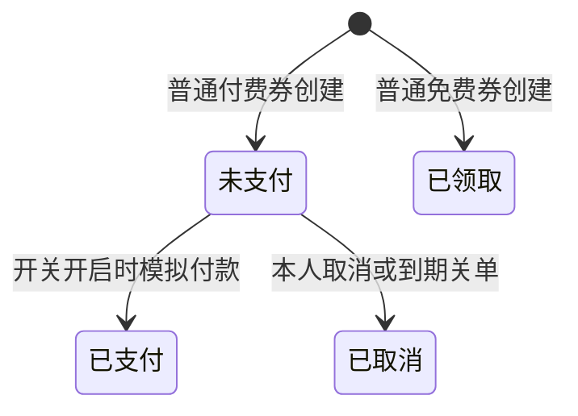

# 07 优惠券与订单生命周期

[返回目录](README.md) · [上一章](06-Canal与数据库变更同步.md) · [下一章：秒杀](08-秒杀Lua与RedisStream.md)

**本章学习目标**：先从普通领券建立同步交易的基础：资格、金额、状态和事务。再逐段读槽位锁、订单快照、付款与关单。读完应能区分重复请求、取消后重领、请求成功和收款成功。

**本章导航**

- [1. 券和订单不是一个东西](#section-01)
- [2. 普通券如何创建订单](#section-02)
- [3. 状态码与实际实现](#section-03)
- [4. 为什么订单要保存价格快照](#section-04)
- [5. 模拟支付与关单竞争](#section-05)
  - [看懂“带状态条件”的 SQL](#section-05-01)
- [6. 本人归属校验](#section-06)
- [7. 全局 ID 如何生成](#section-07)
- [8. 商品管理与准备演示券](#section-08)
- [9. 从“一人一单”推导普通券并发方案](#section-09)
  - [最简单的实现为什么会重复](#section-09-01)
  - [为什么需要一张稳定槽位表](#section-09-02)
  - [逐段读普通券 Service](#section-09-03)
  - [为什么重复成功要返回原 ID](#section-09-04)
- [10. 金额快照、状态迁移与事件如何放在一起](#section-10)
  - [价格快照的真实赋值](#section-10-01)
  - [生命周期登记为什么要求已经有事务](#section-10-02)
  - [模拟付款的每个判断都在保护什么](#section-10-03)
  - [取消与自动关单的区别](#section-10-04)
- [11. 用位运算读懂订单 ID](#section-11)
- [12. 页面验收步骤](#section-12)
- [13. 本章常见追问](#section-13)
- [14. 普通订单的完整操作与并发演算](#section-14)
  - [一次领取究竟建立了哪些东西](#section-14-01)
  - [两个同时领取的请求如何收敛到同一结果](#section-14-02)
  - [金额计算只在演示数字里做，不从当前券倒推历史](#section-14-03)
  - [付款和关单在同一刻发生，谁应该赢](#section-14-04)
  - [按状态而不是按钮点击次数验收](#section-14-05)
  - [源码阅读顺序与本章自测](#section-14-06)

<a id="section-01"></a>

## 1. 券和订单不是一个东西

优惠券是商品定义，例如“50 元代金券，售价 47.50 元”；订单是某位用户领取或购买这张券的记录。券价格与规则后来改变，历史订单应该仍使用创建时的快照。

普通券 `type=0`，秒杀券 `type=1`。普通券关注上架状态、一人一单与价格快照；秒杀券还需要库存、活动起止时间与异步履约。接口不要混用。

| 对象 | 重要字段 | 单位 |
| --- | --- | --- |
| Voucher | `payValue` 实付、`actualValue` 面额、`type`、`status` | 金额为分 |
| SeckillVoucher | `stock`、`beginTime`、`endTime` | 库存为张 |
| VoucherOrder | 用户、券、价格/规则/类型/店铺快照、状态、到期时间 | 金额为分 |

<a id="section-02"></a>

## 2. 普通券如何创建订单

入口：[VoucherOrderController](../src/main/java/com/hmdp/controller/VoucherOrderController.java)，实现：[VoucherOrderServiceImpl](../src/main/java/com/hmdp/service/impl/VoucherOrderServiceImpl.java)，SQL：[VoucherOrderMapper.xml](../src/main/resources/mapper/VoucherOrderMapper.xml)。

```text
正常登录 → POST /voucher-order/ordinary/{voucherId}
→ 获取当前用户，争取用户维度 Redisson 锁
→ 数据库事务插入并锁定 (user, voucher) 槽位
→ 校验券、查现有有效订单
→ 已有则返回同一个订单号，否则创建快照订单与生命周期事件
→ 数据库提交，释放分布式锁
```

Redisson 锁减少同一用户的竞争。数据库槽位使两个并发请求可以锁定同一个稳定的行；仅仅“查订单是否存在”不能锁住一个不存在的订单。唯一主键、行锁与事务共同完成兜底。

已经有未取消订单，重复提交返回原订单 ID。普通待付款订单取消后允许再次创建新的订单，因此“一人一单”不是“这辈子只能产生一条数据库记录”。

<a id="section-03"></a>

## 3. 状态码与实际实现

实体定义：1 未支付、2 已支付、3 已核销、4 已取消、5 退款中、6 已退款。定义了状态不代表每种转移都有完整接口。

当前普通券可体验：



“已领取”在存储上使用 status=2，因为免费券不需要真实付款；这不能证明产生了收款。真实支付、核销、退款没有完整接入。

秒杀预约另有 PROCESSING/SUCCESS/REVIEW/FAILED 状态，见第 08 章。**预约状态与订单 status 是两套不同概念**，切勿把 SUCCESS 显示为已付款。

<a id="section-04"></a>

## 4. 为什么订单要保存价格快照

假设用户领取时售价 4750 分，过一天商品调整成 4500 分。历史订单仍应以 4750 为准，不能查当前券价重新计算。当前订单保存 `pay_value_snapshot`、`title_snapshot`、`rules_snapshot`、`voucher_type_snapshot`、`shop_id_snapshot`。

价格必须由服务根据数据库读取来确定，不能信任浏览器提交“我应付 1 分”。模拟支付入口传 `expectedPayCents` 是并发和金额匹配校验，不是允许前端决定最终价格。

<a id="section-05"></a>

## 5. 模拟支付与关单竞争

模拟支付默认关闭。需要本地演示时显式设置 `HMDP_PAYMENT_MOCK_ENABLED=true` 并重新创建 Java 服务。它只用于验证状态转换，不连接支付宝、微信或银行。

付款与关单都要求订单仍处于可迁移状态。假设关单线程与支付线程同时执行，应该由数据库条件更新决定谁先成功，另一方看到状态已经变化就不能再次改成相反结果。不能采用“先查未支付，然后无条件 UPDATE”的写法。

普通待付款订单默认约 30 分钟到期。RocketMQ 定时消息到期触发关单，数据库维护任务每分钟分批扫描到期订单兜底。到期消息可能延迟，不是严格毫秒准时；未来到期任务也不能因为暂时未消费就当异常重发。

<a id="section-05-01"></a>

### 看懂“带状态条件”的 SQL

当前关单 Mapper 的核心 SQL 为：

```sql
UPDATE tb_voucher_order
SET status = 4
WHERE id = ? AND status = 1 AND expire_at <= NOW(3);
```

这里 `?` 表示绑定订单 ID，实际 XML 用 `#{orderId}`。`status=1` 限定还没付款，`expire_at<=NOW(3)` 限定确实到期；不是把所有订单直接取消。更新行数为 1，才表示本次迁移成功；为 0 时可能是已付款、已取消、未到期或对象不存在，要结合业务判断。

Service 还会检查订单类型与加行锁，并把关单后续事件写入事务。只复制这条 SQL，不代表复制了完整关单流程。

<a id="section-06"></a>

## 6. 本人归属校验

`GET /voucher-order/{id}`、`GET /voucher-order/of/voucher/{id}`、`GET /voucher-order/mine` 与体验订单进度都基于当前登录用户。知道某个订单 ID 并不意味着可以读取该订单。

取消只支持本人普通券未支付订单；当前不提供秒杀订单取消。错误账号、已经付款、已经取消、错误类型，应分别被服务判断，不允许用前端按钮限制代替校验。

<a id="section-07"></a>

## 7. 全局 ID 如何生成

[RedisIdWorker](../src/main/java/com/hmdp/utils/RedisIdWorker.java) 使用 2022-01-01 为起点，将时间差移入高位，低 32 位使用 Redis INCR 序列，Key 为 `icr:{业务前缀}:{yyyy:MM:dd}`。

低位计数按**天**而不是按秒。它不是带机器号的标准 Snowflake。当前实现使用 `LocalDateTime` 并按 UTC offset 换算，因此时区与时钟行为需要理解，不能直接宣称是严格统一 UTC 时钟方案。时钟回拨、Redis 序列丢失、多环境误共用前缀等问题属于后续可靠性设计边界。

同一天理论上低 32 位有约 2^32 个序号，实际业务远小于这个值，但还应关注每日计数 Key 的生命周期与跨环境隔离。浏览器始终把 ID 当字符串。

<a id="section-08"></a>

## 8. 商品管理与准备演示券

正常管理员可创建演示普通券与秒杀券。创建服务校验店铺存在、标题和规则长度、金额关系、活动起止时间和库存范围，并设置演示标记、上架状态与券类型。

普通券请求示例，先把店铺 ID 换成实际存在的测试店铺，使用管理员 token：

```json
{
  "shopId": 1,
  "title": "文档验证普通券",
  "subTitle": "用于本地功能体验",
  "rules": "仅用于演示，不具有真实支付价值",
  "payValue": 100,
  "actualValue": 200
}
```

用 `POST /voucher` 发送 JSON，不自行指定 id。100 分表示 1 元。每次创建会产生真实演示商品记录，建议在自己的环境按需准备，不在共享演示数据中随意批量执行。

秒杀创建用 `POST /voucher/seckill`，再增加 `stock`、`beginTime`、`endTime`；开始/结束时间必须按服务时区设置，不能照抄一个已经过期的固定日期。保存券成功不等于 Redis 活动已经准备好，需要等待发布任务并查询实际状态。

<a id="section-09"></a>

## 9. 从“一人一单”推导普通券并发方案

<a id="section-09-01"></a>

### 最简单的实现为什么会重复

教学上先写“查询这个用户有没有该券订单，没有就插入”。两个请求同时到来，都在插入前查到没有，就可能创建两条订单。问题不在 SELECT 写错，而在检查与插入之间可以插入另一个请求。

| 时刻 | 请求 A | 请求 B |
| --- | --- | --- |
| t1 | 查询无订单 | 查询无订单 |
| t2 | 判断可创建 | 判断可创建 |
| t3 | 插入订单 101 | 插入订单 102 |

给查询和插入加同一个 JVM 的 synchronized，能限制单实例线程，但多 Java 实例有不同内存锁。需要跨实例协调，同时让数据库有最终约束。

<a id="section-09-02"></a>

### 为什么需要一张稳定槽位表

数据库行锁通常锁具体记录。订单不存在时，“查现有订单 FOR UPDATE”不一定提供你期望的稳定业务互斥，也会受隔离级别、索引和间隙锁行为影响。

当前先为 `(userId,voucherId)` 插入唯一槽位，再锁该槽位。无论是否已有订单，都有一个共同可锁对象。同一用户同一券的并发事务会在这个业务身份上协调。

以下为 [VoucherOrderMapper.xml](../src/main/resources/mapper/VoucherOrderMapper.xml) 的相关源码片段。为便于阅读只展示当前部分，依赖与 import 请查看原文件；无需把片段另建类复制运行。

```sql
INSERT IGNORE INTO tb_ordinary_order_slot(user_id,voucher_id)
VALUES(#{userId},#{voucherId})
```

以下为 [VoucherOrderMapper.xml](../src/main/resources/mapper/VoucherOrderMapper.xml) 的相关源码片段。为便于阅读只展示当前部分，依赖与 import 请查看原文件；无需把片段另建类复制运行。

```sql
SELECT user_id
FROM tb_ordinary_order_slot
WHERE user_id=#{userId} AND voucher_id=#{voucherId} FOR UPDATE
```


INSERT IGNORE 用主键避免两个槽位，后续 SELECT FOR UPDATE 必须处在业务事务中；事务结束后锁释放。不能把锁槽位单独执行、提交后再创建订单，那样互斥范围已经结束。

<a id="section-09-03"></a>

### 逐段读普通券 Service

以下为 [VoucherOrderServiceImpl.java](../src/main/java/com/hmdp/service/impl/VoucherOrderServiceImpl.java) 的相关源码片段。为便于阅读只展示当前部分，依赖与 import 请查看原文件；无需把片段另建类复制运行。

```java
public Result orderOrdinaryVoucher(Long voucherId) {
  Long userId = UserHolder.getUser().getId();
  RLock lock = redissonClient.getLock("lock:order:ordinary:" + userId);
  if (!lock.tryLock()) {
    return Result.fail("订单正在处理，请稍后查询");
  }
  try {
    return transactionTemplate.execute(
        tx -> {
          baseMapper.insertOrdinarySlot(userId, voucherId);
          baseMapper.lockOrdinarySlot(userId, voucherId);
          Voucher voucher = voucherService.getById(voucherId);
          if (voucher == null
              || voucher.getStatus() == null
              || voucher.getStatus() != 1
              || voucher.getType() == null
              || !VoucherType.ORDINARY.matches(voucher.getType())) {
            return Result.fail("普通券不存在或已下架");
          }
          VoucherOrder existing =
              query()
                  .eq("user_id", userId)
                  .eq("voucher_id", voucherId)
                  .ne("status", OrderStatus.CANCELLED.getCode())
                  .orderByDesc("create_time")
                  .last("LIMIT 1")
                  .one();
          if (existing != null) {
            return Result.ok(existing.getId());
          }
          VoucherOrder order = new VoucherOrder();
          order.setId(redisIdWorker.nextId("order"));
          order.setUserId(userId);
          order.setVoucherId(voucherId);
          snapshot(order, voucher);
          // 免费券直接领取；付费券只创建待支付订单，不能冒充支付成功。
          order.setStatus(initialOrderStatus(voucher));
          if (!save(order)) {
            return Result.fail("创建订单失败");
          }
          lifecycle.registerOrderCreatedEventAndDeadline(order.getId());
          return Result.ok(order.getId());
        });
  } finally {
    lock.unlock();
  }
}
```


按“身份 → 竞争 → 事务 → 规则 → 历史 → 新单”来读：

- userId 来自当前登录态，不接受浏览器随便指定。
- Redisson 用户维度锁减少重复竞争；tryLock 失败返回忙，用户可以查询或稍后再试。
- 事务内建立并锁定券槽位，再读取当前券，确认上架且类型为普通券。
- 现有订单排除 status=4 的已取消记录，有有效单则返回原 ID。
- 创建新单时由服务生成 ID、复制快照，免费设 2、付费设 1。
- 保存后调用 lifecycle.created，在同一个事务中记录生命周期任务；finally 释放分布式锁。

当前用户锁按用户而不是用户+券划分，同一用户同时领不同券也会竞争，这是现有粒度选择。可以优化粒度，但应先确认数据库槽位和跨操作规则，不能为了“更高并发”随意删锁。

<a id="section-09-04"></a>

### 为什么重复成功要返回原 ID

网络超时不代表没创建。如果第一次已经提交，用户再点一次，返回已有 ID 能让用户继续查询这笔单；直接提示“重复下单”却不提供关联，会让用户不知道之前的结果。

幂等要区分有效历史和已取消历史。当前取消后再次领取允许新 ID，旧记录仍保留，不能用简单 `(user,voucher)` 唯一键永久禁止所有历史订单。

<a id="section-10"></a>

## 10. 金额快照、状态迁移与事件如何放在一起

<a id="section-10-01"></a>

### 价格快照的真实赋值

以下为 [VoucherOrderServiceImpl.java](../src/main/java/com/hmdp/service/impl/VoucherOrderServiceImpl.java) 的相关源码片段。为便于阅读只展示当前部分，依赖与 import 请查看原文件；无需把片段另建类复制运行。

```java
private static void snapshot(VoucherOrder order, Voucher voucher) {
  order.setShopIdSnapshot(voucher.getShopId());
  order.setPayValueSnapshot(voucher.getPayValue());
  order.setTitleSnapshot(voucher.getTitle());
  order.setRulesSnapshot(voucher.getRules());
  order.setVoucherTypeSnapshot(voucher.getType());
}
```


快照是服务从当前券复制，不是浏览器填写。100 元券的 actualValue 可以是 10000，优惠售卖 payValue 可以是 9500，两者单位都是分。

当前订单实体保存 shopIdSnapshot；但 `queryMyOrder` 中展示 `shopId` 仍从当前券读取，因此“保存了店铺快照”不代表每条展示路径都完全只使用快照。历史券被迁店时这一差别值得后续统一。

<a id="section-10-02"></a>

### 生命周期登记为什么要求已经有事务

以下为 [OrderLifecycleServiceImpl.java](../src/main/java/com/hmdp/service/impl/OrderLifecycleServiceImpl.java) 的相关源码片段。为便于阅读只展示当前部分，依赖与 import 请查看原文件；无需把片段另建类复制运行。

```java
/**
 * 在订单创建事务内初始化截止时间，并登记创建事件及延迟关单事件。
 *
 * <p>登记成功不代表已发送消息；Relay 会在业务提交后投递，回滚时事件也一起回滚。
 */
@Override
public void registerOrderCreatedEventAndDeadline(long orderId) {
  requireTransaction();
  if (timeoutMinutes < 1 || timeoutMinutes > 1440) {
    throw new IllegalStateException("普通订单超时必须在 1～1440 分钟之间");
  }
  voucherOrderMapper.initializeDeadline(timeoutMinutes, orderId);
  Map<String, Object> row = voucherOrderMapper.selectDeadline(orderId);
  Long userId = ((Number) row.get("user_id")).longValue();
  outbox.appendBusinessEvent("ORDER_CREATED", orderId, userId);
  if (row.get("expire_at") != null) {
    outbox.appendOrderExpirationEvent(orderId, userId, (Timestamp) row.get("expire_at"));
  }
}
```


requireTransaction 防止在没有业务事务时零散登记任务。先设置普通未支付单的到期时间，再写 ORDER_CREATED，有截止时间才写 ORDER_EXPIRE；免费普通券不是待付款单，不会需要相同的超时付款处理。

<a id="section-10-03"></a>

### 模拟付款的每个判断都在保护什么

以下为 [VoucherOrderServiceImpl.java](../src/main/java/com/hmdp/service/impl/VoucherOrderServiceImpl.java) 的相关源码片段。为便于阅读只展示当前部分，依赖与 import 请查看原文件；无需把片段另建类复制运行。

```java
public Result payMockOrder(Long orderId, Long expectedPayCents) {
  if (!mockPaymentEnabled) {
    return Result.fail("本地模拟支付未启用");
  }
  return transactionTemplate.execute(
      tx -> {
        Long userId = UserHolder.getUser().getId();
        VoucherOrder order = getById(orderId);
        if (order == null || !userId.equals(order.getUserId())) {
          return Result.fail("订单不存在");
        }
        Voucher voucher = voucherService.getById(order.getVoucherId());
        Long payable =
            order.getPayValueSnapshot() == null
                ? (voucher == null ? null : voucher.getPayValue())
                : order.getPayValueSnapshot();
        if (payable == null || payable <= 0 || !payable.equals(expectedPayCents)) {
          return Result.fail("支付金额不匹配，请重新查询");
        }
        if (OrderStatus.PAID.matches(order.getStatus())) {
          return Result.ok(orderId.toString());
        }
        if (!OrderStatus.UNPAID.matches(order.getStatus())) {
          return Result.fail("订单不是待支付状态");
        }
        boolean changed =
            update()
                .set("status", OrderStatus.PAID.getCode())
                .set("pay_time", LocalDateTime.now())
                .eq("id", orderId)
                .eq("user_id", userId)
                .eq("status", OrderStatus.UNPAID.getCode())
                .apply("(expire_at IS NULL OR expire_at > NOW(3))")
                .update();
        if (!changed) {
          VoucherOrder latest = getById(orderId);
          if (latest == null
              || !userId.equals(latest.getUserId())
              || !OrderStatus.PAID.matches(latest.getStatus())) {
            return Result.fail("订单状态已变化，请刷新后重试");
          }
        }
        if (changed) {
          lifecycle.registerOrderPaidEvent(orderId, userId);
        }
        return Result.ok(orderId.toString());
      });
}
```


先看开关，再看归属和金额，最后看状态条件。已支付重复请求与已取消请求不能同样处理；状态迁移成功才登记付款事件。expectedPayCents 用于核对客户端展示的金额，最终值来自快照。

模拟接口不是接收第三方支付回调。真实支付还要验签、核对渠道订单和账务、处理重复/迟到通知，不能只把这个方法名字改成 pay 就上线。

<a id="section-10-04"></a>

### 取消与自动关单的区别

以下为 [VoucherOrderServiceImpl.java](../src/main/java/com/hmdp/service/impl/VoucherOrderServiceImpl.java) 的相关源码片段。为便于阅读只展示当前部分，依赖与 import 请查看原文件；无需把片段另建类复制运行。

```java
public Result cancelUnpaidOrdinaryOrder(Long orderId) {
  return transactionTemplate.execute(
      tx -> {
        Long userId = UserHolder.getUser().getId();
        VoucherOrder order = getById(orderId);
        if (order == null || !userId.equals(order.getUserId())) {
          return Result.fail("订单不存在");
        }
        Voucher voucher = voucherService.getById(order.getVoucherId());
        if (voucher == null
            || voucher.getType() == null
            || !VoucherType.ORDINARY.matches(voucher.getType())
            || voucher.getPayValue() == null
            || voucher.getPayValue() <= 0) {
          return Result.fail("仅支持取消未支付的普通券订单");
        }
        if (OrderStatus.CANCELLED.matches(order.getStatus())) {
          return Result.ok(orderId);
        }
        if (!OrderStatus.UNPAID.matches(order.getStatus())) {
          return Result.fail("订单不是待支付状态");
        }
        boolean changed =
            update()
                .set("status", OrderStatus.CANCELLED.getCode())
                .eq("id", orderId)
                .eq("user_id", userId)
                .eq("status", OrderStatus.UNPAID.getCode())
                .update();
        if (changed) {
          lifecycle.registerOrderClosedEvent(orderId, userId);
        }
        return changed ? Result.ok(orderId) : Result.fail("订单状态已变化，请刷新后重试");
      });
}
```


本人主动取消与后台到期关闭都要检查类型和当前状态，但触发原因不同。这里没有秒杀订单取消；秒杀明确失败补偿也不等同于用户取消付款单。

已取消订单的重复取消可以按当前返回结果处理；已经付款后不能用取消接口偷偷退钱。退款是另一条商业流程，当前未实现。

<a id="section-11"></a>

## 11. 用位运算读懂订单 ID

以下为 [RedisIdWorker.java](../src/main/java/com/hmdp/utils/RedisIdWorker.java) 的相关源码片段。为便于阅读只展示当前部分，依赖与 import 请查看原文件；无需把片段另建类复制运行。

```java
public long nextId(String keyPrefix) {
  // 1.生成时间戳
  LocalDateTime now = LocalDateTime.now();
  long nowSecond = now.toEpochSecond(ZoneOffset.UTC);
  long timestamp = nowSecond - BEGIN_TIMESTAMP;

  // 2.生成序列号
  // 2.1.获取当前日期，精确到天
  String date = now.format(DateTimeFormatter.ofPattern("yyyy:MM:dd"));
  // 2.2.自增长
  long count = stringRedisTemplate.opsForValue().increment("icr:" + keyPrefix + ":" + date);

  // 3.拼接并返回
  return timestamp << COUNT_BITS | count;
}
```


`timestamp << 32` 把时间差放到高 32 位，`| count` 把每日计数合入低位。左移不是字符串拼接，按位或也不是普通加法的业务表述；由于位区间不重叠，组合出一个 Long。

举一个纯演算例子：时间差取 1，计数取 5，则结果是 `(1L << 32) | 5 = 4294967301`。真实当前时间差更大，浏览器数值安全范围可能不足，所以传输时保留字符串。

Redis 的每日 INCR 为同一业务前缀提供共享序列，重启单个 Java 不把它重新置为 0。但 Redis 数据丢失或环境前缀混用仍需处理；当前不是完整 Snowflake，也没有实现自动时钟回拨防护。

<a id="section-12"></a>

## 12. 页面验收步骤

在体验页选普通付费券，确认后提交一次，记录订单号。再次提交应返回同一个有效订单号。查看本人订单，应显示待支付和快照金额。取消后查询应显示已取消，再次领取才会生成新的 ID。

免费券直接进入已领取状态；秒杀券另走异步链路。先确认券类型与是否免费，才能解释页面上的状态和取消按钮。

如果重复请求提示“订单正在处理”，说明并发锁尚未释放，应查询原订单或稍后重试，不要认为每个重复请求都必须立即得到 ID。网络超时也不能直接断言没创建；先查本人订单，避免盲目产生新动作。

<a id="section-13"></a>

## 13. 本章常见追问

为什么有 Redis 锁还需要行锁？因为分布式锁不是数据库约束，过期或异常可能产生竞争。为什么取消后允许新订单？因为有效资格与历史记录不同。为什么要存订单事件？方便追踪、统计和异步投影。为什么不只保存券 ID？因为价格和规则可能修改，历史订单必须有稳定事实。

<a id="section-14"></a>

## 14. 普通订单的完整操作与并发演算

<a id="section-14-01"></a>

### 一次领取究竟建立了哪些东西

普通券记录描述“可以买什么”，订单记录描述“某位用户以当时的条件买了什么”。领取成功不是仅把用户 ID 加到券表里，还要建立独立订单、保存券类型和金额等快照，并登记创建事件；对待支付普通订单还会初始化截止时间和到期事件。免费券直接进入已领取状态，不应按待支付超时链路解释。

持久槽位 `tb_ordinary_order_slot(user_id,voucher_id)` 为同一用户同一券提供稳定竞争位置。它不是商品库存，也不是订单详情，而是让并发请求有一行可共同加锁。不存在的订单行不能像已有记录一样稳定充当这个入口，因此先建立槽位再加锁有实际意义。

<a id="section-14-02"></a>

### 两个同时领取的请求如何收敛到同一结果

设用户甲同时提交请求 A、B，目标是同一普通券。当前入口先使用用户级 Redisson tryLock；B 如果未拿到锁，会返回“订单正在处理”，并非自动等待后返回成功。稍后重试取得锁后，才进入数据库槽位事务。

数据库兜底层面，两次事务都尝试插入同一槽位，唯一约束使槽位不会复制为两行，再以行锁串行化检查和创建。先前事务已提交订单时，下一次请求查到既有有效订单，返回原 ID。应分别理解入口减竞争与数据库稳定互斥，不把它们说成所有并发 HTTP 请求都阻塞等待。

这种重复成功对浏览器尤其有用：网络超时后重试，用户拿回原订单，而不是看到莫名“重复购买”却不知道先前是否成功。HTTP 请求重试可以发生，订单身份不应因此随意改变。

一人一单的含义还要读状态条件。当前有效订单查询排除 CANCELLED（状态 4）；本人取消和超时关闭都使用这个关闭状态，因此关闭后的复领与尚未关闭的重复领取不同。沿着当前 Service 的状态条件判断行为，并在验收记录中说明旧订单状态。

<a id="section-14-03"></a>

### 金额计算只在演示数字里做，不从当前券倒推历史

假设券售价 1990 分，面值 3000 分，页面分别显示 19.90 元和 30.00 元。订单保存领取时快照。后来券售价改为 2290 分，已有订单仍应按原 1990 分解释，不再关联当前售价重算。

前端展示转换为元不改变数据库单位。提交支付动作也不能让浏览器指定“我要付 1 分”覆盖订单快照；当前只有模拟支付，不具备真实支付平台签名校验和资金账务闭环。

订单 ID 应在页面保持字符串。超过 JavaScript 安全整数后，两个接近的 Long 可能被表示成同一个 Number；错误 ID 继续传回后端会造成查询不存在或对象错配。ID 精度是接口契约的一部分，不只是页面格式问题。

<a id="section-14-04"></a>

### 付款和关单在同一刻发生，谁应该赢

教学时序：订单待支付且接近截止时间。线程 P 尝试模拟支付，线程 C 尝试关闭。应使用数据库锁与状态条件串行判断，而不是先在 Java 查到待支付后各自无条件覆盖。

若支付提交在前，关闭重新读取到已支付，应停止；若到期关闭提交在前，支付不能把已关闭订单改回已支付。若关闭消息提前到达，数据库当前时间尚未到期，流程只登记后续到期责任，不应因为消息名称叫 ORDER_EXPIRE 就立刻关闭。

这里的截止时间由数据库持久字段和 SQL 判断参与校验。消息延迟是触发检查的一种方式，不是最终业务真相。定时扫描也调用同一单订单关闭流程，所以不应绕过校验直接批量覆盖所有候选。

<a id="section-14-05"></a>

### 按状态而不是按钮点击次数验收

选择自己的普通券，保存领取返回的 ID。重复领取一次，比较返回身份与有效订单数；打开本人订单看金额快照和当前状态；在允许模拟支付的演示环境验证支付，否则明确记录功能开关关闭。再选另一张订单验证取消，别把第一张已支付订单强行改回待支付做实验。

检查创建、支付、关闭事件时，也保存事件 ID。一个订单可以有多条事件，订单 ID 与事件 ID 不能混用。`/experience/orders/{id}` 展示的是本人已落库订单的相关进度；对尚未持久化的秒杀预约，不应把它当通用预约状态接口。

<a id="section-14-06"></a>

### 源码阅读顺序与本章自测

先读 `VoucherOrderServiceImpl` 普通领取和本人查询，再读 `snapshot` 与初始状态，随后读 `OrderLifecycleServiceImpl` 的登记及关闭流程，最后查看 Mapper 的槽位、截止时间和条件 SQL。

请独立回答：为什么先锁槽位而不是先数订单？为什么重复请求返回原 ID？为什么关闭消息不直接代表已关闭？为什么支付开关关闭与订单系统不可用是两种现象？每个答案都应能指出一条对应判断，避免只说“加锁保证安全”而说不出锁住了什么。
