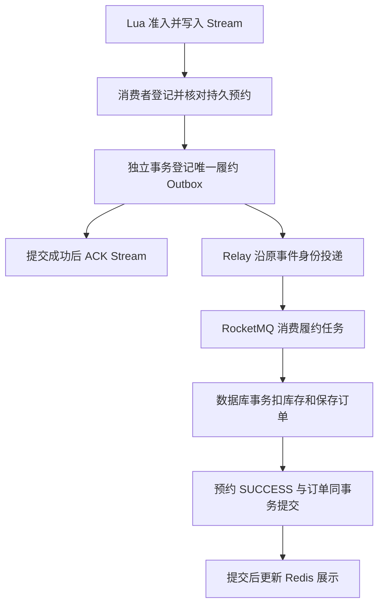

# 08 秒杀、Lua 与 Redis Stream

[返回目录](README.md) · [上一章](07-优惠券与订单生命周期.md) · [下一章：RocketMQ](09-RocketMQ可靠消息.md)

**本章学习目标**：本章从超卖与一人一单问题推导到 Lua，再把预占、Stream、持久预约、Outbox 和正式订单连接起来。学习重点是每个崩溃窗口由谁继续处理，以及补偿为什么必须认准原订单身份。

**本章导航**

- [1. 秒杀最核心的两个错误](#section-01)
- [2. Lua 在入口做什么](#section-02)
- [3. 为什么使用 Stream 而不是进程内队列](#section-03)
- [4. Pending、ACK 与接管](#section-04)
- [5. 数据库履约如何兜底](#section-05)
- [6. 请求的四种状态](#section-06)
- [7. 补偿为什么要核对原订单 ID](#section-07)
- [8. 发布、恢复与对账](#section-08)
- [9. 分布式锁的课程知识怎么用](#section-09)
- [10. 从超卖时序推导入口和履约两级校验](#section-10)
  - [单线程代码正确，不代表并发正确](#section-10-01)
  - [悲观与乐观方案怎么比较](#section-10-02)
- [11. 从 SET NX EX 推导可靠解锁](#section-11)
  - [为什么 SETNX 后再 EXPIRE 不够](#section-11-01)
  - [owner 为什么不能只是 true](#section-11-02)
  - [Redisson 增加了什么，仍未增加什么](#section-11-03)
- [12. 把秒杀 Lua 按六组 Key 逐行拆开](#section-12)
- [13. 从 List、Pub/Sub 到 Stream 消费者组](#section-13)
  - [用独立 Key 学习命令](#section-13-01)
  - [当前消费者循环怎样同时处理新消息和旧责任](#section-13-02)
- [14. 持久交接的崩溃窗口逐个分析](#section-14)
- [15. 数据库履约与精确补偿代码导读](#section-15)
- [16. 验证路线](#section-16)
- [17. 秒杀从入口受理到最终订单的责任地图](#section-17)
  - [先给三种状态分别起名字](#section-17-01)
  - [库存为 2 时，逐步算出中间差异](#section-17-02)
  - [Stream ACK 之前，必须知道谁接过责任](#section-17-03)
  - [持久交接重放为什么不能换一个订单号](#section-17-04)
  - [精确补偿为什么比库存加一复杂](#section-17-05)
  - [活动恢复为什么必须先停止不确定性](#section-17-06)
  - [读者怎么把一次 PROCESSING 定位到具体段](#section-17-07)

<a id="section-01"></a>

## 1. 秒杀最核心的两个错误

十张券同时被很多人抢，如果所有请求都先读“库存=10”再各自减 1，就可能超卖；同一个用户连续点十次，如果没有资格约束，还可能占十张。

课程先用 SQL `stock > 0` 条件更新防超卖，再引入一人一单和分布式锁，最后把高并发入口移到 Redis Lua。当前项目保留数据库条件扣减和唯一资格，Redis 负责快速预占，后台负责持久履约。

```text
浏览器提交 → Lua 原子预占并 XADD → 返回订单 ID（已受理）
→ Stream 消费登记预约 → 数据库持久 Outbox 交接 → ACK Stream
→ RocketMQ → 数据库条件扣库存并保存订单 → 预约 SUCCESS
```

这个流程分两阶段：**入口预占**与**数据库履约**。两者之间有在途状态，并不处在同一个跨组件事务中。

<a id="section-02"></a>

## 2. Lua 在入口做什么

源码：[seckill.lua](../src/main/resources/seckill.lua)、[VoucherOrderServiceImpl](../src/main/java/com/hmdp/service/impl/VoucherOrderServiceImpl.java)。

脚本显式接收库存、买家、Stream、活动元信息、用户订单映射与请求状态这些 Key。它先检查 Key 类型、活动状态与起止时间，使用 Redis TIME 判断入口时间；再检查重复资格和剩余库存；允许时一次执行：减 Redis 库存、登记买家、关联用户与订单、保存 PROCESSING 请求状态、写入 Stream。

| 返回值 | 含义 | 前端应理解为 |
| --- | --- | --- |
| 0 | 预占与入队成功 | 已受理，继续查询状态 |
| 1 | 无剩余库存 | 本次没有拿到资格 |
| 2 | 已有购买资格 | 返回已有订单号或查询原处理状态 |
| 3 | 活动未就绪、暂停或不在时段 | 当前不能提交 |
| 4 | 数据结构异常 | 需要排查，不能继续随意覆盖 |

重复资格优先于售罄判断，所以即使后来库存为零，重复请求仍有机会找到自己的原订单 ID，而不是错误地告诉已受理用户“你没抢到”。

Lua 将入口的多步 Redis 命令串行执行，避免其他请求插入检查与扣减之间。当前脚本先检查类型，减少执行到一半才遇到 WRONGTYPE 的风险。不要把“Lua 原子执行”说成 MySQL 与 Redis 共同提交；本项目没有这样的跨库事务。

请求状态 Hash 设置约 7 天过期。持久预约登记后，以数据库事实为准；Redis 状态只是用户查询的临时投影。

<a id="section-03"></a>

## 3. 为什么使用 Stream 而不是进程内队列

进程内 BlockingQueue 在服务退出时可能丢掉未处理任务，且多个实例各自有一份队列。Redis Stream 可以在 Redis 持久化与消费者组机制之上保存待处理记录和确认进度。

当前使用 `stream.orders`，消费者组 `g1`，每个 Java worker 使用唯一消费者名。消费者读新消息并处理，也会检查 pending。读到一条消息不等于删除它；只有 ACK 后，该组才认为消息完成了交接或处理。

AOF 当前配置 `appendfsync always`，是本地提高入口持久性的选择，仍不能替代多副本容灾，也会有性能成本。不要为“演示快速”直接清空 Redis 或删除 Stream。

<a id="section-04"></a>

## 4. Pending、ACK 与接管

读到但未确认的消息在组的 pending 列表中。假设旧消费者突然退出，新消费者需要处理旧 pending，而不只是不断读取新消息。

[SeckillServiceImpl](../src/main/java/com/hmdp/service/impl/SeckillServiceImpl.java) 会扫描并接管空闲达到约 30 秒的消息；扫描游标轮转，避免坏消息一直卡住前面。接管不代表旧消费者一定停止，因此后续处理仍必须幂等。

关键时机：启用 MQ 交接时，先确认预约身份，再把 `SECKILL_FULFILL` Outbox 写入 MySQL，提交后才 ACK Stream。即使 ACK 后 Java 重启，Outbox 已经接过持久任务；MQ 暂时不可用也可以后续继续投递。

当前预约登记与 Outbox 交接有各自事务步骤，不是“读取 Stream 后所有动作一个大事务”。如果崩溃发生在预约登记后、Outbox 交接前，未 ACK 的消息仍可重放并继续交接。Outbox 幂等键 `seckill:{orderId}` 防止重复创建有效交接任务。

没有开启 MQ 交接时，当前消费服务仍能走直接数据库履约分支。这是功能开关下的路径差异，不要把关闭 MQ 的测试说成跑过了真实 RocketMQ。

<a id="section-05"></a>

## 5. 数据库履约如何兜底

后台履约校验预约与订单身份，按 `stock > 0` 条件减少 MySQL 库存，并保存订单与快照。数据库更新必须确认受影响行数，不能只认为 SQL 执行没有异常就成功。

重复消息若对应同一成功业务，应恢复查询状态并确认，不再扣库存。相同 orderId 如果携带不同用户或券，则属于冲突消息，隔离保存死信，不能因为 ID 相同就返回成功，也不能释放真正用户的资格。

秒杀预约约束 `voucher_id,active_user` 与订单身份核对共同兜底；数据库事务失败不会自动撤销 Redis 预占。系统需要保留处理中/复核状态，或在明确失败后执行指定补偿。

<a id="section-06"></a>

## 6. 请求的四种状态

| 状态 | 事实 | 用户操作与运维含义 |
| --- | --- | --- |
| PROCESSING | 已受理或已经交接，尚未完成持久订单 | 等待并查询，重复提交应关联原 ID |
| SUCCESS | 订单持久化成功 | 查本人订单，另看付款状态 |
| REVIEW | 超过自动处理边界或需要人工确认 | 复核身份、任务、库存，不能当作失败直接释放 |
| FAILED | 已明确失败并进入对应释放/补偿路径 | 可按实际结果重新参与，不能影响后续新预约 |

`GET /voucher-order/requests/{id}` 会校验请求归属；数据库预约存在时优先用数据库事实，未登记时再读 Redis。网络错误不是 FAILED；MQ 不可用也不是立即退还库存的理由。

登记/处理故障会累计尝试；当前自动尝试达到配置上限（默认 5）后，部分预约进入 REVIEW 并保存死信。非法冲突消息按消息 ID 隔离，不替真正预约伪造失败。

<a id="section-07"></a>

## 7. 补偿为什么要核对原订单 ID

[seckill-compensate.lua](../src/main/resources/seckill-compensate.lua) 不只是 `INCR stock`。它先检查活动用户映射仍指向这次原订单，匹配才移除对应买家、释放预占并标记失败。

假设旧请求已失败，用户又拿到了新请求。旧补偿重复到达，如果只按 userId 释放，会误释放新请求，甚至让库存增加两次。匹配原订单身份与幂等处理可以避免这类“迟到补偿”错误。

库存预占属于稀缺资格，补偿必须在明确业务失败后执行。不能看到消息超时就立即释放，同时让后台继续履约，否则相当于同一张券又卖一次。

<a id="section-08"></a>

## 8. 发布、恢复与对账

发布把合法活动的元信息、库存与资格索引准备到 Redis。系统自动发布只针对未使用、无未解决预约、无相关在途条件的活动。已经发布或使用过的活动丢了 Redis 状态，会先关闭入口，要求受控恢复，避免把初始库存重新作为可卖库存。

管理员可以查看 `/ops/seckill/{voucherId}/reconcile`，报告初始库存、数据库剩余、订单数、未解决预约和 Redis 剩余。最基本的数据库关系是：

```text
初始库存 = 数据库剩余库存 + 已持久订单数
```

Redis 还包含未完成预占，不能要求所有时刻都直接等于 MySQL 剩余。对账接口只报告差异，不覆盖库存。

恢复操作会先关闭 admission，再依据可见事实重建相关状态。若 Redis 中“已受理但尚未登记到数据库”的 Stream 消息已经永久丢失，数据库不能凭空还原它。承认这个窗口，才能解释当前持久化设计的作用与高可用的后续需求。

<a id="section-09"></a>

## 9. 分布式锁的课程知识怎么用

课程从 SET NX EX、owner 比较删除，到 Lua 原子解锁，再到 Redisson 可重入锁与 watchdog。可以把锁理解为“限定时间、带身份的使用权”。解锁必须原子比较 owner 与删除；先 GET 再 DEL 仍会出现租约过期后的误删。

Redisson 的看门狗可以在适用调用方式下续期，不能保证持有进程永远存活，也不能替代数据库约束。Redis Cluster 下 Lua 涉及多个 Key 要在同一 slot，当前 Key 布局不能直接宣称已经支持 Cluster，无需把单机脚本当成集群版实现。

<a id="section-10"></a>

## 10. 从超卖时序推导入口和履约两级校验

<a id="section-10-01"></a>

### 单线程代码正确，不代表并发正确

教学伪代码先检查 `stock>0` 再 UPDATE。当最后只剩 1 张时，A、B 都在更新前读到 1，可能都认为可创建。读取结果只是那个时刻的观察，不是独占资格。

把条件放到数据库更新里：

```sql
UPDATE tb_seckill_voucher
SET stock = stock - 1
WHERE voucher_id = ? AND stock > 0;
```

只在当前行仍有库存时更新，第二个竞争者会看到条件不满足、影响 0 行。它能防库存小于 0，但不能单独防同一用户多次购买，也不能减少每个请求到数据库竞争的成本。

<a id="section-10-02"></a>

### 悲观与乐观方案怎么比较

| 方案 | 思路 | 问题与适用范围 |
| --- | --- | --- |
| 本地 synchronized | 一个 JVM 中顺序执行 | 不覆盖其他实例 |
| 数据库 FOR UPDATE | 事务持有行锁 | 正确但热点竞争可能大 |
| 比对旧 stock/version | 数据没变化才更新 | 正常库存变化也可能令本次失败，需要设计重试 |
| stock>0 条件更新 | 还有库存就原子减一 | 配合唯一资格，作为履约兜底 |
| Redis Lua 预占 | 更早过滤库存与资格 | 需要持久履约、状态查询与恢复 |

当前不是用 Redis 替代 MySQL 的最终库存约束，而是在入口先挡住大量没有资格的请求，再保留数据库条件更新。

<a id="section-11"></a>

## 11. 从 SET NX EX 推导可靠解锁

<a id="section-11-01"></a>

### 为什么 SETNX 后再 EXPIRE 不够

如果 SETNX 成功，程序在 EXPIRE 前退出，就留下没有租约的锁。锁与期限应在一次获取操作中写入。当前 StringRedisTemplate 的 setIfAbsent 带超时，对应这种带期限的获取。

<a id="section-11-02"></a>

### owner 为什么不能只是 true

A 卡住，锁过期，B 获取同名锁；A 恢复执行 DEL，若没有身份就删掉 B 的锁。owner 应标识持有者，且比较与删除必须原子，否则比较后锁换人仍有误删窗口。

以下为 [SimpleRedisLock.java](../src/main/java/com/hmdp/utils/SimpleRedisLock.java) 的相关源码片段。为便于阅读只展示当前部分，依赖与 import 请查看原文件；无需把片段另建类复制运行。

```java
public boolean tryLock(long timeoutSec) {
  // 获取线程标示
  String threadId = ID_PREFIX + Thread.currentThread().getId();
  // 获取锁
  Boolean success =
      stringRedisTemplate
          .opsForValue()
          .setIfAbsent(KEY_PREFIX + name, threadId, timeoutSec, TimeUnit.SECONDS);
  return Boolean.TRUE.equals(success);
}
```

以下为 [SimpleRedisLock.java](../src/main/java/com/hmdp/utils/SimpleRedisLock.java) 的相关源码片段。为便于阅读只展示当前部分，依赖与 import 请查看原文件；无需把片段另建类复制运行。

```java
public void unlock() {
  // 调用lua脚本
  stringRedisTemplate.execute(
      UNLOCK_SCRIPT,
      Collections.singletonList(KEY_PREFIX + name),
      ID_PREFIX + Thread.currentThread().getId());
}
```


这是保留的课程锁实现，用进程 UUID 前缀加线程 ID 标识 owner，并调用 unlock.lua。当前普通/秒杀履约使用 Redisson，缓存重建使用 UUID owner + Lua；不是所有入口都直接使用这个 SimpleRedisLock。

<a id="section-11-03"></a>

### Redisson 增加了什么，仍未增加什么

可重入让同一持有线程嵌套获取同一锁时能继续执行，用计数决定最终释放；获取重试与通知减少盲目自旋；适用获取方式下的 watchdog 续期降低长业务超过固定租约的风险。

续期仍依赖进程与连接正常，暂停、网络故障、节点切换并不消失。显式固定 lease 的调用与自动续期调用要分清，数据库唯一键和身份核对也不能省略。

<a id="section-12"></a>

## 12. 把秒杀 Lua 按六组 Key 逐行拆开

| 位置 | 业务意义 | 类型 |
| --- | --- | --- |
| KEYS[1] | 活动入口库存 | String |
| KEYS[2] | 已有资格用户集合 | Set |
| KEYS[3] | 待交接消息 | Stream |
| KEYS[4] | 活动状态、起止时间 | Hash |
| KEYS[5] | 用户对应的这次订单 | Hash |
| KEYS[6] | 当前订单的查询状态 | Hash |

ARGV[1] 是券 ID，ARGV[2] 是用户 ID，ARGV[3] 是服务生成的订单 ID。Lua 数组从 1 开始，不要用 Java 数组的下标习惯解释 KEYS[0]。

以下为 [seckill.lua](../src/main/resources/seckill.lua) 的相关源码片段。为便于阅读只展示当前部分，依赖与 import 请查看原文件；无需把片段另建类复制运行。

```lua
-- All accessed keys are explicit. This deployment uses a single Redis instance.
-- KEYS: stock, buyers(set), stream, activity(hash), user->order(hash), request(hash).
local types={'string','set','stream','hash','hash','hash'}
for i=1,6 do
  local t=redis.call('TYPE',KEYS[i]).ok
  if t~='none' and t~=types[i] then return 4 end
end
local stock=tonumber(redis.call('GET',KEYS[1]))
local start=tonumber(redis.call('HGET',KEYS[4],'begin'))
local finish=tonumber(redis.call('HGET',KEYS[4],'end'))
if not stock or not start or not finish or redis.call('HGET',KEYS[4],'state')~='ACTIVE' then return 3 end
local clock=redis.call('TIME')
local now=tonumber(clock[1])*1000+math.floor(tonumber(clock[2])/1000)
if now<start or now>finish then return 3 end
-- Duplicate status remains queryable even after inventory is sold out.
if redis.call('SISMEMBER',KEYS[2],ARGV[2])==1 then return 2 end
if stock<=0 then return 1 end
redis.call('DECR',KEYS[1])
redis.call('SADD',KEYS[2],ARGV[2])
redis.call('HSET',KEYS[5],ARGV[2],ARGV[3])
redis.call('HSET',KEYS[6],'orderId',ARGV[3],'userId',ARGV[2],'voucherId',ARGV[1],'state','PROCESSING')
redis.call('EXPIRE',KEYS[6],604800)
redis.call('XADD',KEYS[3],'*','userId',ARGV[2],'voucherId',ARGV[1],'id',ARGV[3])
return 0
```


第一段 TYPE 检查使 Key 为不存在或指定类型时才继续。库存存在但活动缺少 begin/end 或不 ACTIVE 时拒绝，不把半准备活动当成可抢。

第二段读取 Redis TIME 并转换成毫秒，与活动时间比较。入口时间用 Redis 视角，但创建活动的本地日期仍需要正确的时区转换；两者不是自然相同。

第三段先识别已有资格，再判断售罄。新请求被允许后 DECR、SADD、映射、请求 Hash、过期和 XADD 组成这次入口操作。XADD 的 ID 是消息位置，不是业务 orderId，业务身份保存为字段 id。

Java 收到返回 2，会尝试查询原订单映射/事实并返回原业务 ID；它不是每次重复都重新抢一个名额。

<a id="section-13"></a>

## 13. 从 List、Pub/Sub 到 Stream 消费者组

| 队列方式 | 消费后记录 | 能否重新追消息 | 这里的取舍 |
| --- | --- | --- | --- |
| List 弹出 | 通常已从列表移除 | 需要另建处理中记录 | 单纯弹出后退出易丢处理责任 |
| Pub/Sub | 在线订阅即时接收 | 无持久消费进度 | 适合失效通知，不作为秒杀可靠入口队列 |
| Stream 普通 XREAD | 日志可保留 | 从记录位置读取 | 自己维护消费位置，不能每次用 $ |
| Stream 消费组 | 已读未 ACK 留 pending | 可重放与接管 | 当前入口的持久交接方式 |

消费者组不是“每个消费者都执行每条消息”。同组分配工作；不同组可各自处理同一流。`>` 读组内未投递的新记录，`0` 等位置用于当前消费者的 pending 读取；其他已退出消费者的 pending 还需要接管。

<a id="section-13-01"></a>

### 用独立 Key 学习命令

下面在自己的 Redis 练习环境运行，Key 为 `tutorial:orders`，不触碰真实 stream.orders：

```text
XGROUP CREATE tutorial:orders tutorial-g 0 MKSTREAM
XADD tutorial:orders * userId 1 voucherId 2 id 1001
XREADGROUP GROUP tutorial-g worker-a COUNT 1 STREAMS tutorial:orders >
XPENDING tutorial:orders tutorial-g
```

记下实际返回的消息 ID，再 `XACK tutorial:orders tutorial-g 实际消息ID`。随后 XPENDING 数量应减少；XRANGE 可能仍看得到消息，因为 ACK 是消费者组确认，不等于从 Stream 删除日志。练习完成 DEL tutorial:orders 清理自己创建的练习 Key。

<a id="section-13-02"></a>

### 当前消费者循环怎样同时处理新消息和旧责任

以下为 [SeckillServiceImpl.java](../src/main/java/com/hmdp/service/impl/SeckillServiceImpl.java) 的相关源码片段。为便于阅读只展示当前部分，依赖与 import 请查看原文件；无需把片段另建类复制运行。

```java
private void consumeOrderStreamMessages() {
  while (running && !Thread.currentThread().isInterrupted()) {
    try {
      List<MapRecord<String, Object, Object>> records =
          redis
              .opsForStream()
              .read(
                  Consumer.from(GROUP, consumer),
                  StreamReadOptions.empty().count(10).block(Duration.ofSeconds(1)),
                  StreamOffset.create(STREAM, ReadOffset.lastConsumed()));
      if (records != null) {
        for (MapRecord<String, Object, Object> record : records) {
          handleOrderStreamMessage(record);
        }
      }
      // XCLAIM transfers idle entries from any dead/slow consumer, not just this worker's
      // own PEL.
      reclaimPending();
      pendingSize.set(redis.opsForStream().pending(STREAM, GROUP).getTotalPendingMessages());
    } catch (RuntimeException e) {
      if (!running) {
        break;
      }
      log.warn("秒杀消费暂时失败，将重试", e);
      try {
        Thread.sleep(1000);
      } catch (InterruptedException interrupted) {
        Thread.currentThread().interrupt();
      }
    }
  }
}
```

以下为 [SeckillServiceImpl.java](../src/main/java/com/hmdp/service/impl/SeckillServiceImpl.java) 的相关源码片段。为便于阅读只展示当前部分，依赖与 import 请查看原文件；无需把片段另建类复制运行。

```java
private void reclaimPending() {
  Range<String> range =
      "-".equals(pendingCursor) ? Range.unbounded() : Range.leftOpen(pendingCursor, "+");
  PendingMessages pending = redis.opsForStream().pending(STREAM, GROUP, range, 50);
  // Rotate even past entries which are not idle yet, so a young first page cannot starve the
  // tail.
  pendingCursor = "-";
  for (PendingMessage message : pending) {
    if (pending.size() == 50) {
      pendingCursor = message.getId().getValue();
    }
    long delay =
        idleMillis * Math.min(16, 1L << Math.min(4, (int) message.getTotalDeliveryCount() - 1));
    if (message.getElapsedTimeSinceLastDelivery().toMillis() < delay) {
      continue;
    }
    for (MapRecord<String, Object, Object> record :
        claim(consumer, Duration.ofMillis(delay), message.getId())) {
      handleOrderStreamMessage(record);
    }
  }
}
```


新消息每批最多约 10 条，阻塞读取约 1 秒，不会不停空轮询。处理后检查 pending 并更新指标。

接管扫描每页约 50 条，游标会转过未到接管时间的条目，避免年轻消息挡住后面的旧 pending。默认基础 idle 30 秒，重投次数增加时等待会放大，上限约 16 倍基础时间；不是所有 pending 恰好 30 秒就无条件再执行。

旧消费者可能只是慢，不是真的停止，所以 XCLAIM 后仍要通过预约行锁、身份和数据库幂等防双重效果。

<a id="section-14"></a>

## 14. 持久交接的崩溃窗口逐个分析

以下为 [SeckillServiceImpl.java](../src/main/java/com/hmdp/service/impl/SeckillServiceImpl.java) 的相关源码片段。为便于阅读只展示当前部分，依赖与 import 请查看原文件；无需把片段另建类复制运行。

```java
/**
 * 登记抢购资格，并核对重复订单号的用户、券是否一致。
 *
 * <p>INSERT IGNORE 只避免重复写入，不能证明消息身份正确；冲突消息必须单独隔离。
 */
private void registerAndValidateReservation(VoucherOrder order) {
  seckillReservationMapper.insertReservation(
      order.getId(), order.getVoucherId(), order.getUserId());
  SeckillReservation reservation = seckillReservationMapper.selectReservation(order.getId());
  if (reservation == null
      || !reservation.getVoucherId().equals(order.getVoucherId())
      || !reservation.getUserId().equals(order.getUserId())) {
    throw new InvalidOrderMessage("秒杀资格或订单号冲突，需核对");
  }
}
```

以下为 [SeckillServiceImpl.java](../src/main/java/com/hmdp/service/impl/SeckillServiceImpl.java) 的相关源码片段。为便于阅读只展示当前部分，依赖与 import 请查看原文件；无需把片段另建类复制运行。

```java
/**
 * 在事务中登记持久履约任务，把后续投递交给 Outbox。
 *
 * <p>调用者必须等事务提交成功后再 ACK Stream；否则进程崩溃会丢掉尚未持久化的工作。
 */
private void enqueueFulfillmentTask(VoucherOrder order) {
  transactions.execute(
      tx -> {
        businessOutboxMapper.insertSeckillFulfillment(
            order.getId(), order.getUserId(), "seckill:" + order.getId());
        // An explicit reservation retry can re-publish the same quarantined event.
        businessOutboxMapper.retryFulfillment("seckill:" + order.getId());
        return null;
      });
  metrics.counter("hmdp.seckill.handoffs", "result", "durable").increment();
}
```


| 崩溃时刻 | 已保存在哪里 | 谁继续处理 |
| --- | --- | --- |
| Lua 前 | 没有接受资格 | 用户可按响应重试 |
| Lua 后、登记前 | Redis 预占与 Stream | 未确认消息消费/接管 |
| 预约登记后、Outbox 前 | Redis + MySQL 预约 | Stream 未 ACK，重放继续交接 |
| Outbox 提交后、ACK 前 | MySQL 预约与待办已存在 | Stream 重放幂等核对，不再建重复有效任务 |
| Stream ACK 后、MQ 前 | MySQL Outbox | Relay 重试投递 |
| MQ 重复投递 | 同一任务与预约身份 | Inbox/订单约束防重复 |
| MySQL 成功、Redis 状态写失败 | 订单与预约 SUCCESS | 查询以持久事实为准，展示后续修复 |

这张表是理解为何同时出现 Stream、预约与 Outbox 的关键。多加一张表是为转移处理责任，不是为了凑架构名词。

<a id="section-15"></a>

## 15. 数据库履约与精确补偿代码导读

以下为 [VoucherOrderServiceImpl.java](../src/main/java/com/hmdp/service/impl/VoucherOrderServiceImpl.java) 的相关源码片段。为便于阅读只展示当前部分，依赖与 import 请查看原文件；无需把片段另建类复制运行。

```java
protected void createVoucherOrder(VoucherOrder voucherOrder) {
  Long userId = voucherOrder.getUserId();
  Long voucherId = voucherOrder.getVoucherId();
  RLock lock = redissonClient.getLock("lock:order:" + userId);
  if (!lock.tryLock()) {
    throw new IllegalStateException("订单锁忙，保留消息重试");
  }
  try {
    transactionTemplate.execute(
        status -> {
          if (coordinator != null && !coordinator.lockReservationForFulfillment(voucherOrder)) {
            return null;
          }
          VoucherOrder existing = getById(voucherOrder.getId());
          if (existing != null) {
            if (!userId.equals(existing.getUserId())
                || !voucherId.equals(existing.getVoucherId())) {
              throw new IllegalStateException("订单号冲突");
            }
            if (coordinator != null) {
              coordinator.markReservationSuccessful(voucherOrder.getId());
            }
            return null;
          }
          if (query().eq("user_id", userId).eq("voucher_id", voucherId).count() > 0) {
            throw new IllegalStateException("资格对应的订单号不一致，保留消息核对");
          }
          boolean deducted =
              seckillVoucherService
                  .update()
                  .setSql("stock = stock - 1")
                  .eq("voucher_id", voucherId)
                  .gt("stock", 0)
                  .update();
          if (!deducted) {
            throw new IllegalStateException("库存不足，保留消息核对");
          }
          Voucher voucher = voucherService.getById(voucherId);
          if (voucher == null) {
            throw new IllegalStateException("商品不存在，保留消息核对");
          }
          snapshot(voucherOrder, voucher);
          voucherOrder.setStatus(initialOrderStatus(voucher));
          if (!save(voucherOrder)) {
            throw new IllegalStateException("订单写入失败，回滚库存");
          }
          if (coordinator != null) {
            coordinator.markReservationSuccessful(voucherOrder.getId());
          }
          return null;
        });
  } finally {
    lock.unlock();
  }
}

private static int initialOrderStatus(Voucher voucher) {
  boolean freeVoucher = voucher.getPayValue() != null && voucher.getPayValue() == 0L;
  return freeVoucher ? OrderStatus.PAID.getCode() : OrderStatus.UNPAID.getCode();
}
```


履约先锁用户，再在事务中锁预约，只有 PROCESSING 可继续。已存在同 orderId 的订单要核对用户与券；同用户同券却是不同订单 ID 时，进入核对错误而不是直接冒充成功。

条件扣库存、快照、订单保存与预约 SUCCESS 在数据库事务内。订单写失败会抛异常回滚数据库库存；Redis 预占不会被这个数据库回滚自动撤销，所以错误留在可重试/复核链路。

以下为 [seckill-compensate.lua](../src/main/resources/seckill-compensate.lua) 的相关源码片段。为便于阅读只展示当前部分，依赖与 import 请查看原文件；无需把片段另建类复制运行。

```lua
local types={'string','set','hash','hash'}
for i=1,4 do
 local t=redis.call('TYPE',KEYS[i]).ok
 if t~='none' and t~=types[i] then return -2 end
end
local stock=redis.call('GET',KEYS[1])
if not stock or not tonumber(stock) then return -1 end
-- Only compensate the exact reservation, once; never release a later request.
local owner=redis.call('HGET',KEYS[3],ARGV[1])
if owner~=ARGV[2] then return 0 end
redis.call('HDEL',KEYS[3],ARGV[1])
redis.call('SREM',KEYS[2],ARGV[1])
redis.call('INCR',KEYS[1])
redis.call('HSET',KEYS[4],'state','FAILED')
return 1
```


用 A 用户旧订单 1001、新订单 1002 演算：映射已是 1002 时，旧补偿拿 ARGV[2]=1001，owner 不匹配返回 0，不删资格也不加库存。真正匹配 1002 的明确失败补偿才释放一次；第二次同补偿映射已删除，也不会再加一。

stock 缺失返回 -1、类型异常返回 -2，是“无法安全补偿”，不能当“已经退还”。需要复核与恢复，不创造一个不知道是否正确的新库存数。

<a id="section-16"></a>

## 16. 验证路线

页面可以验证真实有效活动的提交、原 ID 幂等返回、PROCESSING → SUCCESS 与本人订单。数据库唯一约束、消费重放、宕机接管、补偿错配和库存并发应在隔离测试环境验证，见第 13 章。

没有有效秒杀活动时，页面不能凭空验证秒杀，应由管理员准备活动。不要把普通券重复领取成功说成“已验证高并发秒杀不超卖”。

<a id="section-17"></a>

## 17. 秒杀从入口受理到最终订单的责任地图

<a id="section-17-01"></a>

### 先给三种状态分别起名字

一次秒杀至少涉及活动状态、预约状态和订单支付状态。活动说明是否开放准入；预约说明这次资格是否已经完成履约；订单支付状态说明生成的订单是否付款、取消或关闭。

预约 SUCCESS 表示持久履约成功，不等于真实支付完成。预约 PROCESSING 也不等于请求失败；它可能已被准入并正在交接。REVIEW 表示需要核对，不能机械地当成失败后释放库存。面试时不把三套状态压成一个“成功/失败”，读代码时也分别定位对应字段。

<a id="section-17-02"></a>

### 库存为 2 时，逐步算出中间差异

以下是无历史购买、无故障的教学演算：初始 Redis 与数据库库存均为 2。用户甲准入成功，Redis 为 1，数据库仍为 2；用户乙准入成功，Redis 为 0，数据库仍可能为 2。此时用户丙不能再准入。

后台完成甲的履约，数据库为 1，并有甲的订单及 SUCCESS 预约；乙尚未履约时，Redis 与数据库剩余仍不同。乙最终成功后数据库为 0，已有两单，两边才在这一演算下收敛。

因此对账要同时看初始库存、数据库剩余、已有订单、未完成预约与 Redis 剩余。只看到差值非 0 不能立即重置执行库存；未完成工作可能解释差值，也可能是故障，需要沿身份追踪。对账报告是读证据，不自动修库存。

<a id="section-17-03"></a>

### Stream ACK 之前，必须知道谁接过责任

Lua 在准入时写入 Stream，进程退出后不能只靠内存保存待办。消费者读取后，未确认消息会进入 Pending。Pending 的意思是已交给某个消费者但尚未确认，不能把它理解成永久丢失。

开启秒杀 MQ 交接时，Stream 消费者先登记并核对持久预约，再在独立事务中写入唯一履约 Outbox 任务，等提交成功后才确认 Stream。预约登记与 Outbox 交接不是一个大事务；两步之间退出时，未 ACK 的 Stream 消息可以重放继续交接。之后 Outbox 即使尚未投递，数据库也已保存接下来的责任。没有这个持久交接，过早 ACK 后退出就可能无人再知道需要建订单。

未开启该交接时，消费者走本地履约路径，再同步预约结果和确认消息。两种运行模式的责任终点不同，说明实验时应先记录实际开关，不能用本地投影通过证明真实 RocketMQ 网络已经验证。

开启 MQ 交接时，用下面这张图确认每一段责任在哪里。图中两次数据库写入是分步完成，ACK 位于持久交接之后。



<a id="section-17-04"></a>

### 持久交接重放为什么不能换一个订单号

假设预约与履约任务提交后，Stream ACK 因断线失败。重放会再次看到同一条准入消息。订单 ID、用户 ID、券 ID 必须延续原身份；唯一履约键阻止登记第二份同一责任。

如果重放时重新生成订单号，就不再是原操作的重试，数据库去重与 Redis 资格归属会不一致。重试、补偿和人工核对都应围绕原 ID，不能通过“删掉记录重新生成”掩盖原请求尚未结束。

数据库履约同时检查预约身份、已有订单身份，并条件扣减正库存。锁帮助控制竞争，持久状态和 SQL 条件帮助防止重复及超卖。Redis 准入原子性并不能替代数据库最终写入的检查。

<a id="section-17-05"></a>

### 精确补偿为什么比库存加一复杂

假设用户甲的旧订单 O1 明确失败并释放资格，后来又取得新订单 O2。迟到的 O1 失败处理如果只按用户删除购买标记，就会误删 O2；再加一库存，会额外开放一个名额。

当前补偿 Lua 先比较该用户现有 requests 归属是否仍为 O1，匹配才删除 O1 资格并归还一次库存。第一次补偿后归属被移除，重复 O1 补偿不再匹配；如果已经是 O2，也不匹配。这个比较同时防重复和防迟到操作伤害新请求。

先把数据库预约判定为 FAILED 与执行 Redis 补偿是两段操作，SQL 事务不会回滚 Redis。数据库已失败而补偿依赖暂时异常时，仍需检查补偿结果，不能仅凭 FAILED 就断言资格已经归还。

<a id="section-17-06"></a>

### 活动恢复为什么必须先停止不确定性

发布与恢复需要建立活动基线、重建购买索引，并检查未完成预约、任务及 Stream 工作。如果还有未读或未完成工作，直接重建库存可能与消费者竞争，造成同一份资格被再次开放。

已经发布的活动若 Redis 基线丢失，入口拒绝继续受理是当前保护方式。它牺牲短时可用性以避免从不完整状态重新开卖。不要把“数据库有库存”当成自动恢复的充分条件，也不要把发布接口当成刷新按钮反复点击。

<a id="section-17-07"></a>

### 读者怎么把一次 PROCESSING 定位到具体段

先保存领取返回的原订单号，使用对应的本人预约状态查询。再在授权运维视角检查持久预约是否存在、履约 Outbox 是否登记以及最终订单是否存在。必要时在隔离测试查看 Stream Pending，区分准入后尚未交接、已交接待投递、已收到履约但写库失败。

完成标准是能说明“现在是谁有责任继续”，并找到该段的重试依据。页面显示等待可以是合法中间状态；长时间不推进则要带着同一 ID 查链路。随意重复发布活动、改库存或 ACK 消息，都会破坏原本可复核的证据。
