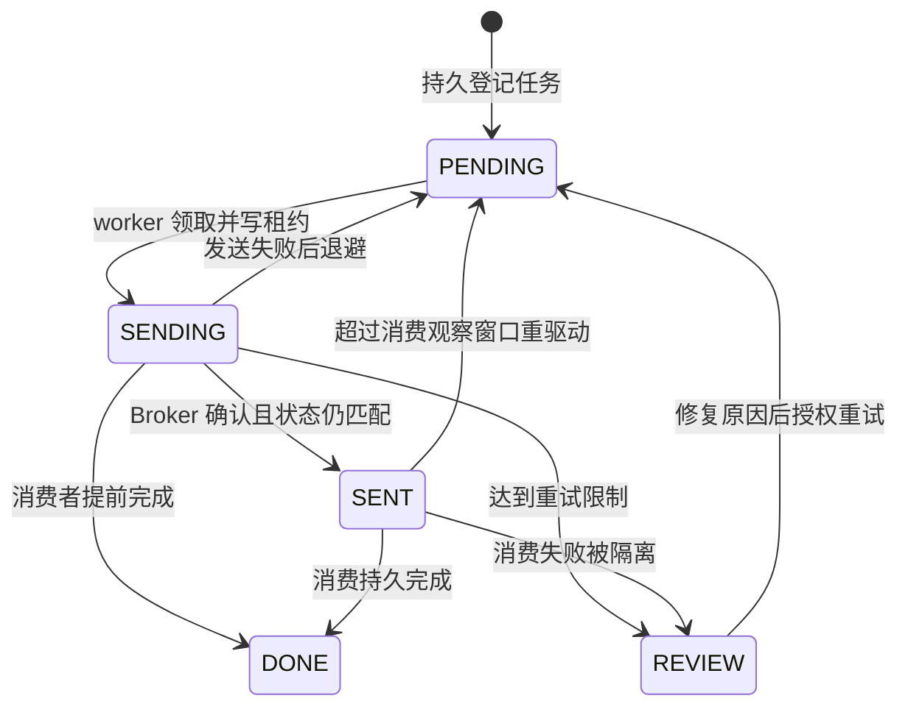

# 09 RocketMQ 可靠消息

[返回目录](README.md) · [上一章](08-秒杀Lua与RedisStream.md) · [下一章：Kafka 热榜](10-Kafka行为分析与热榜.md)

**本章学习目标**：先证明直接“保存后发消息”的两个故障窗口，再读数据库任务、租约认领与 Inbox 消费。最后看分批 Feed 和延迟关单。读完应能解释为什么允许重发，却不能重复造成指定业务效果。

**本章导航**

- [1. 为什么数据库成功后发消息仍可能丢](#section-01)
- [2. 两条通道怎样分工](#section-02)
- [3. Outbox 的关键字段](#section-03)
- [4. Relay 如何允许多个 worker 同时运行](#section-04)
- [5. Outbox 状态如何理解](#section-05)
- [6. 消费端 Inbox 怎么防重复](#section-06)
- [7. 乱序如何处理](#section-07)
- [8. 延迟关单不是 sleep](#section-08)
- [9. 不开启 MQ 时是什么行为](#section-09)
- [10. 从“业务保存后发消息”推导 Outbox](#section-10)
  - [两种直接发送顺序都存在窗口](#section-10-01)
  - [真实事件登记入口](#section-10-02)
  - [业务 ID、事件 ID 与 Broker ID](#section-10-03)
- [11. 多 worker 怎样领任务又不长时间锁数据库](#section-11)
  - [查询条件与 SKIP LOCKED](#section-11-01)
  - [发送代码怎么分段读](#section-11-02)
  - [发送确认丢失怎样重试](#section-11-03)
- [12. Inbox 与业务状态怎样在同一事务完成](#section-12)
  - [三个消费故障时序](#section-12-01)
  - [怎样决定重试还是隔离](#section-12-02)
- [13. 定时关单为什么还需要数据库扫描](#section-13)
  - [并发付款与关单演算](#section-13-01)
  - [本章验收模板](#section-13-02)
- [14. 页面与运维怎么观察](#section-14)
- [15. 一句话串起这个亮点](#section-15)
- [16. 可靠消息教程：从一条任务推导发送与消费](#section-16)
  - [先选一条事件，给三个 ID 各留一栏](#section-16-01)
  - [逐步推导任务状态，而不是背一串枚举](#section-16-02)
  - [多 worker 并行时，租约保护什么](#section-16-03)
  - [用三次退出演算 Inbox 的价值](#section-16-04)
  - [失败重试为什么要有退避与隔离](#section-16-05)
  - [RocketMQ 开关关闭时，什么仍然成立](#section-16-06)
  - [实操验收分成“投递”和“完成”两栏](#section-16-07)

<a id="section-01"></a>

## 1. 为什么数据库成功后发消息仍可能丢

假设发布笔记先写数据库，随后发消息让后台推送粉丝。数据库刚提交，Java 就退出，消息还没发，笔记存在但粉丝一直看不到动态。

换成先发消息也有问题：消息已经消费，数据库事务后来失败，用户却看到了不存在的笔记。可靠事件需要把“业务事实”和“待发送任务”一起持久化。

当前用本地事务 Outbox：在同一 MySQL 事务写业务表与 `tb_business_outbox`。后台 Relay 扫描任务并发送 RocketMQ，失败继续使用原事件 ID 重试。它不是 RocketMQ 事务消息实现，也不是数据库与 Broker 的分布式事务。

<a id="section-02"></a>

## 2. 两条通道怎样分工

RocketMQ 负责需要业务恢复与确认的任务：Feed、关注/点赞投影、媒体删除、缓存失效、活动发布、秒杀履约、订单事件与到期关单。Kafka 负责行为分析，详见下一章。

当前代码：[BusinessOutboxServiceImpl](../src/main/java/com/hmdp/service/impl/BusinessOutboxServiceImpl.java)、[OutboxRelayServiceImpl](../src/main/java/com/hmdp/service/impl/OutboxRelayServiceImpl.java)、[RocketMqTransport](../src/main/java/com/hmdp/messaging/RocketMqTransport.java)、[BusinessEventServiceImpl](../src/main/java/com/hmdp/service/impl/BusinessEventServiceImpl.java)。

<a id="section-03"></a>

## 3. Outbox 的关键字段

| 字段 | 用途 |
| --- | --- |
| id | 稳定业务事件号，重试不换号 |
| kind / aggregate_id / user_id | 事件类型、业务对象与相关用户 |
| state / attempts / next_attempt_at | 状态、尝试次数、下次可执行时间 |
| lease_owner / lease_until | 哪次 worker 批次暂时持有处理权 |
| sent_at / consumed_at | 发送确认与消费完成时间 |
| deliver_at | 定时任务目标时间 |
| cursor_id | Feed 等分批工作进度 |
| idempotency_key | 秒杀持久交接唯一业务键 |
| last_error | 最近错误，便于复核 |

业务 eventId 不等于 RocketMQ broker messageId。一次业务重试可能对应多个 Broker 消息，但业务身份保持不变。事件目前包含对同一数据库任务的引用，若以后拆成独立微服务，必须设计足够完整、兼容演进的消息契约。

<a id="section-04"></a>

## 4. Relay 如何允许多个 worker 同时运行

Relay 在短数据库事务中通过 `FOR UPDATE SKIP LOCKED` 获取一批可执行任务，默认约 20 条；给它们设置批次 UUID owner 和约 60 秒租约，然后提交。网络发消息在事务外执行，避免长时间占数据库行锁。

每次实际处理会核对/续期租约，状态写回带 owner 条件。即使旧 worker 暂停后恢复，它也不应覆盖后来接管者的状态。这叫租约 fencing；只判断“任务现在是 SENDING”不足以识别持有者。

MySQL 8 支持这里使用的 `SKIP LOCKED`。项目的完整开发环境用 MySQL 8；不要仅根据旧课程连接器版本以为任意 MySQL 5.7 都能原样运行当前扩展 SQL。

<a id="section-05"></a>

## 5. Outbox 状态如何理解

典型过程：PENDING → SENDING → SENT → DONE。SENT 只表示发送已确认，不保证消费者业务完成；DONE 才表示对应处理步骤完成。

消费者可能很快，先将任务标成 DONE，发送者才回写 SENT。因此 `markSent` 必须带条件，不能把已完成状态覆盖回未完成。

发送错误会记录原因，按退避规则回到 PENDING，当前自动发送失败约 10 次后进入 REVIEW。已经 SENT 但到期后较长时间没有消费确认的任务也会被定期检查，使用原 ID 重新驱动。默认检查阈值约 300 秒，未来定时任务在目标时间前不应被误判。

重复发送是允许的；下游必须防重复。自动重试有限，REVIEW 必须让管理员能看见。

<a id="section-06"></a>

## 6. 消费端 Inbox 怎么防重复

```text
收到消息 → 核对事件与目标组
→ 数据库事务锁定持久任务，查询 (consumer_group,event_id) Inbox
→ 已处理则走重复路径，否则完成本次投影 / 登记后续分析任务
→ 插入 Inbox、更新任务状态 → 提交 → 向 Broker 确认
```

当前先锁定持久事件行再检查 Inbox，处理效果与新增 Inbox 在同一事务提交。重复消息已经有该组 Inbox 时，不再重复完成数据库副作用；唯一主键作为最后约束。消费成功后 ACK 失败导致消息重投，也是正常场景。

逻辑组按照职责分为 feed、relations、media、cache、activities、fulfillment、orders、deadlines。分组并不是让每个消费者都执行所有事件；RocketMQ Tag 和订阅约束让各组处理对应类别。

对 Redis 与文件的外部效果，Inbox 的 MySQL 事务不能自动回滚它们。例如文件已删除但事务提交失败，重试删除应该仍安全。因此需要幂等外部操作、状态校验和读取当前事实，不能把 Inbox 称为所有组件端到端 Exactly Once。

非法、无法解释或冲突消息会记录 `tb_message_failure`，记录 Broker ID、逻辑组和原因供复核。不是无限悄悄忽略，也不是把未知消息当成成功业务。

<a id="section-07"></a>

## 7. 乱序如何处理

关注后迅速取消，两个 FOLLOW 事件到达次序可能与发生次序不同。如果直接执行消息中的“关注/取消”动作，旧消息最后到达就会让缓存错。

当前 LIKE/FOLLOW 投影读取数据库当前事实，再更新 Redis，并对相应投影使用锁串行协调。迟到消息会再次投影“现在的真实状态”，而不是机械恢复过去的动作。数据库因此需要保留可查的关系事实。

这不能泛化为所有消息都随便乱序。例如创建、支付、关单需要明确状态条件，分批 Feed 还需要续传游标。要按具体副作用设计幂等与顺序策略。

<a id="section-08"></a>

## 8. 延迟关单不是 sleep

订单创建事务保存到期时间和 `ORDER_EXPIRE` 事件。RocketMQ 5.x 使用目标投递时间 `setDeliverTimeMs`，到期后调用数据库条件关单。当前本地 Broker 的 timer wheel 配置支持相应定时范围，最大延迟范围约 24 小时；不是旧版几个固定延迟等级的近似映射。

有消息仍需要数据库兜底：发送失败、消费延迟、消息保留范围、服务停机都可能影响及时处理。维护任务按到期索引每分钟处理最多一批约 200 条普通未支付订单。大量积压需要观察批次处理能力，不能认为固定扫描一定立即清空任意数量。

<a id="section-09"></a>

## 9. 不开启 MQ 时是什么行为

MQ 关闭时 Relay 可以通过本地消费服务完成对应任务，定时事件未到期会延后。这便于最小环境学习，也保留任务状态机制。

只有启用实际 RocketMQ、存在 Broker 投递与消费者证据，才算验证了真实消息链路。体验页的 Outbox/Inbox 是当前数据库回执，不能仅凭看到了一个表记录就证明 Broker 宕机恢复等全部故障场景都测过。

<a id="section-10"></a>

## 10. 从“业务保存后发消息”推导 Outbox

<a id="section-10-01"></a>

### 两种直接发送顺序都存在窗口

方案 A 先保存数据库，再 send。如果事务提交后 Java 退出，消息没有发出，后续任务永久缺席。方案 B 先 send，再提交数据库。如果消息已经消费，数据库随后回滚，下游执行了没有业务事实的动作。

| 顺序 | 故障发生位置 | 错误结果 |
| --- | --- | --- |
| DB 提交 → send | 提交后 send 前 | 事实存在，后续通知丢失 |
| send → DB 提交 | 消息消费后 DB 回滚 | 下游处理了不存在的事实 |
| DB 与 Outbox 同事务 | 提交后应用退出 | 待办仍在，可以恢复发送 |

Outbox 不要求 send 与 DB 同步成功，而要求“如果业务已提交，发送责任也已经持久保存”。这是本地事务能做到的事情。

<a id="section-10-02"></a>

### 真实事件登记入口

以下为 [BusinessOutboxServiceImpl.java](../src/main/java/com/hmdp/service/impl/BusinessOutboxServiceImpl.java) 的相关源码片段。为便于阅读只展示当前部分，依赖与 import 请查看原文件；无需把片段另建类复制运行。

```java
public void appendBusinessEvent(String kind, long aggregateId, Long userId) {
  if (!TransactionSynchronizationManager.isActualTransactionActive()) {
    throw new IllegalStateException("Outbox 必须与业务写入同事务");
  }
  businessOutboxMapper.insertEvent(kind, aggregateId, userId);
}
```

以下为 [BusinessOutboxMapper.xml](../src/main/resources/mapper/BusinessOutboxMapper.xml) 的相关源码片段。为便于阅读只展示当前部分，依赖与 import 请查看原文件；无需把片段另建类复制运行。

```sql
INSERT INTO tb_business_outbox(kind,aggregate_id,user_id)
VALUES(#{kind},#{aggregateId},#{userId})
```


方法明确检查已有事务。它不是先单独开一个 Outbox 事务再尝试业务，否则一边成功一边失败仍有问题。kind 表示处理类型，aggregateId 是业务对象 ID，userId 保存相关用户上下文。

同一张表承接不同对象，所以 aggregateId=1 可能是店铺 1，也可能是订单 1，要结合 kind。消息查询不能只按 aggregateId 粗暴关联所有任务；体验页限定了相关订单事件类型并校验所有者。

<a id="section-10-03"></a>

### 业务 ID、事件 ID 与 Broker ID

假设订单号为 1001，创建事件的 Outbox id 为 81，Broker messageId 为某个传输标识。它们分别标识订单、处理责任和一次运输，不应互相替代。

同订单可以有创建、付款、关单等多个事件；同事件重发可以产生多份 Broker 消息。幂等键应选逻辑事件或业务动作，不能每次重发都使用新 UUID 掩盖重复。

以下为 [BusinessEvent.java](../src/main/java/com/hmdp/messaging/BusinessEvent.java) 的相关源码片段。为便于阅读只展示当前部分，依赖与 import 请查看原文件；无需把片段另建类复制运行。

```java
package com.hmdp.messaging;

import com.hmdp.entity.BusinessOutboxTask;
import lombok.Data;

/** The durable outbox ID is stable across sends; broker message IDs are transport metadata. */
@Data
public class BusinessEvent {
  private int schemaVersion = 1;
  private long eventId;
  private String kind;
  private long aggregateId;
  private long occurredAt;
  private Long deliverAt;

  public static BusinessEvent from(BusinessOutboxTask task) {
    BusinessEvent event = new BusinessEvent();
    event.eventId = task.getId();
    event.kind = task.getKind();
    event.aggregateId = task.getAggregateId();
    event.occurredAt = task.getCreatedAt().getTime();
    if (task.getDeliverAt() != null) {
      event.deliverAt = task.getDeliverAt().getTime();
    }
    return event;
  }
}
```


消息含 schemaVersion、eventId、kind、aggregateId、occurredAt 与可选 deliverAt。当前消费者会回数据库核对任务身份，所以这个消息并不是适用于任意独立服务的完整业务快照。拆服务时要考虑接收方是否能访问这张 Outbox。

<a id="section-11"></a>

## 11. 多 worker 怎样领任务又不长时间锁数据库

<a id="section-11-01"></a>

### 查询条件与 SKIP LOCKED

以下为 [BusinessOutboxMapper.xml](../src/main/resources/mapper/BusinessOutboxMapper.xml) 的相关源码片段。为便于阅读只展示当前部分，依赖与 import 请查看原文件；无需把片段另建类复制运行。

```sql
SELECT *
FROM tb_business_outbox
WHERE (state='PENDING' AND next_attempt_at<=NOW()) OR (state='SENDING' AND lease_until<NOW(3))
ORDER BY id LIMIT #{limit} FOR UPDATE SKIP LOCKED
```


PENDING 要到 next_attempt_at 才可执行；SENDING 只有 lease_until 已过期才可接管。按 ID 有限取批，SKIP LOCKED 避开其他事务正在领的记录，不在一把全局大锁上排队。

这是数据库里的短事务领取，不是在数据库事务中一直等待 MQ 网络返回。高并发下还要观察索引、批次和锁竞争，SKIP LOCKED 不是“所有情况都无锁”。

以下为 [OutboxRelayServiceImpl.java](../src/main/java/com/hmdp/service/impl/OutboxRelayServiceImpl.java) 的相关源码片段。为便于阅读只展示当前部分，依赖与 import 请查看原文件；无需把片段另建类复制运行。

```java
/**
 * 用短事务领取一批可投递任务，写入租约后提交。
 *
 * <p>SKIP LOCKED 允许其他 worker 领取不同任务；网络投递放在提交之后，避免长时间持有行锁。
 */
@Override
public List<BusinessOutboxTask> claimOutboxBatch(String leaseOwner) {
  return transactions.execute(
      tx -> {
        List<BusinessOutboxTask> tasks =
            businessOutboxMapper.selectClaimableEvents(Math.max(1, Math.min(100, batchSize)));
        for (BusinessOutboxTask task : tasks) {
          businessOutboxMapper.claimEvent(leaseOwner, effectiveLeaseSeconds(), task.getId());
        }
        return tasks;
      });
}
```

以下为 [BusinessOutboxMapper.xml](../src/main/resources/mapper/BusinessOutboxMapper.xml) 的相关源码片段。为便于阅读只展示当前部分，依赖与 import 请查看原文件；无需把片段另建类复制运行。

```sql
UPDATE tb_business_outbox
SET lease_until=TIMESTAMPADD(SECOND,#{leaseSeconds},NOW(3))
WHERE id=#{eventId} AND state='SENDING' AND lease_owner=#{leaseOwner}
```


owner 是每批唯一 UUID。续期与状态写回都核对 owner，防止同 JVM 两次重叠调用或旧 worker 恢复后覆盖新持有者。

<a id="section-11-02"></a>

### 发送代码怎么分段读

以下为 [OutboxRelayServiceImpl.java](../src/main/java/com/hmdp/service/impl/OutboxRelayServiceImpl.java) 的相关源码片段。为便于阅读只展示当前部分，依赖与 import 请查看原文件；无需把片段另建类复制运行。

```java
/**
 * 领取并投递一批 Outbox 任务，不保证一次清空所有待处理任务。
 *
 * <p>每批使用独立租约 owner，过期或重叠执行时通过 owner 条件避免覆盖新 worker 的结果。
 */
@Override
public void relayOutboxBatch() {
  // 批次独立 owner 防止同进程重叠调用在租约过期后互相覆盖。
  String leaseOwner = UUID.randomUUID().toString();
  for (BusinessOutboxTask task : claimOutboxBatch(leaseOwner)) {
    sendClaimedTask(task, leaseOwner);
  }
}

private void sendClaimedTask(BusinessOutboxTask task, String leaseOwner) {
  long started = System.nanoTime();
  try {
    if (businessOutboxMapper.renewLease(effectiveLeaseSeconds(), task.getId(), leaseOwner) == 0) {
      return;
    }
    if (deliverOutboxTask(task, leaseOwner)) {
      metrics.counter("hmdp.mq.sends", "result", "success").increment();
    }
  } catch (RuntimeException failure) {
    recordSendFailure(task, leaseOwner, failure);
    metrics.counter("hmdp.mq.sends", "result", "retry").increment();
    log.warn("事件 {} 投递失败，将按原事件号重试: {}", task.getId(), FailureMessages.summarize(failure));
  } finally {
    metrics.timer("hmdp.mq.send").record(System.nanoTime() - started, TimeUnit.NANOSECONDS);
  }
}

private boolean deliverOutboxTask(BusinessOutboxTask task, String leaseOwner) {
  BusinessEvent event = BusinessEvent.from(task);
  if (mqEnabled) {
    publishers.getObject().publish(event);
    // 快速消费可能已经完成；owner/state 条件防止 DONE 被覆盖成 SENT。
    businessOutboxMapper.markSent(task.getId(), leaseOwner);
    return true;
  }
  if (event.getDeliverAt() != null && event.getDeliverAt() > System.currentTimeMillis()) {
    businessOutboxMapper.deferDeadline(task.getId(), leaseOwner);
    return false;
  }
  consumer.consume(event, BusinessEventServiceImpl.resolveConsumerGroup(event.getKind()));
  return true;
}

private void recordSendFailure(
    BusinessOutboxTask task, String leaseOwner, RuntimeException failure) {
  int attempts = task.getAttempts() + 1;
  boolean needsReview = attempts >= DeliveryRetryPolicy.MAX_SEND_ATTEMPTS;
  String reason = FailureMessages.summarize(failure);
  transactions.execute(
      tx -> {
        int changed =
            businessOutboxMapper.recordSendFailure(
                attempts,
                DeliveryRetryPolicy.delaySeconds(attempts),
                needsReview ? OutboxState.REVIEW.name() : OutboxState.PENDING.name(),
                reason,
                task.getId(),
                leaseOwner);
        if (changed > 0 && needsReview && "SECKILL_FULFILL".equals(task.getKind())) {
          seckillReservationMapper.markProcessingForReview(reason, task.getAggregateId());
        }
        return null;
      });
}

private int effectiveLeaseSeconds() {
  return Math.max(10, leaseSeconds);
}
```


`relayOutboxBatch` 创建批次 owner 并领取；`sendClaimedTask` 负责续期、计时与失败处理；`deliverOutboxTask` 负责 MQ 或本地投递；`recordSendFailure` 在事务中保存退避与复核状态。方法拆开后，租约校验和异常捕获仍包住同一个任务的投递过程。

未到目标时间的本地 deadline 延后，不立即执行关单。MQ 模式则可提前将定时消息送给 Broker。SENT 的写入必须带条件，因为此时快消费者可能已经消费完成。

attempts 增加后退避秒数按指数增大并设上限，默认自动发送第 10 次失败后 REVIEW。它避免故障时每秒无穷重试，但也意味着恢复不能只依赖“总有一天自己成功”：复核状态需要被观察和处理。

<a id="section-11-03"></a>

### 发送确认丢失怎样重试

Broker 已收消息，但发送者网络超时没收到确认，任务会回到重试路径。再次发原 eventId 是正确选择；如果为了避免重复而直接标 DONE，就可能在 Broker 实际没收到时永久丢任务。

以下为 [BusinessOutboxMapper.xml](../src/main/resources/mapper/BusinessOutboxMapper.xml) 的相关源码片段。为便于阅读只展示当前部分，依赖与 import 请查看原文件；无需把片段另建类复制运行。

```sql
UPDATE tb_business_outbox
SET state='SENT',sent_at=NOW(3),lease_owner=NULL,lease_until=NULL,last_error=NULL
WHERE id=#{eventId} AND state='SENDING' AND lease_owner=#{leaseOwner}
```


WHERE 同时要求 SENDING 和正确 owner。任务被快速消费者置 DONE 或被别的批次接管时，旧发送者更新 0 行，不把状态倒退。

<a id="section-12"></a>

## 12. Inbox 与业务状态怎样在同一事务完成

以下为 [BusinessEventServiceImpl.java](../src/main/java/com/hmdp/service/impl/BusinessEventServiceImpl.java) 的相关源码片段。为便于阅读只展示当前部分，依赖与 import 请查看原文件；无需把片段另建类复制运行。

```java
public void consume(BusinessEvent event, String group) {
  if (event.getSchemaVersion() != 1
      || event.getEventId() <= 0
      || event.getKind() == null
      || !group.equals(resolveConsumerGroup(event.getKind()))) {
    throw new IllegalArgumentException("事件版本、事件号或消费组无效");
  }
  long started = System.nanoTime();
  try {
    transactions.execute(
        tx -> {
          consumeLockedTask(event, group);
          return null;
        });
  } finally {
    metrics
        .timer("hmdp.mq.consume", "group", group)
        .record(System.nanoTime() - started, TimeUnit.NANOSECONDS);
  }
}

private void consumeLockedTask(BusinessEvent event, String group) {
  // 只锁当前事件；业务效果、Inbox 和任务完成状态仍在同一事务提交。
  BusinessOutboxTask task = businessOutboxMapper.selectEventForUpdate(event.getEventId());
  if (task == null) {
    throw new IllegalArgumentException("消息没有对应的持久化事件");
  }
  if (!event.getKind().equals(task.getKind())
      || event.getAggregateId() != task.getAggregateId()) {
    throw new IllegalArgumentException("消息内容与持久化事件不一致");
  }
  if (messageMapper.countInboxEvent(group, event.getEventId()) > 0) {
    businessOutboxMapper.markDuplicateDone(event.getEventId());
    metrics.counter("hmdp.mq.consumptions", "group", group, "result", "duplicate").increment();
    return;
  }
  if (OutboxState.REVIEW.matches(task.getState())) {
    throw new IllegalStateException("事件等待人工复核");
  }
  if (projector.project(task) == ProjectionResult.CONTINUE) {
    appendFeedContinuation(task);
  }
  messageMapper.insertInboxEvent(group, event.getEventId());
  businessOutboxMapper.markConsumed(event.getEventId());
  metrics.counter("hmdp.mq.consumptions", "group", group, "result", "success").increment();
}

private void appendFeedContinuation(BusinessOutboxTask task) {
  // 游标由当前批次推进；后续批次独立持久化，沿用原发布时间。
  long cursor = businessOutboxMapper.selectCursor(task.getId());
  businessOutboxMapper.insertFeedContinuation(
      task.getKind(), task.getAggregateId(), task.getUserId(), cursor, task.getCreatedAt());
}
```


按以下五步检查：

1. 消息版本、正事件 ID、kind 和逻辑消费组必须匹配。
2. 锁 Outbox 对应行，任务不存在或内容不一致不能继续。
3. 已有 Inbox 表示这个组处理过，走重复路径，不再重做。
4. 执行投影；返回 `ProjectionResult.CONTINUE` 时创建 Feed 续传事件，返回 `COMPLETE` 表示不需要下一批。
5. 插入 Inbox、标任务 DONE，并与数据库效果一同提交。

Feed 续传不是“本次失败”：本批的 Redis 投递完成后，返回 `ProjectionResult.CONTINUE`，事务中登记下一批任务并把当前任务标为 DONE。新增的 `MessagingIntegrationTest.feedContinuationPreservesCursorAndPublicationTimeAcrossDuplicateDelivery` 用 201 名发布前关注的粉丝和 1 名发布后关注的粉丝验证边界：首批只处理 200 人，续批覆盖剩余 1 人；重投首批不会多建续传任务；下一批沿用原发布时间，也不会把历史笔记发给后来才关注的人。

这里的 Inbox 实际在投影之后插入，但同事务内对事件行加锁，并由唯一键兜底。不能机械背“必须先插 Inbox”；关键是数据库处理效果与登记要原子提交，并正确串行化同事件竞争。

<a id="section-12-01"></a>

### 三个消费故障时序

| 故障 | 是否有 Inbox | 重试结果 |
| --- | --- | --- |
| DB 投影失败并回滚 | 没有成功提交 | 后续重新处理 |
| DB 提交后 Broker ACK 失败 | 有 | 后续识别重复，不再重复 DB 效果 |
| Redis/文件已改但 DB 回滚 | 可能无 | 外部操作要幂等，再依据当前事实执行 |

第三行是最容易忽略的边界。数据库事务并不管理 Redis 或文件；即使使用 Inbox，仍需要幂等删除、固定 Feed member、读取当前关系与 owner/state 校验。

<a id="section-12-02"></a>

### 怎样决定重试还是隔离

非法格式/未知事件没有合法事实可以执行，要持久隔离；合法事件的暂时故障可以重试。当前有效消费失败达到约 5 次后进入 REVIEW 并记录失败，秒杀履约还关联预约复核。Broker 的最大重消费配置与业务主动隔离门槛不是同一个数字。

失败记录没有保存成功时，不应返回消费成功；否则日志虽然写了一句错误，消息责任却没了。RocketMqTransport 的监听器只有在失败已持久保存并被允许隔离后，才继续确认相应消息。

<a id="section-13"></a>

## 13. 定时关单为什么还需要数据库扫描

以下为 [RocketMqTransport.java](../src/main/java/com/hmdp/messaging/RocketMqTransport.java) 的相关源码片段。为便于阅读只展示当前部分，依赖与 import 请查看原文件；无需把片段另建类复制运行。

```java
public void publish(BusinessEvent event) {
  if (connected.get() == 0) {
    throw new IllegalStateException("RocketMQ 客户端尚未启动");
  }
  String group = BusinessEventServiceImpl.resolveConsumerGroup(event.getKind());
  try {
    Message message =
        new Message(
            "deadlines".equals(group) ? deadlineTopic : businessTopic,
            event.getKind(),
            "outbox:" + event.getEventId(),
            json.writeValueAsBytes(event));
    message.putUserProperty("eventId", String.valueOf(event.getEventId()));
    message.putUserProperty("aggregateId", String.valueOf(event.getAggregateId()));
    if (event.getDeliverAt() != null && event.getDeliverAt() > System.currentTimeMillis()) {
      if (event.getDeliverAt() - System.currentTimeMillis() > 86400000L) {
        throw new IllegalArgumentException("订单延迟超过本地 Broker 配置的 24 小时范围");
      }
      message.setDeliverTimeMs(event.getDeliverAt());
    }
    if (producer.send(message).getSendStatus() != SendStatus.SEND_OK) {
      throw new IllegalStateException("Broker 未确认消息可靠写入");
    }
  } catch (Exception failure) {
    throw new IllegalStateException("RocketMQ 投递结果未确认", failure);
  }
}
```

以下为 [OrderLifecycleServiceImpl.java](../src/main/java/com/hmdp/service/impl/OrderLifecycleServiceImpl.java) 的相关源码片段。为便于阅读只展示当前部分，依赖与 import 请查看原文件；无需把片段另建类复制运行。

```java
/**
 * 锁定订单并重新校验当前状态、类型和截止时间，再条件关闭普通券订单。
 *
 * <p>提前到达的消息只重新登记截止事件；支付或关闭已经完成时不再产生重复关闭事件。
 */
@Override
public boolean closeExpiredOrdinaryOrder(long orderId) {
  return Boolean.TRUE.equals(
      transactions.execute(
          tx -> {
            List<Map<String, Object>> rows =
                voucherOrderMapper.selectExpiryStateForUpdate(orderId);
            if (rows.isEmpty()) {
              return false;
            }
            Map<String, Object> row = rows.get(0);
            if (!OrderStatus.UNPAID.matches(((Number) row.get("status")).intValue())
                || row.get("voucher_type_snapshot") == null
                || !VoucherType.ORDINARY.matches(
                    ((Number) row.get("voucher_type_snapshot")).intValue())) {
              return false;
            }
            if (row.get("expire_at") == null) {
              throw new IllegalStateException("普通订单缺少截止时间");
            }
            long userId = ((Number) row.get("user_id")).longValue();
            if (((Number) row.get("due")).intValue() == 0) {
              outbox.appendOrderExpirationEvent(
                  orderId, userId, (Timestamp) row.get("expire_at"));
              return false;
            }
            if (voucherOrderMapper.closeExpiredOrder(orderId) == 0) {
              return false;
            }
            registerOrderClosedEvent(orderId, userId);
            return true;
          }));
}
```


发送方法按 group 选择业务/定时 Topic，携带 kind Tag、稳定业务 key 和元属性。有未来 deliverAt 才设置目标时间，超过本地 24 小时范围会拒绝发送；超时付款配置也要求在允许范围内。

到期消费再锁订单，检查仍是普通、未支付、确实到期。提前收到时重新登记 deadline 而不是无条件关闭；已支付或已取消时不做相反迁移。数据库扫描使用同一个 expire 业务规则，所以两条触发路径可以重复而不重复关单。

<a id="section-13-01"></a>

### 并发付款与关单演算

A 付款与 B 关单同时争取订单状态。先成功把状态从 1 改走的事务提交后，另一个必须看当前状态不能满足，再返回对应结果。不能允许 A 刚付完款，B 用自己几秒前的“未支付”快照无条件取消。

<a id="section-13-02"></a>

### 本章验收模板

正常投递看任务 PENDING/SENT/DONE 和 Inbox；重复投递看 Inbox 不重复与业务效果不变；Broker 短时不可用看任务保留/退避；到期任务看期限和最终订单状态；等待复核看失败原因与受控重试。

每项至少关联 eventId、aggregateId、业务状态和处理时间。`clientStarted=1` 只能证明客户端初始化，不能替代这些任务级证据。

<a id="section-14"></a>

## 14. 页面与运维怎么观察

普通用户在体验页查看自己的订单，能看到关联业务任务状态和 Inbox 回执数量，不能读取其他用户消息载荷。管理员通过 `/ops/outbox`、`/ops/messages/failures` 查看整体积压与失败，并对指定任务执行 `/ops/outbox/{id}/retry`。

处理顺序：核对事件 kind 与对象 → 判断业务是否已经完成 → 查看发送/消费时间与原因 → 修复组件或数据条件 → 受控重试原 ID → 确认 DONE 与最终业务结果。不能靠创建一个新 eventId 掩盖旧任务，也不能直接把数据库 state 手改成 DONE 作为“修复”。

<a id="section-15"></a>

## 15. 一句话串起这个亮点

“通过业务事务 Outbox 避免提交后任务丢失，Relay 用短行锁与 owner 租约并行领任务，RocketMQ 至少一次投递，消费端 Inbox 和业务状态条件防重复，并通过重投、失败隔离、管理接口与指标形成恢复闭环。”

追问保证范围时要指出：保障依赖持久数据库与恢复策略，外部 Redis/文件效果通过幂等协调，单机 Broker 与本地卷并不具备生产多副本容灾。

<a id="section-16"></a>

## 16. 可靠消息教程：从一条任务推导发送与消费

<a id="section-16-01"></a>

### 先选一条事件，给三个 ID 各留一栏

在普通订单创建流程中，订单号标识业务对象，Outbox ID 标识这一条要处理的事件，Broker 消息 ID 标识一次网络投递。一个订单可有创建、支付、关闭等多条事件；同一事件又可能被多次投递。因此三栏不能合并。

排查时先从订单找到关联任务，再用任务 ID 追踪消费。仅拿 Broker ID 去订单表查询不会找到同样的对象；重新投递也不应生成新的业务 eventId，否则 Inbox 失去识别重放的依据。

当前消费者不仅检查 eventId，还比较事件 kind、aggregateId 与持久任务，并验证 schemaVersion 和消费组。消息内容错配不能因“ID 已存在”就随意当成功，也不能借一个伪造 ID 把别人的真实任务改成 REVIEW。

<a id="section-16-02"></a>

### 逐步推导任务状态，而不是背一串枚举

PENDING 是待领取；SENDING 是某个 worker 已取得租约；SENT 是发送已确认但后续消费可能没结束；DONE 是该逻辑处理步骤持久完成；REVIEW 是自动重试不能继续推进、需要核对。



这是启用 Broker 路径的概念图，省略了终态的重复投递自环；关闭 MQ 后本地投影可从 SENDING 直接完成。真实迁移仍以 Mapper 的状态和 owner 条件为准。

状态不是只由一个线程写。发送 worker 可能正在等待 Broker 确认，而消费者已经快速完成数据库处理并写 DONE。发送 worker 随后执行 `markSent` 时，SQL 要求旧状态仍是 SENDING 且 owner 匹配，避免把 DONE 覆盖回 SENT。

这个例子说明状态机不只是画箭头。每次 UPDATE 的 WHERE 条件就是防止旧线程覆盖新进度的实际约束；阅读时把状态条件、owner 条件和行数判断一同圈出来。

<a id="section-16-03"></a>

### 多 worker 并行时，租约保护什么

worker A 在短事务中用 `FOR UPDATE SKIP LOCKED` 领取一批，写 owner=A 和 lease_until 后提交。worker B 可以跳过 A 当时锁住的任务，继续领取其他任务。网络发送放在事务外，避免 Broker 慢时长期占住数据库行锁。

假设 A 退出，租约过期后 B 重新领取，owner 改为 B。A 又迟到恢复时，不能凭旧快照把任务结果覆盖回去；续租、发送完成与失败登记都按 owner 条件处理。这与分布式锁的 owner 思想相同，但这里是数据库待办租约。

租约不保证 Broker 只收到一次。A 可能已经发送但未记录确认，B 会再次发同一事件。它保证“可以恢复并限制旧执行者改状态”，重复投递仍由消费端幂等处理。

<a id="section-16-04"></a>

### 用三次退出演算 Inbox 的价值

| 退出位置 | 下次可能发生什么 | 正确依赖 |
| --- | --- | --- |
| 数据库业务与 Outbox 尚未提交 | 事务回滚，没有已提交业务与待办 | 同库事务原子性 |
| Broker 接收后，发送端未记 SENT | 原 eventId 再次投递 | 消费端身份校验与去重 |
| 消费数据库提交后，Broker 未收到确认 | 消费者再次收到同一事件 | Inbox 记录与业务结果同事务 |

Inbox 主键包含 consumer_group 和 event_id：同一逻辑组的重放应去重，另一组的独立处理不应被第一组屏蔽。当前任务会校验预期消费组，不是所有任意组都能合法接收同一任务。

还要区分数据库副作用与外部副作用。Inbox 与订单事件历史能同事务提交；Redis ZADD、缓存失效和文件删除不会因 SQL 回滚撤销。外部动作需要能安全重复或重新读取当前事实。不能单凭 Inbox 就把所有跨组件效果宣传成 exactly-once。

<a id="section-16-05"></a>

### 失败重试为什么要有退避与隔离

瞬时连接异常可能恢复，原身份重试合理；无效载荷、缺失归属或内容冲突可能每次都失败，无限快速重试会挤占正常任务。当前设计记录错误摘要、次数与下一次尝试时间，超过策略限制进入 REVIEW 或持久失败记录。

隔离不是忘记任务，而是保存“哪一个对象、什么错误、何时停止自动推进”的证据。人工重试前应先修正原因，之后沿原 ID 恢复；不能只清空失败次数就声称问题已解决。当前默认策略和限额以 `DeliveryRetryPolicy` 为准，业务错误与网络错误需要从原因字段进一步判断。

<a id="section-16-06"></a>

### RocketMQ 开关关闭时，什么仍然成立

关闭 MQ 后，Relay 在 Java 中调用相同逻辑投影，仍利用持久 Outbox 和 Inbox；未来截止任务先延期等待。这样可以学习业务设计，但没有实际经过 Broker 的网络发送、重投递和消费组过程。

因此实验记录至少注明 MQ enabled、消费客户端状态、任务 ID、最终数据库效果。真实 RocketMQ 测试与本地投影测试是两类证据。不要因两者最终页面都能展示就说真实消息中间件已验证。

<a id="section-16-07"></a>

### 实操验收分成“投递”和“完成”两栏

创建普通订单后保存关联事件。第一次记录任务当前状态；稍后查询，检查消费者是否写入 Inbox 与订单事件历史。未来到期事件保持 SENT 一段时间是预期，因为它还未到期；不要把所有 SENT 都统计为异常积压。

若隔离实验需要观察重驱动，保持原 eventId 并核对最终业务效果只发生一次。仅观察发送日志新增两条不能证明幂等；应比较任务最终 DONE、Inbox 唯一记录及业务结果。[第 13 章](13-测试监控与故障排查.md)进一步说明如何把这类预期写成断言。
