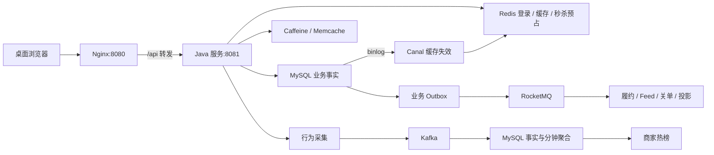

# 黑马点评项目 Wiki

> 面向第一次接触 Spring Boot、Redis 和消息队列的同学。本文档依据当前点评项目源码整理，采用“业务问题 → 原理 → 实现 → 验证”的讲解方式。主体代码核对日期：2026-10-11；仓库交付配置于 2026-10-30 整理。

这个项目是一套可以在浏览器中体验的本地生活系统：用户找店铺、看探店笔记、关注作者、签到、领取优惠券，并查看自己的订单。后端在课程基础上增加了多层缓存、缓存变更同步、可靠业务消息、异步秒杀履约、超时关单、行为热榜和体验验证页面。

先记住一件事：**MySQL 保存大部分可恢复的业务事实；缓存和消息帮助系统更快、更稳地完成工作。** Redis 还保存验证码、登录状态、签到和秒杀的入口预占，这些数据并非全部能从 MySQL 重建。

## 如何阅读

第一次接触项目，按 01 → 02 → 03 → 04 阅读，再用 11 章的页面步骤实际点一遍。理解业务后学习 05～10 章的技术亮点。准备面试时结合 12 章组织自己的表达，遇到问题查 13 章和附录。

把项目部署到已安装 Docker 的阿里云 2GB 服务器供人初步体验，使用 [云服务器轻量部署教程](../deploy/README.md)。该配置公开网页入口，保留当前桌面前端，暂不启动 Kafka、RocketMQ、Canal；与本地完整开发环境的功能开关不同。

| 章节 | 你会弄懂什么 |
| --- | --- |
| [01 项目全貌与基础概念](01-项目全貌与基础概念.md) | 业务场景、技术职责、课程与当前项目的差别 |
| [02 环境搭建与启动](02-环境搭建与启动.md) | Docker 一次启动、登录、管理员配置、停止和重启 |
| [03 架构、代码与数据库](03-架构代码与数据库.md) | Controller → Service → Mapper，目录、表和请求链路 |
| [04 登录、权限与签到](04-登录权限与签到.md) | Redis 登录、验证码、ThreadLocal、权限和 Bitmap |
| [05 五层缓存与一致性](05-五层缓存与一致性.md) | 缓存穿透、击穿、版本栅栏、多实例失效 |
| [06 Canal 与数据库变更同步](06-Canal与数据库变更同步.md) | binlog、CDC、批次确认、断线恢复边界 |
| [07 优惠券与订单生命周期](07-优惠券与订单生命周期.md) | 普通券、一人一单、订单快照、幂等、模拟支付和关单 |
| [08 秒杀、Lua 与 Redis Stream](08-秒杀Lua与RedisStream.md) | 预占、库存、消费者组、ACK、接管、补偿与对账 |
| [09 RocketMQ 可靠消息](09-RocketMQ可靠消息.md) | Outbox/Inbox、租约、重投、延迟消息、状态闭环 |
| [10 Kafka 行为分析与热榜](10-Kafka行为分析与热榜.md) | PV/UV、两种可靠性、offset、去重与分钟聚合 |
| [11 社区、搜索与页面验证](11-社区搜索与页面验证.md) | 点赞、关注、Feed、上传、GEO，如何让别人轻松验证 |
| [12 学习路线与面试表达](12-学习路线与面试表达.md) | 亮点串联、面试追问、可用的简历表达和扩展方向 |
| [13 测试、监控与故障排查](13-测试监控与故障排查.md) | 隔离回归、指标、问题定位、恢复步骤 |
| [附录 接口、配置与数据字典](附录-接口配置与数据字典.md) | 接口查阅、环境变量、Redis Key、数据库表 |

## 每章怎样学

各章按参考文档的教学节奏展开：先给业务场景与出错例子，再推导方案，随后分段阅读当前源码，最后通过演算、练习、页面或隔离测试核对结果。章节开头有学习目标和可跳转目录；源码片段链接回真实文件，便于在 IDE 里继续追踪。

例如，缓存从最简 Cache Aside 讲到空值、互斥重建、多层读取、旧值回填竞争和版本栅栏；秒杀从超卖时序讲到资格预占、消息确认、持久交接和指定补偿；Kafka 从提交窗口讲到重复事件、offset 回退、跨分钟 UV 与热度手算。

不要一次粘贴整章命令。先读前提，挑自己的店铺、券、订单或事件 ID，再执行对应步骤。独立教学 Key 与真实业务 Key 会明确区分，故障实验使用隔离测试环境。

各章新增的深入教程保留在原章节内，既可以顺序阅读，也可以按当前卡点直接跳转。数字例子均为教学演算；实操结果需要保存自己的对象 ID 和观测时间。

| 阅读时卡在哪里 | 对应的深入教程 |
| --- | --- |
| 组件很多，不知道为何需要 | [账本、副本、任务与同步/异步](01-项目全貌与基础概念.md#section-08) |
| 启动后不知道算不算成功 | [三层启动验收与重启方式](02-环境搭建与启动.md#section-12) |
| 看得懂语法，看不懂业务分层 | [Mapper 返回值、事务与源码阅读作业](03-架构代码与数据库.md#section-10) |
| 登录、权限、签到结果混淆 | [请求身份、令牌格式与签到演算](04-登录权限与签到.md#section-12) |
| 缓存命中会看，旧值竞争不懂 | [版本、owner、源寿命与通知的完整推演](05-五层缓存与一致性.md#section-16) |
| Canal 能连接，却不知是否同步 | [迁店、批次重放与日志缺口](06-Canal与数据库变更同步.md#section-13) |
| 领券成功之后不知道查什么 | [普通订单并发与付款/关单竞争](07-优惠券与订单生命周期.md#section-14) |
| 秒杀处理中，不知道谁继续负责 | [准入到履约的责任地图](08-秒杀Lua与RedisStream.md#section-17) |
| 分不清发送成功和消费完成 | [任务身份、租约与三种退出窗口](09-RocketMQ可靠消息.md#section-16) |
| PV、UV、热度与回执对不上 | [从事件手算窗口和热榜](10-Kafka行为分析与热榜.md#section-16) |
| 社区正常能用，边界不会验证 | [点赞重试、两套 Feed 游标与图片生命周期](11-社区搜索与页面验证.md#section-17) |
| 想讲亮点，但只记得术语 | [分阶段交付物、追问与六道练习](12-学习路线与面试表达.md#section-13) |
| 发生故障只会重启 | [假设、证据、恢复与回归断言](13-测试监控与故障排查.md#section-19) |
| 接口参数、单位或 SQL 不会读 | [请求与数据字段入门手册](附录-接口配置与数据字典.md#section-20) |

| 当前想做什么 | 从哪里开始 | 完成时应拿到什么 |
| --- | --- | --- |
| 首次跑通 | 02 → 附录操作例子 | 公开查询、正常登录、本人订单 |
| 弄懂缓存 | 05 → 06 → 13 的缓存/CDC 测试 | 命中路径、旧回填时序、失败不 ACK 的理由 |
| 讲透交易与消息 | 07 → 08 → 09 | 同一 orderId 的状态链与恢复责任 |
| 验证 Kafka | 10 → 11 的体验页 → 附录回执 | 刚提交的 eventId 的 PERSISTED 证据与统计口径 |
| 准备面试 | 12 → 13 的测试与报告 | 一段能展开的介绍和有明确限制的验证记录 |

## 五分钟理解整体流程

图里看起来有很多组件，但它们不要求你一次学完。先把“网页调用 Java，Java 通过 Mapper 查询 MySQL”理解好，再把缓存加到查询前面，最后理解哪些工作可以晚一点完成。

## 当前交付的边界

- 已有桌面页面与真实业务接口；页面体验入口是 [体验验证](http://127.0.0.1:8080/experience.html)。此地址只有部署机器本地可访问，发给其他电脑需要另行配置网络访问。
- 登录验证码写入 Redis，并在 Java 调试日志中输出；尚未接入真实短信服务。
- 普通付费券可以创建待支付订单；真实支付、核销、退款链路没有完整实现。模拟支付开关默认关闭，不能把模拟成功当作真实收款。
- 秒杀成功返回订单号首先表示受理；`SUCCESS` 表示履约订单已落库，仍需区分订单付款状态。
- 点赞、关注有持久化事实与异步投影；课程的 Redis-only 方案不是当前完整实现。
- Kafka 热榜统计已落库事件，UV 仅去重已登录用户；没有用 HyperLogLog 实现匿名访客 UV，也没有做机器学习推荐。普通订单创建已有生命周期分析事件；当前秒杀履约还未统一接入这条创建事件路径。
- `/blog-comments` 只有空控制器，不能宣传为完整评论系统；没有迁移 Token 额度业务。
- Docker 是方便学习的单机部署，不代表已经具备多机高可用、跨地域容灾或生产支付合规能力。

## 证据与版本说明

[页面验证报告](../docs/experience-verification.json) 记录了 2026-10-10 的 90 项 Java 隔离回归测试、12 项前端测试，以及格式检查结果。它是历史记录，并不表示读者打开文档或点击页面就运行了所有故障测试。其他历史优化记录见 [优化实现与验证](../docs/优化实现与验证.md)。旧记录中的默认前端、TTL、测试数量可能属于之前的迭代；本 Wiki 用当前源码解释行为。

2026-10-11 的后续 Java 整理结果见 [可读性验证](../docs/java-readability-verification.json) 和 [命名与注释验证](../docs/java-naming-verification.json)。后者记录 91 项不同回归用例通过，最终 37 项重点用例为同一批覆盖的子集，不能相加为 128 项；这些仍是已有代码验证记录。

本轮只扩写与核对 Wiki，没有重跑业务回归、压测或故障实验；测试与性能数字继续注明原报告时间和环境。

文档内的命令默认在 `点评/hm-dianping` 目录执行。`/api/...` 是浏览器经 Nginx 访问的路径；直接访问 Java 8081 时使用 `/...`，不要再加 `/api`。金额、时间、订单号和权限规则见各章与附录。
